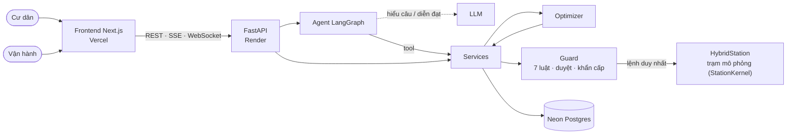

# ChargePilot — điều phối lịch sạc xe điện cho bãi sạc chung cư

> Bãi sạc ít đầu nối, nguồn điện có hạn, xe đến không đều → **AI hiểu yêu cầu sạc bằng lời nói, bộ tối ưu tính lịch
> và công suất, bộ kiểm tra an toàn chặn mọi lệnh sai** → cho **cư dân** đặt lịch / theo dõi xe và **vận hành** điều
> phối bãi. Đề tài **SC-16**, nhóm **T019**, AI20K Build Phase.

**Live (bản test):** web <https://p019-web.vercel.app> · API <https://p019-backend-develop.onrender.com/docs>
(gói Free: lần mở đầu chờ khoảng 50 giây). Trạm sạc là **mô phỏng** — không điều khiển trụ sạc thật.

## Vấn đề (Problem)

Một bãi sạc gần chung cư / khu đô thị có ít đầu nối, gồm cả **AC** (chậm, qua đêm) và **DC** (nhanh), chung một giới hạn
nguồn điện.

- **Cư dân** phải chờ mà không biết chờ bao lâu; không biết xe có kịp đủ pin trước giờ đi không; không hiểu vì sao bị
  giảm công suất.
- **Vận hành** không thấy tải tổng theo thời gian thực; khi nguồn giảm hay đầu nối lỗi phải cắt tay, lịch cố định nhanh
  chóng sai và cam kết với cư dân bị vỡ.
- **Chi phí điện** tăng khi sạc vào giờ cao điểm (biểu giá theo giờ — giả định trong `config/tariff.yaml`).
- Quy tắc đến trước phục vụ trước (FCFS) hoặc chia đều công suất giữ được an toàn nhưng không cùng lúc tối ưu được thời
  gian chờ, tỉ lệ đủ pin đúng hạn, tiền điện và công bằng.

Mức chứng minh: hợp lý về cơ chế và khớp brief SC-16; **chưa có số liệu vận hành của một trạm cụ thể** — mọi số đo hiện
tại đến từ kịch bản mô phỏng (xem [Kết quả](#kết-quả-đo-được)).

## Giải pháp (Solution)

Web app hai vai trò trên một trạm mô phỏng, theo nguyên tắc **3 trụ**: AI hiểu yêu cầu → bộ tối ưu tính phương án →
bộ kiểm tra an toàn kiểm soát thực thi. AI không tính công suất và không vượt qua bộ kiểm tra.

- **Đặt lịch bằng lời nói (Agent F1)** — cư dân nhắn "cần sạc VF8 lên 80% trước 7h tối"; Agent LangGraph trích
  yêu cầu, hỏi lại chỗ thiếu, gọi tool tính kWh (bằng code, không bằng LLM) và đề xuất lịch. Lịch **chỉ được giữ chỗ
  khi cư dân bấm Xác nhận** (human-in-the-loop). LLM lỗi thì tự chuyển sang form đặt lịch.
- **Tối ưu lịch và công suất** — gán cổng theo vùng AC / DC, phân bổ công suất bằng LP + MPC (HiGHS) trên horizon trượt:
  đủ kWh trước giờ rời, ưu tiên giờ giá rẻ, tôn trọng mức đồng ý của cư dân (được lùi giờ / giảm công suất bao nhiêu).
  Có baseline FCFS / EDF để so sánh.
- **Bộ kiểm tra an toàn (Guard)** — mọi lệnh tới trạm đi qua một cửa duy nhất với **7 luật** (giới hạn lưới / tủ / vùng,
  giới hạn cổng và xe, chống bật-tắt liên tục, trạng thái cũ, quyền, phiên bản lịch, xung đột). Lệnh vượt mức đồng ý
  của cư dân phải được cư dân duyệt; lệnh do AI đề xuất phải được vận hành duyệt; khi nguồn giảm thì **tự giảm công
  suất ngay**, không chờ ai.
- **Trạm tự vận hành** — vòng điều khiển theo sự kiện (đặt / huỷ lịch, sự cố, mỗi 15 phút) tính lại lịch và áp lệnh
  qua Guard; con người chỉ tham gia khi quyết định vượt quyền đã cho phép.
- **Màn vận hành realtime** — tải tổng, trạng thái từng đầu nối, lịch, nhật ký quyết định, hàng chờ phê duyệt qua
  WebSocket; bơm sự cố (nguồn giảm, đầu nối lỗi); chạy kịch bản mô phỏng và xem bảng so sánh policy B0 / M2b / M3a / M3b.
- **Giải thích** — cư dân xem vì sao lịch như vậy (kWh cần nạp, khung giờ, chi phí, lý do điều chỉnh).

## Target User

- **Primary — cư dân có xe điện** (web trên điện thoại): đặt lịch, biết khi nào xe đủ pin, duyệt / từ chối điều chỉnh.
- **Secondary — nhân viên vận hành bãi** (web trên máy tính): theo dõi tải, xử lý sự cố, duyệt lệnh, so sánh chiến lược.

## Kết quả đo được

Baseline backend có version `backend-phase3` / `2026-11-23-phase3` (**tạm** — baseline chính thức sinh ở vòng nghiệm
thu cuối refactor): `HybridStation` trên kernel dùng chung với simulator, vật lý 1', trần quyết định 15', 5 kịch bản ×
4 policy × seed 1–5. Dữ liệu + điều kiện đo: [`eval/evidence/2026-11-23-refactor-phase3-baseline/`](eval/evidence/2026-11-23-refactor-phase3-baseline/README.md)
(màn S8 đọc đúng thư mục này qua `GET /simulation/benchmark`). Trung bình 5 seed, trích hai kịch bản:

| Kịch bản | Policy | Đúng hạn | Chi phí điện (VND) | Vượt giới hạn nguồn | Tính lại p95 |
|---|---|---|---|---|---|
| `hybrid_evening` | B0 — FCFS + chia đều | 47,5% | 866.649 | 0 | ≤ 0,01 s |
| `hybrid_evening` | M3a — LLF + LP AC/DC | 46,3% | 796.053 | 0 | 0,02 s |
| `hybrid_power_drop` (nguồn 106 → 40 kW) | B0 | 45,0% | 770.933 | 0 | ≤ 0,01 s |
| `hybrid_power_drop` | M3a | 41,2% | 710.449 | 0 | 0,02 s |

Đọc đúng các số này:

- **0 lần vượt giới hạn nguồn** ở cả 100 run, kể cả khi nguồn rớt và đầu nối lỗi; tính lại lịch p95 ≤ 0,03 s
  (mục tiêu ≤ 2 s).
- M3a **rẻ hơn B0 khoảng 8 %** tiền điện nhưng tỉ lệ đúng hạn **không tốt hơn** — không tuyên bố "tối ưu đúng hạn
  tốt hơn baseline".
- Tỉ lệ đúng hạn thấp vì kịch bản **cố ý quá tải**; đây không phải số đo trạm thật.
- Không so với bảng A–D cũ (LP backend + `LiveStation`, đã xoá): bảng đó là archive deprecated ở
  [`eval/results/archive/2026-11-22-pre-refactor/`](eval/results/archive/2026-11-22-pre-refactor/README.md), và
  bằng chứng lịch sử [`eval/evidence/2026-11-22/`](eval/evidence/2026-11-22/README.md) đo trên kiến trúc cũ.

## Tech Stack

| Layer | Technology |
|-------|-----------|
| AI Agent | LangGraph 1.x + LangChain 1.x; LLM qua API tương thích OpenAI (OpenAI hoặc Gemini); prompt ở `prompts/*.md` |
| Optimizer | Planning Core: dispatch (FCFS / EDF / LLF) → LP vùng AC / DC (SciPy `linprog`, HiGHS) → Global Coordinator; registry policy B0 / M2b / M3a / M3b |
| Backend | FastAPI + Python 3.12, Pydantic v2, WebSocket, SSE cho chat |
| Database | PostgreSQL (Neon) khi deploy, SQLite khi chạy local; SQLAlchemy 2 + Alembic |
| Simulator | Một kernel `StationKernel` (EV2Gym AC, đường sạc DC): `HybridStation` cho backend, `HybridSimulator` cho CLI / golden (ADR-019) |
| Frontend | Next.js 16 + TypeScript, type sinh từ `openapi.json` |
| DevOps | Docker, GitHub Actions trên self-hosted runner, Docker Hub, Render (backend), Vercel (web) |

## Kiến trúc



Chi tiết: [`docs/architecture_diagram.md`](docs/architecture_diagram.md) (sơ đồ thành phần + luồng dữ liệu),
[`ARCHITECTURE.md`](ARCHITECTURE.md) (cấu trúc thư mục, ranh giới, truy vết yêu cầu → module → test),
[`docs/adr/`](docs/adr/README.md) (16 quyết định kiến trúc).

## Quick Start

```bash
# 1. Clone repo
git clone https://github.com/AI20K-Build-Phase-Cohort-5/P-019.git
cd P-019

# 2. Môi trường Python 3.12
python3.12 -m venv .venv
source .venv/bin/activate          # Windows: .venv\Scripts\activate
pip install -r requirements.txt

# 3. Biến môi trường
cp .env.example .env
# OPENAI_API_KEY: để TRỐNG khi chưa có key (chuỗi mẫu bị coi là key thật); có thể dùng Gemini qua OPENAI_BASE_URL.
# AI_LOG_API_KEY: mỗi thành viên tạo tại https://phoenix.note.transformerlabs.ai/api-keys

# 4. Cài hook ghi log AI (một lần sau khi clone)
bash scripts/setup_hooks.sh                                       # Linux / macOS / Git Bash
# powershell -ExecutionPolicy Bypass -File scripts\setup_hooks.ps1  # Windows PowerShell

# 5. Chạy backend
make migrate && make run           # = alembic upgrade head + uvicorn → http://localhost:8000/docs

# 6. Chạy web
cd frontend && npm install && npm run dev   # → http://localhost:3000
```

Tài khoản demo được seed từ `SEED_USERS_JSON` trong `.env` (xem `.env.example`). Docker: `docker compose up`.

Kiểm tra: `make check` (ruff + format + pytest + docs) · `make check-all` (+ OpenAPI, eval Agent offline) ·
`make web-check` (lint, typecheck, test, build của web) · `make benchmark`.

## Project Structure

```
├── src/
│   ├── llm_chat/        # Trụ 1 — chat cư dân LangGraph: graph.py, state.py, nodes/, tools/charging.py, guardrails.py
│   ├── agents/          # dành cho AI-1 / AI-4 (chưa có code)
│   ├── optimizer/       # Trụ 2 — dispatch/, zones/ (LP AC/DC, HiGHS), coordination/, registry.py (B0/M2b/M3a/M3b)
│   ├── guard/           # Trụ 3 — rules (7 luật), approval, emergency, dispatcher (cửa duy nhất tới trạm)
│   ├── simulator/       # StationKernel + HybridSimulator (src/engine/hybrid.py), hybrid_station.py (backend)
│   ├── services/        # charging, admission, hybrid_planner, station, control_loop, runtime, event_bus, realtime…
│   ├── db/              # SQLAlchemy: 9 bảng, session, mappers
│   ├── api/             # REST /api/v1 + WebSocket: auth, resident, operations, simulation, catalog, chat
│   ├── models/          # Pydantic — hợp đồng dữ liệu
│   ├── forecast/        # F6 dự báo giờ rút cổng (hoãn)
│   ├── config.py        # Settings
│   └── main.py          # App entry point
├── config/              # station.yaml, vehicles.yaml, tariff.yaml, scenarios/ — tham số mô phỏng
├── prompts/             # prompt ngoài code
├── migrations/          # Alembic
├── frontend/            # Next.js
├── tests/               # pytest (405 test)
├── eval/                # eval Agent, benchmark B0–M3b, baseline có version, bằng chứng theo ngày (A–D: archive)
├── docs/                # PRD, ADR, plan, sơ đồ kiến trúc, mockups, guidebook
├── Dockerfile, docker-compose.yml, render*.yaml
└── .github/workflows/   # CI (6 job) + deploy
```

## API Endpoints

Đầy đủ ở Swagger `/docs` (khoảng 45 thao tác). Chính:

| Method | Path | Description |
|--------|------|-------------|
| GET | `/health`, `/ready` | Liveness; readiness (config + DB) |
| POST | `/api/v1/auth/login` | Đăng nhập (JWT, vai trò cư dân / vận hành) |
| POST | `/api/v1/chat/stream`, `/api/v1/chat/resume` | Chat với Agent (SSE); xác nhận / huỷ đặt lịch |
| POST | `/api/v1/resident/quote`, `/api/v1/resident/bookings` | Báo giá phương án; đặt lịch (Idempotency-Key) |
| GET | `/api/v1/resident/session`, `/queue`, `/explanation` | Phiên sạc, vị trí hàng chờ, giải thích lịch |
| POST | `/api/v1/resident/approvals/{id}` | Cư dân duyệt / từ chối điều chỉnh |
| GET | `/api/v1/operator/station`, `/schedule`, `/decision-log` | Trạng thái trạm, lịch, nhật ký Guard |
| POST | `/api/v1/simulation/incidents`, `/api/v1/simulation/runs` | Bơm sự cố; chạy kịch bản mô phỏng |
| WS | `/api/v1/ws/resident`, `/api/v1/ws/operator` | Đẩy thay đổi lịch, thông báo, yêu cầu duyệt |

## Deliverables Checklist

- [x] Source Code (GitHub) — `src/`, `frontend/`
- [x] README.md
- [x] Architecture Diagram — [`docs/architecture_diagram.md`](docs/architecture_diagram.md)
- [x] AI Logs — hook ghi prompt tự động (`.ai-log/`, gửi khi `git push`); LangSmith bật được qua `LANGCHAIN_*`
- [x] Live URL / Deploy — bản test (Render + Vercel + Neon); production chưa dựng ([plan 56](docs/plan/56-deploy-render-image.md))
- [ ] Video Demo
- [ ] Pitch Deck (`presentation/`)
- [x] Weekly Journal ([`JOURNAL.md`](JOURNAL.md))
- [x] Worklog ([`WORKLOG.md`](WORKLOG.md))
- [ ] Evaluation Evidence — baseline backend B0–M3b có version (tạm,
  [`eval/evidence/2026-11-23-refactor-phase3-baseline/`](eval/evidence/2026-11-23-refactor-phase3-baseline/README.md));
  bằng chứng lịch sử A–D ([`eval/evidence/2026-11-22/`](eval/evidence/2026-11-22/README.md), archive); baseline nghiệm
  thu cuối và `eval/results/report.md` (eval Agent với LLM thật) chưa chạy

## Team

| Member (tên GitHub / commit) | Role (theo phần việc trong commit) | Student ID |
|--------|------|-----------|
| LufkyMama | Kế hoạch, kiến trúc, backend (DB, auth, Guard, optimizer, services), CI / deploy | [cần điền] |
| LamBui (`lam-bui-tech`) | Frontend (màn cư dân / vận hành), hook ghi log AI | [cần điền] |
| Le Hien Hieu (`hieulhaiwork`) | Simulator R&D (HybridSimulator, EV2Gym), optimizer AC / DC MVP-2 / 3 | [cần điền] |
| HaiVuu (`HaiVuuu`) | Agent F1 (LangGraph, streaming chat), eval Agent | [cần điền] |

## Tài liệu khác

[`PROJECT_CONTEXT.md`](PROJECT_CONTEXT.md) (đọc đầu tiên) · [`docs/PRD.md`](docs/PRD.md) ·
[`docs/business-overview.md`](docs/business-overview.md) · [`docs/plan/`](docs/plan/00-overview.md) ·
[`docs/handoff/HANDOFF.md`](docs/handoff/HANDOFF.md) · Technical Guidebook của BTC: [`docs/guide/`](docs/guide/README.md)
(online: <https://phoenix.note.transformerlabs.ai/technical-book>).

## License

MIT — xem [`LICENSE`](LICENSE).
