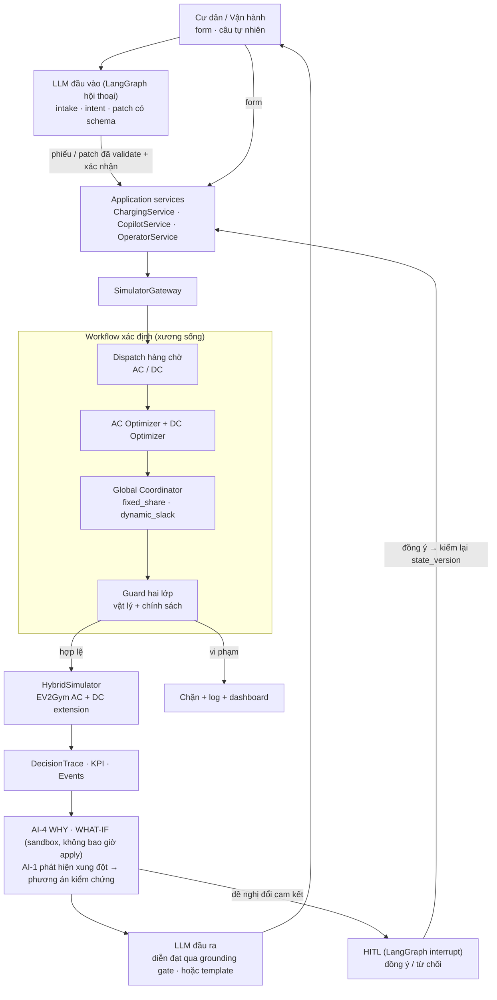
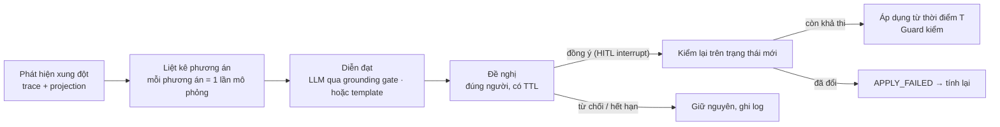

# PRD — ChargePilot (SC-16)

| Phiên bản | Ngày | Nhóm | Trạng thái |
|:---:|:---:|:---:|---|
| **v0.4** | 2026-11-21 | T019 | **Bản nháp chờ nhóm + mentor duyệt.** Thay thế PRD v0.3 (20/11, bản nháp nội bộ chưa commit) |

> **Hiện trạng triển khai 22/11 ([ADR-016](adr/ADR-016-livestation-cho-backend.md)):** backend chạy trên `LiveStation`, chưa phải `HybridSimulator`; FR9a và FR12 **chưa đạt** ở runtime (HybridSimulator chỉ chạy R&D offline). Số benchmark của backend và của R&D không được trộn.

**Nguồn của bản này** (thứ tự ưu tiên khi mâu thuẫn theo master context §0.1):

- Quyết định người phụ trách duyệt ngày 21/11 cho đợt sửa branch `feature/research-sc16-alignment`.
- Master context v1.0 (20/11/2026): `CHARGEPILOT_PROJECT_CONTEXT_2026-11-20.md` — §3, §6, §8, §11.2, §13, §15.
- Research gốc `RESEARCH-SC16` (Google Doc *RESEARCH AI VALUE*): bãi hybrid AC/DC, MVP-1…4, bốn hướng AI.
- ADR mới trên branch này: ADR-010 … ADR-015 (`docs/adr/`).
- Simulator v1.2 @ `d15871a` (branch `feature/simulator`, chỉ đọc).
- Bằng chứng chạy lại ngày 21/11: `eval/evidence/2026-11-21/`.
- R&D nhánh `experiment/claude-chargepilot-fullstack-ai` (chưa merge): `docs/experimental/*` — **chỉ tham khảo**, số liệu
  gắn nhãn [R&D — CHƯA XÁC MINH].

**Nhãn dùng trong tài liệu:** [ĐÃ TRIỂN KHAI] · [ĐÃ XÁC MINH 21/11] · [R&D — CHƯA MERGE] · [R&D — CHƯA XÁC MINH] ·
[MỤC TIÊU] · [GIẢ ĐỊNH] · [HOÃN].

> Mọi số đo ở đây đến từ **mô phỏng với workload tổng hợp (synthetic)**. Đó không phải số đo tại trạm thật. Thông số
> phần cứng và nguồn là **[GIẢ ĐỊNH]** mô hình hoá, không phải thông số VinFast / Vinhomes đã kiểm chứng. Đường sạc DC:
> VF3 synthetic, VF8 proxy EVKX, VF9 / UNKNOWN generic Simolin 2025 — **không curve nào là đo OEM**.

---

## 0. Thay đổi so với v0.3

| Mục | v0.3 (20/11) | **v0.4 (21/11)** | Lý do |
|---|---|---|---|
| Lớp AI chính | AI-1 + AI-4, cộng lớp xử lý bất định (F12, F13) | **AI-4 Decision Copilot WHY + WHAT-IF (trục chính)** + **AI-1 thương lượng SLA + HITL (bổ trợ)** + **LLM tiếp nhận** ở đầu vào. F12 / F13 bỏ khỏi lớp AI chính | Master context §6 MVP-4, §8.1; ADR-015 |
| F12 Dự báo hành vi | 🔴 Must, "Không cắt F12" | **[HOÃN]** (Won't trong sprint 20–26/11). Optimizer dùng **giờ rời khai báo + giả định persistence**. Bỏ câu "Không cắt F12" | Master §11.2, §13 (loại training forecasting khỏi sprint) |
| F13 Mức linh hoạt | 🟠 Should | **[HOÃN]**. AI-1 hỏi theo **thứ tự thay đổi nhỏ nhất, bằng luật** | Master §6, §15.1 D-10; ADR-015 |
| F14 Chiếm cổng | 🔴 Must: ân hạn, nhắc dời xe, phí, danh sách | **🟠 Should**, chỉ trạng thái `FINISHED_PLUGGED` (AC giữ cổng tới giờ rời khai báo, DC rút sau 5 phút — simulator đã mô phỏng). Nhắc dời xe / phí → **[HOÃN]** | Quyết định 21/11 mục 5 |
| F8 HOW-TO | Must, binary search ≤ 9 lần mô phỏng | **Bỏ khỏi Must.** Dùng phương án AI-1 đã kiểm chứng làm **gợi ý có điều kiện**. Binary search **[HOÃN]** vì giả định đơn điệu chưa chứng minh | Master §8.2 (C) |
| FR30a câu hỏi mở nhiều bước | Có (khi có LLM) | **[HOÃN]** | Quyết định 21/11 mục 5 |
| FR30b | WHY nêu chiếm cổng (F14) **và** dự báo hành vi (F12) | Chỉ còn phần **chiếm cổng `FINISHED_PLUGGED`** | F12 hoãn |
| FR32 Grounding gate | Chỉ kiểm số (±0,5 / ±0,05, giờ khớp tuyệt đối) | Kiểm thêm **mã xe / đối tượng, thời điểm, đơn vị, quan hệ nhân quả** với `reason_code` + `evidence_ref`. Nghi ngờ → template hoặc "không đủ bằng chứng" | Master §8.2 (A), §9.4: "kiểm số bằng regex là chưa đủ" |
| §2.2 Kịch bản | `evening_9cars_hybrid_v1` + `rnd_conflict_site_drop` mô tả "8 xe AC, 4 xe DC" | Kịch bản chuẩn `config/scenarios/mvp1` (scenario_id `evening_9cars_hybrid_v1`). `rnd_conflict_site_drop` = **8 cổng AC + 2 cổng DC (10 đầu nối), 12 lượt xe**, lưới 180 → 120 kW, là fixture **R&D minh hoạ xung đột**. Thêm `vinfast_dc_2port_120kw`. Thêm `supply_mode` | Master §3.4, §10.6; ADR-010, ADR-012 |
| Kiến trúc | AI điều phối tool qua Counterfactual Engine | **Workflow xác định là xương sống** (Dispatch → AC/DC Optimizer → Global Coordinator → Guard). LLM chỉ ở hai đầu. LangGraph chỉ giữ hội thoại + HITL interrupt. Không có "super-agent" | Master §1 tư tưởng sản phẩm; ADR-013 |
| Simulator | Hybrid simulator (EV2Gym AC + DC tự viết) | **Một** `HybridSimulator` EV2Gym-first sau `src/simulator/base.py` + `SimulatorGateway`; một bộ `Algorithms` dùng chung live / benchmark / what-if; Guard hai lớp **vật lý + chính sách** | ADR-011 |
| Thước đo | MT1–MT13, cột "R&D đã đo" như kết quả | Mục tiêu ghi **[MỤC TIÊU]**; số R&D ghi **[R&D — CHƯA XÁC MINH]**. MT10, MT11, MT13 → [HOÃN]. MT8b bỏ HOW-TO. MT12 thu hẹp theo F14 mới | Quy tắc bằng chứng 21/11; ADR-015 |
| Ablation §9.6 | X1–X5 | Chỉ giữ thí nghiệm chạy được trong sprint: **AI-4, AI-1, LLM vs template**. X1 (F12), X3 (F13) → [HOÃN]. X4 / X5 phần thử người thật → [HOÃN] | ADR-015 |
| Lộ trình §11 | Tuần W1–W4 tới 13/12; MVP-2 / MVP-3 "✅ R&D xong" | **Sprint 20–26/11/2026 với 5 gate** (master §13). Trạng thái MVP theo nhãn; MVP-1 = "đã triển khai, đang hardening"; không ghi "✅ Xong" cho R&D | Quyết định 21/11 mục 6 |
| Câu hỏi Q2, Q3 | Đang mở | **Đã có hướng:** Q3 → ADR-013; Q2 → ADR-015 | ADR-013, ADR-015 |
| Truy vết §14 | Mục tiêu → nghiệm thu → FR | **FR → module → ADR** (ADR-010…015) + bảng mục tiêu cũ | Yêu cầu đợt sửa 21/11 |
| Phụ lục | Bảng tài liệu R&D | Thêm **"Số đã xác minh 21/11"**; mọi số R&D gắn nhãn; đối chiếu sau với `eval/evidence/2026-11-21/RD_RERUN.md` | Quy tắc bằng chứng |

### 0.1 Lịch sử: thay đổi v0.2 → v0.3 (giữ nguyên để truy vết)

| Mục | v0.2 (15/11) | v0.3 (20/11) | Lý do (theo v0.3) | Trạng thái ở v0.4 |
|---|---|---|---|---|
| Bãi sạc | Chỉ AC, 8 × 7 kW, giới hạn 35 kW | Hybrid AC + DC, giới hạn ba tầng | Khảo sát tham khảo Vinhomes Ocean Park 1; mentor đồng ý hướng hybrid; ADR-010 | Giữ; topology `mvp1` là **fixture nền, không phải chốt cuối** |
| Kiến trúc tối ưu | Một bộ MPC + LP | AC Optimizer + DC Optimizer + Global Coordinator + Global Guard | AC đỗ lâu, DC đỗ ngắn khác mục tiêu | Giữ |
| Vai trò AI | Agent ReAct + dự báo lúc rút | Workflow xác định là xương sống; AI-1, AI-4 + F12, F13 | Research | Giữ workflow; **bỏ F12, F13 khỏi lớp AI chính** |
| Dự báo lúc rút (F6 cũ) | Should | F12 Must | Giá trị khi mô phỏng chiếm cổng | **Thay bởi [HOÃN]** (v0.4) |
| Xe sạc xong không rời | — | F14 Must; F15 Could | Trạng thái "cắm nhưng không sạc" | **F14 → Should, chỉ `FINISHED_PLUGGED`** |
| Thương lượng AI-1 | — | F13 Should | "Thương lượng có học" | **Thay bởi [HOÃN]**; thứ tự theo luật |
| Tiếp nhận bằng lời | LLM điền 6 trường | Mục đích → ràng buộc | Form không làm được | Giữ (xem Conflict mở trong báo cáo) |
| Chứng minh giá trị AI | — | Ablation X1–X5 | "Bỏ AI thì mất gì" | Thu hẹp còn AI-4, AI-1, LLM vs template |
| AI-2 | — | Could, chỉ luật | ML không vượt luật [ĐÃ XÁC MINH 21/11, `RD_RERUN.md`]: F1 luật 0,8019 · LOF 0,8013 · GBDT 0,7833 · IF 0,5385 | Giữ: ML [HOÃN], luật advisory |
| AI-3 | — | Won't | Negative finding [ĐÃ XÁC MINH 21/11, `RD_RERUN.md`]: learner < baseline ở 8 / 16 / 48 cổng | Giữ: không chọn |
| Thước đo AI | MT7 = MAE dự báo | MT7–MT9 | Đo đúng thứ tạo giá trị | Giữ MT7–MT9 |
| Mục tiêu chi phí | Giảm 15% | Báo số đo, không cam kết % | — | Giữ |
| Lộ trình | 4 tuần | MVP-1 → MVP-4 | Research | **Thay bởi sprint 20–26/11** |

---

## 1. Tổng quan sản phẩm

**ChargePilot** là web app hai vai trò (cư dân / vận hành) để vận hành **mô phỏng** một bãi sạc hỗn hợp AC/DC trong
khu dân cư. Hệ thống là **simulation-only**, không điều khiển trụ thật. Một **workflow xác định** quyết định lịch và
công suất dưới ràng buộc vật lý. AI giúp con người **hiểu** quyết định (WHY), **thử** giả định (WHAT-IF), và **thương
lượng** khi không giữ được mọi cam kết (AI-1, có HITL).

> **Nguyên tắc:** *"Optimizer tính phương án — Guard kiểm soát thực thi — AI giải thích, thử và thương lượng — Con
> người quyết định thay đổi cam kết."*

### 1.1 Vì sao cần AI, không chỉ một thuật toán quản lý

Thuật toán tối ưu giải được bài toán công suất. Nó **không** giúp người dùng hiểu, thử và đồng ý thay đổi. AI chỉ được
dùng ở đúng những chỗ đó:

| Khoảng trống | Thuật toán / dashboard thông thường | Lớp AI của ChargePilot | Tính năng |
|---|---|---|---|
| **Không hiểu vì sao** phải chờ / bị giảm công suất | Dashboard báo *xe nào trễ*, không nói *vì sao* | **AI-4 WHY**: đọc `DecisionTrace`, trả lý do có `reason_code` + `evidence_ref` | F8 (chính) |
| **Không biết đổi giả định thì ra sao** | Vận hành tự thử từng tham số | **AI-4 WHAT-IF**: patch có schema → mô phỏng cách ly → trước / sau, `applied: false` | F8 (chính) |
| **Không thể giữ mọi cam kết** | Luật cố định ("DC ưu tiên") làm người khác trễ | **AI-1**: phát hiện xung đột, phương án do simulator kiểm chứng, hỏi theo thứ tự thay đổi nhỏ nhất, HITL | F7 (bổ trợ) |
| **Nhu cầu nói bằng lời** | Form nhiều trường | **LLM tiếp nhận**: câu tự nhiên → phiếu có schema, cư dân xác nhận | F1 |
| Người dùng không giữ đúng lời khai (rời sớm / muộn, không đến) | Dùng giờ rời khai báo | **[HOÃN]** F12 dự báo hành vi. Sprint này dùng **giờ rời khai báo + giả định persistence** | F12 [HOÃN] |

**Những gì cố ý không giao cho AI:** dispatch hàng chờ, tính công suất (LP / MPC), Global Coordinator, Guard, bảo vệ khẩn
cấp, quyết định thay đổi cam kết. Mọi con số AI đưa ra đều do code hoặc simulator tính.



**Cách hoạt động:**

1. **Tiếp nhận:** cư dân đặt lịch bằng form, hoặc nói bằng lời. LLM chuyển câu thành phiếu có schema; cư dân xác nhận.
   Form và chat cùng gọi một `charging_service` (master §9.3). Code tra thông số xe và tính kWh.
2. **Tối ưu:** Dispatch đưa xe vào cổng trống đúng vùng. AC Optimizer (đỗ lâu, theo giá giờ) và DC Optimizer (đỗ ngắn,
   theo hàng chờ) nêu nhu cầu. Global Coordinator chia ngân sách. Guard kiểm phương án cuối. Optimizer dùng **giờ rời
   khai báo** và **giả định persistence** (giới hạn tương lai giữ nguyên tới khi có sự kiện) — [GIẢ ĐỊNH].
3. **Ghi vết:** mỗi bước quyết định sinh một **DecisionTrace** có cấu trúc: ràng buộc nào đang chặn, xe nào còn bao
   nhiêu phút dư, vì sao.
4. **Chiếm cổng sau sạc:** xe sạc xong mà còn cắm ở trạng thái `FINISHED_PLUGGED`; cổng không dùng được cho tới khi rút
   (AC: tới giờ rời khai báo; DC: sau 5 phút). Hệ thống hiển thị trạng thái này; chưa nhắc dời xe, chưa tính phí.
5. **AI-4 (chính):** người dùng hỏi *vì sao* hoặc *nếu như*. Copilot đọc trace hoặc chạy kịch bản giả định trong
   sandbox cách ly; **không bao giờ** áp dụng.
6. **AI-1 (bổ trợ):** khi dự báo một cam kết không giữ được, hệ thống tự phát hiện, dùng simulator tính các phương án
   khả thi, hỏi chủ xe theo thứ tự thay đổi nhỏ nhất. Chỉ áp dụng sau khi được đồng ý **và** kiểm lại.

---

## 2. Bài toán và cấu hình mô phỏng

### 2.1 Vấn đề

- Số cổng có hạn, hàng chờ giờ cao điểm (18h–22h), giới hạn công suất ở nhiều tầng: xe, cổng, tủ, nguồn.
- Sạc AC dài giờ và sạc DC nhanh **cạnh tranh cùng một nguồn** khi bãi dùng nguồn chung ([GIẢ ĐỊNH], master §3.1).
- Deadline, chi phí theo giờ, công bằng và tải đỉnh có thể mâu thuẫn nhau; đôi khi **không thể giữ mọi cam kết**.
- Sạc DC giảm dần theo SOC (taper), nên công suất ra lệnh ≠ công suất thực nhận.
- **Xe sạc xong không rời** vẫn chiếm cổng, làm thời gian chờ của xe khác dài hơn.
- Quy tắc tự động có thể đụng tới cam kết của cư dân, nên phải giải thích được, kiểm được tính khả thi, và có người duyệt.

Trạng thái chứng minh pain point: hợp lý về cơ chế, phù hợp brief SC-16; **chưa có số liệu vận hành tại trạm cụ thể**
(master §2.1).

### 2.2 Cấu hình tham chiếu

Mọi tham số nằm trong `config/*.yaml` (ADR-003, sửa một phần bởi ADR-012). Danh mục xe một nơi: `config/vehicles.yaml`
(provenance theo từng trường). Mọi kịch bản nằm trong `config/scenarios/` (ADR-012).

**`supply_mode: shared | independent`** (ADR-010, master §10.6). `shared`: coordinator được chỉnh ngân sách AC / DC
**trong** giới hạn lưới chung. `independent`: mỗi vùng có `zone_grid_input_limit_kw` riêng, **không** chuyển công suất
AC ↔ DC. Việc hai vùng tại site khảo sát dùng chung feeder là **[GIẢ ĐỊNH]**.

| Thành phần | **Kịch bản chuẩn** `config/scenarios/mvp1` (scenario_id `evening_9cars_hybrid_v1`) | `vinfast_dc_2port_120kw` | `rnd_conflict_site_drop` (R&D) |
|---|---|---|---|
| Vai trò | Fixture nền: regression + demo nền. **Không phải topology chốt cuối** | Fixture kiểm thử hồ sơ xe DC / 2 cổng; không thay mặc định | **Fixture R&D minh hoạ xung đột** [R&D — CHƯA MERGE] |
| Vùng AC | 2 tủ × 1 cổng 11 kW | 2 tủ × 1 cổng 11 kW | 8 cổng AC |
| Vùng DC | 1 tủ, 2 cổng × 60 kW, giới hạn tủ **120 kW** (cap vật lý, tổng hai cổng) | 1 tủ, 2 cổng × 60 kW, 120 kW | 2 cổng DC |
| Tổng đầu nối | 4 | 4 | **10** |
| Lượt xe | 9 (4 AC, 5 DC) | 9 | **12** |
| Nguồn | Lưới **106 kW**; ngân sách chính sách AC **22** / DC **78 kW** | Lưới 150 kW; ngân sách AC 22 / DC 120 kW | Lưới **180 → 120 kW** (giảm lúc 22:30) |
| Hiệu suất | Chuyển đổi **0,95** · sạc **0,98** | như `mvp1` | như `mvp1` |
| Bước thời gian | 1 phút | 1 phút | 2 phút |
| Hồ sơ DC | mặc định simulator | `vinfast_profiles_v0_1` (opt-in) | — |
| Hàng chờ | FIFO (AC) / FCFS (DC) riêng từng vùng; xe AC không dùng cổng DC và ngược lại | như `mvp1` | như `mvp1` |
| Rút đầu nối | Sạc xong **không** giải phóng cổng: AC giữ tới giờ rời khai báo, DC rút sau 5 phút (`FINISHED_PLUGGED`) | như `mvp1` | như `mvp1` |

Kiểm đơn vị (`mvp1`): 22 + 78 = 100 kW output; 100 ÷ 0,95 = 105,263 kW phía lưới ≤ 106 kW. Vì vậy 22 / 78 là **ngân sách
vùng**, không phải hai nguồn độc lập (master §3.2).

**Vị trí file hiện tại:** trên simulator v1.2, các fixture nằm ở `src/simulator/scenario/*.json` (branch
`feature/simulator`); `rnd_conflict_site_drop.json` nằm ở nhánh R&D. Đích chuyển về `config/scenarios/` theo ADR-012.

**Họ kịch bản đánh giá** (có seed): `evening_mixed`, `dc_queue_pressure`, `site_drop`, `dc_outage`, `independent_supply`
(tên theo nhánh R&D [R&D — CHƯA MERGE]). Phải có cả ca optimizer thắng, hoà và **thua** baseline. **Sự cố demo đề xuất:**
giảm lưới 106 → 50 kW (hoặc mức tạo xung đột hợp lệ đã chạy thử) — [GIẢ ĐỊNH], master §3.4.

> **Lưu ý [ĐÃ XÁC MINH 21/11]:** trên `mvp1`, FIFO/FCFS và EDF đều đạt 9/9 đúng hạn. Fixture `mvp1` **không đủ phân biệt
> chính sách**. Nghiệm thu MVP-2 / MVP-3 cần kịch bản có ca baseline thua trên cùng workload / seed (master §6).

### 2.3 Ba tầng ràng buộc công suất

1. **Cổng / xe:** `p ≤ giới hạn cổng` và `p ≤ công suất tối đa xe nhận` theo loại dòng (AC / DC) và theo SOC.
2. **Tủ / vùng:** `Σ p (tủ) ≤ giới hạn đầu ra tủ` và `Σ p (vùng) ≤ ngân sách vùng`.
3. **Lưới:** `Σ p (mọi cổng) ÷ hiệu suất chuyển đổi ≤ giới hạn đầu vào lưới`, kể cả khi giới hạn đổi theo thời gian.
   Ở `independent`: kiểm theo từng `zone_grid_input_limit_kw`.

Guard tách hai lớp (ADR-011): **vật lý** (cap cổng, tủ, lưới, khả năng nhận của xe — không bao giờ được nới) và
**chính sách** (ngân sách vùng, chống bật-tắt, dữ liệu cũ, quyền, phiên bản).

Phân biệt rõ: công suất **yêu cầu / được phép / thực ra** (`requested_output_kw` / `allowed_output_kw` /
`actual_output_kw`), và điện **vào pin / lấy từ lưới** (`battery_added_kwh` / `grid_input_kwh`). Không tính hiệu suất
hai lần.

---

## 3. Persona và nỗi đau

| | Cư dân chủ xe | Ban quản lý / vận hành trạm |
|---|---|---|
| **Muốn** | Biết khi nào có cổng, đặt phiên, đủ pin trước giờ rời, hiểu vì sao phải chờ hoặc nhận ít công suất, có phương án khi không kịp | Không vượt nguồn, xử lý tải đỉnh và trụ lỗi, giám sát SLA, thử tác động của chính sách trong sandbox, duyệt ngoại lệ, đối chiếu số liệu |
| **Đau** | Tối về hết cổng; lịch đổi mà không ai hỏi; không biết giảm mục tiêu pin thì sớm hơn bao nhiêu | Dashboard chỉ báo *xe nào trễ*, không nói *vì sao* và *làm gì được*; phải tự thử từng tham số |
| **Kênh** | Điện thoại (web responsive, mobile-first) | Máy tính phòng vận hành (desktop-first) |

Persona là giả thuyết sản phẩm; **chưa có khảo sát / phỏng vấn người dùng thật** (master §15.3 mục 6).

**Câu hỏi sản phẩm phải trả lời được** (research, Hướng 4):

| Cư dân | Vận hành |
|---|---|
| Vì sao xe tôi phải chờ? *(WHY)* | Vì sao trạm không thể phục vụ tất cả xe đúng hạn? *(WHY)* |
| Nếu giảm mục tiêu từ 90% xuống 75% thì sao? *(WHAT-IF)* | Nếu ưu tiên DC và giảm AC, cư dân nào bị ảnh hưởng? *(WHAT-IF)* |
| Nếu cần rời trước 18:00, có phương án nào không? *(gợi ý có điều kiện từ AI-1)* | Nếu một tủ DC ngừng 30 phút thì sao? *(WHAT-IF)* |
| | ~~Cần tăng tối thiểu bao nhiêu kW để đáp ứng toàn bộ?~~ *(HOW-TO tối thiểu → [HOÃN])* |

---

## 4. User stories

| ID | User story | Tính năng | Ghi chú v0.4 |
|:---:|---|:---:|---|
| US1 | Là **cư dân**, tôi muốn đặt lịch bằng form hoặc nhắn *"cần 80% trước 7h sáng mai"* để hệ thống xếp cổng và khung giờ | F1, F2 | |
| US2 | Là **cư dân** đến khi hết cổng, tôi muốn biết vị trí trong hàng chờ của đúng vùng AC hoặc DC và thời gian chờ ước tính | F2 | Ước tính dựa trên giờ rời khai báo |
| US3 | Là **cư dân**, khi cam kết của tôi không giữ được, tôi muốn được hỏi trước và chọn giữa các phương án **đã được tính là khả thi** | **F7 (AI-1)** | |
| US4 | Là **cư dân**, tôi muốn hỏi *"vì sao xe tôi chờ?"* và nhận câu trả lời có căn cứ, không bịa | **F8 (AI-4)** | |
| US5 | Là **cư dân**, tôi muốn thử *"nếu tôi giảm còn 75% thì sao?"* mà không làm đổi lịch thật | **F8 (AI-4)** | |
| US6 | Là **vận hành**, tôi muốn thấy realtime các vùng, tủ, cổng, hàng chờ, tải so với giới hạn và xe có nguy cơ trễ | F3, F5 | "Realtime" = trạng thái mô phỏng |
| US7 | Là **vận hành**, khi nguồn giảm hoặc tủ lỗi, tôi muốn hệ thống tự giảm tải ngay rồi đề xuất phương án cho các cam kết bị ảnh hưởng | F3, F4, **F7** | |
| US8 | Là **vận hành**, tôi muốn hỏi *"nếu nguồn còn 50 kW thì sao?"* và thấy KPI trước / sau, có nhãn giả định hạ tầng khi cần | **F8 (AI-4)** | Thay bởi v0.4: bản v0.3 hỏi "cần tối thiểu bao nhiêu kW" (HOW-TO → [HOÃN]) |
| US9 | Là **vận hành**, tôi muốn duyệt / từ chối thay đổi ưu tiên, xem lệnh bị chặn và nhật ký ai quyết gì | F4, F7 | |
| US10 | Là **vận hành**, tôi muốn so sánh chính sách (ngân sách cố định vs động, FCFS vs tối ưu) trên cùng kịch bản | F9 | |
| US11 | Là **cư dân**, tôi muốn nói *"mai 6h đi Hải Phòng"* thay vì tự đoán cần bao nhiêu % pin | F1 | Xem Conflict mở về FR4a |
| US12 | Là **cư dân đang chờ**, tôi muốn biết khi cổng bị một xe đã sạc xong chiếm | F14, F8 | v0.3 có thêm F12 (dự báo) → bỏ |
| US13 | Là **vận hành**, tôi muốn thấy cổng nào đang ở trạng thái `FINISHED_PLUGGED` và bao lâu | F14 | Phần "đã nhắc chưa" → [HOÃN] |
| US14 | ~~Là **cư dân**, tôi muốn chỉ bị hỏi khi thật cần, và được đưa phương án hợp với thói quen của mình trước~~ | ~~F13~~, F7 | **[HOÃN]** phần cá nhân hoá (F13). Giữ: phương án được sắp theo thay đổi nhỏ nhất |
| US15 | ~~Là **vận hành**, tôi muốn hỏi câu mở nhiều bước *"nếu tủ DC-01 hỏng 30 phút lúc 19h, ai bị ảnh hưởng và nên làm gì?"*~~ | F8 | **[HOÃN]** (FR30a). Vẫn hỏi được WHAT-IF outage đơn bước (US8) |

---

## 5. Tính năng (MoSCoW)

Ưu tiên tính cho **sprint 20–26/11/2026**. [HOÃN] = Won't trong sprint, không phải tuyên bố vô giá trị vĩnh viễn.

| ID | Tính năng | Mô tả | Ưu tiên |
|:---:|---|---|:---:|
| F1 | Tiếp nhận yêu cầu sạc | Form; LLM chuyển câu tự nhiên thành phiếu có schema, có xác nhận; danh mục xe `config/vehicles.yaml`; kWh do code tính | 🔴 Must |
| F2 | Dispatch + Tối ưu AC/DC + Global Coordinator | Dispatch hàng chờ theo vùng; AC LP theo giá giờ; DC LP theo hàng chờ; coordinator chia ngân sách | 🔴 Must (theo MVP-1 → MVP-3) |
| F3 | Giới hạn động & cân bằng tải | Giới hạn theo thời gian, nguồn giảm, tủ mất kết nối, `supply_mode`; tính lại ngay khi có sự kiện | 🔴 Must |
| F4 | Guard hai lớp + HITL + nhật ký | Lớp vật lý + lớp chính sách; chặn lệnh sai; bảo vệ khẩn cấp; vòng đời phê duyệt; audit | 🔴 Must |
| F5 | Web hai vai trò | Cư dân và vận hành; sơ đồ bãi vùng → tủ → cổng; trạng thái mô phỏng realtime | 🔴 Must |
| F6 | DecisionTrace + Counterfactual sandbox | Lõi dùng chung AI-4 và AI-1: trace có cấu trúc, patch có schema, mô phỏng cách ly **không bao giờ apply** (ADR-014) | 🔴 Must |
| **F7** | **AI-1 · Thương lượng xung đột SLA (bổ trợ)** | Phát hiện xung đột → phương án do simulator tính → đề nghị chủ xe theo thứ tự thay đổi nhỏ nhất → HITL → kiểm lại → áp dụng | 🔴 **Must** (vertical slice) |
| **F8** | **AI-4 · Decision Copilot (trục chính)** | **WHY** (đọc trace) · **WHAT-IF** (sandbox). HOW-TO: chỉ **gợi ý có điều kiện** từ phương án AI-1; tìm tối thiểu / binary search [HOÃN] | 🔴 **Must** (WHY + WHAT-IF) |
| F9 | Benchmark & kịch bản sự cố | So sánh chính sách trên các họ kịch bản; báo cáo trong `eval/`; bằng chứng trong `eval/evidence/` (ADR-015) | 🟠 Should |
| F10 | Cá nhân hoá | Xe mặc định, mục tiêu pin, phạm vi thay đổi đã đồng ý trước | 🟡 Could |
| F11 | AI-2 cảnh báo telemetry (chỉ luật) | Dữ liệu đứng yên, trễ, lệch; chỉ tư vấn, không thay Guard. Phần ML [HOÃN] | 🟡 Could |
| **F12** | ~~Dự báo hành vi~~ | Giờ rời thực tế, đỗ quá giờ, không đến (LightGBM / GBDT) | ⚪ **[HOÃN]** (v0.3: Must) |
| **F13** | ~~Mô hình mức linh hoạt & khả năng đồng ý~~ | Xếp hạng phương án AI-1 theo từng người | ⚪ **[HOÃN]** (v0.3: Should) |
| **F14** | **Chiếm cổng sau sạc** | Chỉ trạng thái `FINISHED_PLUGGED` (AC tới giờ rời khai báo, DC rút sau 5 phút); hiển thị cho vận hành và WHY. Nhắc dời xe, phí → [HOÃN] | 🟠 **Should** (v0.3: Must) |
| F15 | Cảm biến ô đỗ (mô phỏng) | Tín hiệu "ô có xe" có thể nhiễu / mất | 🟡 Could (xem Conflict mở) |
| — | AI-3 học lập lịch · ML / LLM trong vòng điều khiển công suất · RAG · vector DB · RL · multi-agent · HOW-TO tối ưu đa chiều · FR30a câu hỏi mở nhiều bước · cảm biến thật · OCPP · thanh toán · app riêng · nhiều bãi · SCADA/EVN · bản sao số 3D | Ngoài phạm vi sprint / MVP-4 | ⚪ Won't / [HOÃN] |

---

## 6. Yêu cầu chức năng

### 6.1 Chung

- **FR1** Đăng nhập theo 2 vai trò `resident` và `operator`; danh tính lấy phía server (JWT → `config["configurable"]`),
  AI không đọc / ghi được (ADR-006). Cư dân chỉ thấy và chỉ thao tác trên xe của mình.

### 6.2 F1 · Tiếp nhận yêu cầu

- **FR2** Phiếu yêu cầu gồm: mẫu xe, vùng (`AC` | `DC`), % pin hiện tại, % pin mục tiêu, giờ đến, giờ rời, chế độ
  (`reservation` | `walk_in`). Mẫu xe chọn từ danh mục `config/vehicles.yaml` (có `max_ac_kw`, `max_dc_kw`, dung lượng,
  provenance từng trường — ADR-012).
- **FR3** kWh **do code tính** (`src/services/energy.py`): `điện vào pin = dung lượng × (mục tiêu − hiện tại)`;
  `điện từ lưới = điện vào pin ÷ (hiệu suất sạc × hiệu suất chuyển đổi)`.
- **FR4** Tiếp nhận bằng lời: LLM chỉ **điền trường** của phiếu theo schema. Thiếu hoặc mơ hồ thì hỏi lại. Cư dân xác
  nhận phiếu trước khi gửi. Form và chat gọi cùng `charging_service` (`quote` trước, `book` sau xác nhận). Không có LLM
  thì form vẫn đủ để dùng.
- **FR4a** Mục đích → ràng buộc: khi cư dân nói mục đích chuyến đi thay vì % pin, LLM trích **quãng đường và giờ đi**.
  **Code** tính kWh từ mức tiêu thụ của mẫu xe cộng biên dự phòng cấu hình được, rồi đổi ra % pin mục tiêu. Cư dân thấy
  cách tính và sửa được. LLM không tự đưa ra số kWh hay %. *(Giữ từ v0.3; ưu tiên trong sprint chờ nhóm chốt — xem
  Conflict mở.)*

### 6.3 F2 · Dispatch và tối ưu

- **FR5** Tách **dispatch hàng chờ** khỏi **lập lịch công suất**. Chỉ đưa xe vào cổng trống đúng vùng; không "dịch
  chuyển" xe hay rút cắm xe đang sạc để tối ưu KPI.
- **FR6** AC Optimizer: LP cửa sổ trượt (continuous LP, **không phải MILP**), chỉ áp dụng bước đầu, xét deadline, mục
  tiêu SOC, giá theo giờ, taper AC. *(MVP-3)*
- **FR7** DC Optimizer: LP theo hàng chờ (queue-aware), xét taper DC theo SOC và lợi ích hoàn tất sớm khi có xe chờ;
  dispatch so sánh FCFS / EDF / LLF. *(MVP-2)*
- **FR8** Global Coordinator chia ngân sách nguồn chung giữa hai vùng theo chính sách xác định (`fixed_share`,
  `dynamic_slack`; `joint_lp` là tuỳ chọn nâng cao). Ưu tiên nghiệm thu `dynamic_slack` trước `joint_lp`.
  `supply_mode: independent` thì **không** được chuyển công suất AC ↔ DC.
- **FR9** Thông tin dùng để quyết định chỉ là thông tin **đã biết tại thời điểm T** (online), không biết trước xe sắp
  đến. Thời điểm rời của xe = **giờ rời khai báo**; giới hạn tương lai = **giả định persistence** (giữ nguyên tới khi
  có sự kiện) — cả hai ghi vào trace. Solver lỗi hoặc quá thời gian thì dùng phương án dự phòng xác định đã qua Guard,
  ghi `optimizer_status` và `fallback_reason`.
- **FR9a** Live, benchmark và what-if dùng **cùng một bộ `Algorithms`** và cùng `HybridSimulator` (ADR-011).
  **[HIỆN TRẠNG — CHƯA ĐẠT]** live + benchmark backend dùng chung `LiveStation` + `control_loop.on_event` (ADR-016).

### 6.4 F3 · Giới hạn động

- **FR10** Hỗ trợ: lịch giới hạn nguồn theo thời gian, nguồn giảm đột ngột, tủ mất kết nối có thời hạn,
  `supply_mode: shared | independent`. Giới hạn vật lý tách khỏi ngân sách điều chỉnh được; optimizer không được nới
  giới hạn vật lý.
- **FR11** Tính lại ngay khi: xe đến / rời, đặt lịch mới, đổi cam kết (hiệu lực từ thời điểm T, không sửa quá khứ),
  nguồn đổi, tủ lỗi.
- **FR12** Simulator: một `HybridSimulator` EV2Gym-first sau bề mặt `src/simulator/base.py` + `SimulatorGateway`. AC
  dùng EV2Gym native; DC là extension tự viết (EV2Gym bản gốc không có động học DC). Không viết simulator thứ hai.
  **[HIỆN TRẠNG — LỆCH]** backend dùng `LiveStation` (ADR-016: HybridSimulator tự dispatch + guard riêng, cần ev2gym).
  Ghi rõ đây là mô hình tổng hợp (ADR-011).

### 6.5 F4 · Guard, HITL, nhật ký

- **FR13** Guard xác định kiểm **phương án cuối** trước khi áp dụng, chia hai lớp (ADR-011):
  - **Lớp vật lý:** (1) cổng / xe; (2) tủ; (3) lưới (hoặc nguồn vùng ở `independent`).
  - **Lớp chính sách:** (4) ngân sách vùng; (5) chống bật-tắt liên tục; (6) dữ liệu cũ; (7) quyền thao tác;
    (8) phiên bản lịch / phiên bản trạng thái; (9) lệnh mâu thuẫn trên cùng cổng.

  Vi phạm thì **chặn, ghi log, hiện dashboard, không tới simulator**. Chỉ `src/guard/dispatcher.py` gửi lệnh tới trạm
  mô phỏng (ADR-002). *(Danh sách luật chốt theo ADR-011; xem Conflict mở về số luật.)*
- **FR14** Bảo vệ khẩn cấp: nguồn giảm đột ngột thì giảm công suất **ngay**, độc lập với AI và không chờ phê duyệt;
  thông báo sau và ghi log. Sau đó AI-1 mở thương lượng cho các cam kết bị ảnh hưởng.
- **FR15** Ba mức can thiệp (master §8.3):
  1. **Level 1:** đổi allocation trong vùng không vi phạm SLA cam kết — engine tự làm dưới Guard.
  2. **Level 2:** đổi **cam kết** của cư dân (giờ rời, mục tiêu pin) **chỉ thực thi sau khi cư dân đồng ý**.
  3. **Level 3:** đổi **ưu tiên** / can thiệp sự cố chỉ vận hành được quyết.

  Không có tự động đồng ý.
- **FR16** Nhật ký: ai / thành phần nào đề xuất, phương án nào, Guard kết luận gì, ai duyệt, phiên bản trạng thái, thời
  điểm, kết quả áp dụng.

### 6.6 F5 · Web

- **FR17** Cư dân: trạng thái xe, hàng chờ theo vùng, lịch ước tính, **thẻ đề nghị thay đổi** (AI-1), **ô hỏi Copilot**
  (AI-4 WHY / WHAT-IF), thông báo.
- **FR18** Vận hành: sơ đồ bãi (vùng → tủ → cổng, hai làn chờ AC / DC; mặc định topology 4 cổng của `mvp1`), ba thanh
  công suất (lưới · ngân sách AC · ngân sách DC), xe có nguy cơ trễ, cổng `FINISHED_PLUGGED`, **danh sách xung đột và đề
  nghị**, lệnh bị chặn, nhật ký, Copilot cấp bãi (WHY / WHAT-IF), giả lập sự kiện, replay. "Live" = trạng thái mô
  phỏng, không phải số liệu trụ thật.

### 6.7 F6 · DecisionTrace và Counterfactual sandbox

- **FR19** Mỗi bước quyết định sinh **DecisionTrace** có cấu trúc, lấy dữ liệu từ solver / state / Guard (không bao giờ
  chép từ text của LLM) — ADR-014:

  | Trường | Ví dụ |
  |---|---|
  | `policy_id`, `optimizer_status`, `objective_value` | `lp_mpc_dc` · `optimal` · `time_limited` · `fallback_reason` |
  | `limits` | Giới hạn lưới, vùng, tủ hiệu lực tại bước này; `supply_mode` |
  | `binding_constraints` | `site_grid_input` đang chạm trần; `cabinet_outage` DC-01 (theo ID tủ / vùng) |
  | `vehicles[*]` | SOC, kWh còn thiếu, `slack_minutes`, công suất requested / allowed / actual, trạng thái phiên (gồm `FINISHED_PLUGGED`) |
  | `queues`, `queue_decisions` | Vị trí từng xe trong hàng chờ AC / DC |
  | `at_risk_vehicles` | Xe dự báo trễ cam kết (chiếu từ giờ rời khai báo + persistence) |
  | `assumptions` | `declared_departure`, `persistence_limits`, `simulation_only` |
  | `guard` | Luật đang kích hoạt, số lệnh bị chặn |

- **FR20** Counterfactual sandbox:
  - chạy trên **bản sao** cấu hình với `HybridSimulator` mới, **không bao giờ** đổi trạng thái thật (`applied: false`);
  - chỉ dùng thông tin đã biết tại T (`known_at(T)`);
  - cùng engine, charging model, seed, sự kiện ngoài; chỉ đổi biến được hỏi;
  - giả định giới hạn tương lai giữ nguyên, ghi giả định này vào kết quả;
  - ghi `base_config_hash`, `sandbox_config_hash`, `state_version`;
  - tác vụ dài chạy job nền (ADR-014).
- **FR21** Mọi thay đổi giả định đi qua **Patch có schema**, từ chối trường lạ / ID lạ, tối đa 5 thao tác:

  | Thao tác | Tham số | Ai được dùng |
  |---|---|---|
  | `revise_vehicle` | `vehicle_id`, thời điểm hiệu lực, `departure` / `target_soc` / `priority` | Cư dân: chỉ xe mình, không có `priority`. Vận hành: mọi xe |
  | `site_limit` | thời điểm, `grid_input_limit_kw`, `hypothetical_infrastructure` | Chỉ vận hành |
  | `outage` | tủ, bắt đầu, kết thúc | Chỉ vận hành |

  Nâng nguồn vượt mức đã lắp đặt bắt buộc `hypothetical_infrastructure = true`, và nhãn
  `hypothetical_infrastructure_change` đi theo mọi kết quả.

### 6.8 F7 · AI-1 Thương lượng xung đột SLA (bổ trợ)

AI-1 là **system-initiated**; AI-4 là **user-initiated**. Hai bên dùng chung trace + sandbox (master §8.3).



- **FR22** **Phát hiện xung đột:** chiếu tương lai từ thông tin đã biết tại T (giờ rời khai báo + persistence). Xe nào
  dự báo không đạt cam kết thì là xung đột, kèm mã lý do lấy từ trace: `site_grid_input`, `zone_budget`,
  `cabinet_output`, `cabinet_outage`, `waiting_for_port`, `port_finished_plugged`, `insufficient_time_or_power`, cùng số
  kWh còn thiếu. Tải bình thường thì **không** được tự bịa xung đột.
- **FR23** **Liệt kê phương án:** tối đa 12 phương án mỗi xe, **mỗi phương án là một lần mô phỏng thật**:
  - giữ nguyên;
  - lùi giờ rời +15 / 30 / 45 / 60 / 90 / 120 phút;
  - giảm mục tiêu −5 / 10 / 15 / 20 điểm %;
  - tăng ưu tiên (chỉ vận hành).

  Một phương án là **khả thi** khi xe đạt cam kết mới **và không làm xe nào khác bị trễ**. Kết quả có `kpi_delta`, danh
  sách xe bị ảnh hưởng, hash cấu hình làm bằng chứng.
  **Thứ tự hiển thị / hỏi bằng luật:** thay đổi nhỏ nhất trước (trong mỗi nhóm: ít phút lùi nhất, ít điểm % giảm nhất).
  Đây là **luật xác định**, thay cho F13 (v0.3). Luôn hiện đủ mọi phương án khả thi.
- **FR23a** ~~Xếp hạng theo người (F13)~~ — **[HOÃN]** cùng F13.
- **FR23b** **Phương án nhiều bên** (tổ hợp 2–3 xe, mọi người liên quan đều phải đồng ý): ngoài critical path sprint;
  bỏ phần "F13 chọn người nên hỏi". *(Giữ từ v0.3, ưu tiên chờ nhóm chốt — xem Conflict mở.)*
- **FR23c** **Giảm làm phiền:** mỗi cư dân không bị hỏi quá N lần mỗi phiên (cấu hình được). Người đã từ chối một loại
  thay đổi thì loại đó không được đề nghị lại trong cùng phiên.
- **FR24** **Không có số nào hiển thị cho người dùng đến từ LLM.** LLM chỉ diễn đạt các phương án đã tính, qua
  grounding gate (FR32); không qua thì dùng câu template xác định.
- **FR25** **Vòng đời đề nghị** (ADR-014):

  ```text
  PROPOSED ──► APPROVED ──► APPLIED
     │            └──────► APPLY_FAILED
     ├──► REJECTED
     └──► EXPIRED (quá TTL, mặc định 15 phút)
  ```

  - Chỉ phương án **khả thi** mới được đề nghị.
  - Mỗi đề nghị gắn `state_version`. Trạng thái đã đổi thì đề nghị **cũ** và không được duyệt hay áp dụng.
  - Quyết định **idempotent** theo khoá idempotency; duyệt hai lần không áp dụng hai lần; cùng khoá khác payload → lỗi.
  - Áp dụng = **kiểm lại tính khả thi trên trạng thái hiện tại**, rồi ghi thay đổi cam kết có hiệu lực từ T. Không
    còn khả thi thì `APPLY_FAILED`.
  - Báo cả **SLA gốc** (original) và **SLA sau thương lượng** (revised); không tráo SLA gốc thành SLA mới để báo cải
    thiện (master §0.2 mục 7, §7.4).
- **FR26** **Công cụ của AI-1** (chỉ các công cụ này; không công cụ nào nhận số tự do từ model):
  `detect_conflicts` · `enumerate_feasible_options` · `explain_tradeoff` · `submit_proposal` · `record_response` ·
  `apply_if_approved`.
- **FR27** Không có phương án khả thi thì nói rõ, và chuyển cho vận hành xem xét. Không bịa phương án.

### 6.9 F8 · AI-4 Decision Copilot (trục chính)

| Năng lực | Câu hỏi mẫu | Cách trả lời | Không được | Sprint |
|---|---|---|---|---|
| **WHY** | "Vì sao xe DC-B phải chờ?" | Đọc DecisionTrace tại T: trạng thái xe, vị trí hàng chờ, ràng buộc đang chặn, slack. Trả `reasons[{code, text, evidence_ref}]` + `facts` + `assumptions` + `state_version` | Kể nhân quả không có trong trace; thiếu dữ liệu thì nói "không đủ bằng chứng xác định nguyên nhân" | 🔴 Must |
| **WHAT-IF** | "Nếu tôi giảm còn 75%?" · "Nếu tủ DC-01 mất 30 phút?" · "Nếu nguồn còn 50 kW?" | Câu → Patch có schema → sandbox → so sánh trước / sau (SLA, chờ, shortfall, peak, TOU cost, fairness; xe đổi trạng thái đúng hạn) | Áp dụng vào lịch thật; nới giới hạn vật lý mà không gắn nhãn | 🔴 Must |
| **HOW-TO (gợi ý có điều kiện)** | "Cần dời bao lâu để kịp?" | Trả danh sách phương án khả thi của AI-1 (FR23) cho đúng xe, ghi rõ **"gợi ý có điều kiện, không phải tối thiểu toàn cục"** | Tuyên bố "tối thiểu" / "đảm bảo"; tự áp dụng | 🟠 Should |
| ~~HOW-TO tối thiểu~~ | ~~"Cần tối thiểu bao nhiêu kW để tất cả đúng hạn?"~~ | ~~Binary search ≤ 9 lần mô phỏng~~ | — | ⚪ **[HOÃN]**: giả định đơn điệu chưa chứng minh khi các xe cạnh tranh cổng / công suất |

- **FR28** Phân quyền theo role (ADR-014): cư dân chỉ hỏi và thử trên xe của mình, không thấy chi tiết cấp bãi hay dữ
  liệu nhận diện xe khác (chỉ aggregate không nhận diện). Câu hỏi cấp bãi (nguồn, tủ, "tất cả đúng hạn") chỉ vận hành
  được hỏi. Lọc theo role ở cả REST, WebSocket lẫn evidence của Copilot.
- **FR29** Mọi câu trả lời có `evidence`, `assumptions`, phạm vi vai trò, và `applied: false`. Muốn biến kết quả WHAT-IF
  thành thay đổi thật thì phải đi qua luồng đề nghị của AI-1 (FR25).
- **FR30** Câu hỏi ngoài mẫu thì trả `cannot_parse` kèm gợi ý câu hỏi hợp lệ, không đoán.
- **FR30a** ~~Câu hỏi mở nhiều bước~~ — **[HOÃN]**. Nội dung v0.3 (kế hoạch ghép tool, tối đa K bước / M lần mô phỏng)
  giữ làm tham khảo cho sau sprint.
- **FR30b** WHY phải nêu được nguyên nhân là **xe khác đang ở trạng thái `FINISHED_PLUGGED`** khi nó ảnh hưởng tới
  thời gian chờ. Không nêu danh tính xe khác cho cư dân. *(v0.3 có thêm phần dự báo hành vi F12 → bỏ.)*

### 6.10 Lớp LLM (dùng chung F1, F7, F8)

- **FR31** LLM chỉ ở **hai đầu** workflow (ADR-013):
  1. **đầu vào:** hiểu câu tự nhiên thành **intent / patch / phiếu có schema** (được validate);
  2. **đầu ra:** **diễn đạt** kết quả có cấu trúc đã tính bằng tiếng Việt.

  Text của LLM **không bao giờ** quay lại solver hay Guard. LLM không gọi tool điều phối tuỳ ý; không có
  "super-agent". LangGraph chỉ giữ hội thoại và HITL interrupt.
- **FR32** **Grounding gate** — kiểm từng câu LLM so với dữ kiện có cấu trúc (`facts`, `reason_codes`, `evidence_refs`):
  1. **Số:** mọi số phải có trong dữ kiện; giờ khớp tuyệt đối, số nguyên ±0,5, số thập phân ±0,05 (như v0.3).
  2. **Đối tượng:** mã xe / cổng / tủ / vùng nhắc trong câu phải đúng đối tượng mà số liệu thuộc về.
  3. **Thời điểm:** số liệu phải đúng thời điểm / interval của dữ kiện.
  4. **Đơn vị:** kW ≠ kWh, % ≠ điểm %, output trạm ≠ điện lưới.
  5. **Quan hệ nhân quả:** mỗi khẳng định "vì / do" phải khớp một `reason_code` có `evidence_ref` cho đúng đối tượng.

  Sai **hoặc nghi ngờ** bất kỳ mục nào → bỏ câu LLM, dùng template xác định, hoặc trả "không đủ bằng chứng". Một câu có
  số đúng nhưng gắn sai xe / sai nguyên nhân **vẫn là bịa**.
- **FR33** **Chế độ offline xác định:** không có LLM thì parser luật + template vẫn chạy đủ luồng. UI ghi rõ "LLM chưa
  cấu hình" và không giả màn hình như AI đang chạy.
- **FR33a** Prompt injection từ người dùng / telemetry không được nới giới hạn patch, đổi role hay áp dụng lệnh; schema,
  phân quyền và Guard ở backend quyết định.

### 6.11 F12 · Dự báo hành vi — [HOÃN]

> **[HOÃN] trong sprint 20–26/11/2026** (master §11.2, §13). Optimizer dùng **giờ rời khai báo + giả định persistence**
> (FR9). Không tuyên bố đã có dự báo.

Nội dung v0.3 giữ để tham khảo khi mở lại (không triển khai trong sprint):

- ~~FR34~~ Dự báo giờ rời thực tế, đỗ quá giờ, không đến — chỉ từ thông tin có tại lúc cắm.
- ~~FR35~~ Giờ rời khai báo vẫn là ràng buộc cứng; dự báo chỉ để ước lượng cổng trống. *(Phần "giờ rời khai báo là ràng
  buộc cứng" vẫn còn hiệu lực qua FR9.)*
- ~~FR36~~ Baseline trung vị lịch sử → mô hình học; chia dữ liệu theo thời gian.
- ~~FR37~~ `forecast_used` trong DecisionTrace.

Khi mở lại: feature chỉ từ thông tin có tại thời điểm dự đoán; so sánh deadline khai báo vs ML vs oracle (oracle chỉ để
đánh giá) — master §11.2.

### 6.12 F13 · Mô hình mức linh hoạt — [HOÃN]

> **[HOÃN]**. AI-1 hỏi theo **thứ tự thay đổi nhỏ nhất bằng luật** (FR23). Không mô hình sở thích, không lưu dữ liệu
> sở thích.

Nội dung v0.3 (~~FR38~~ – ~~FR41~~: xác suất đồng ý theo người, logistic regression / contextual bandit, chỉ đổi thứ tự
hiển thị, huấn luyện trên hồ sơ người dùng mô phỏng) giữ để tham khảo.

### 6.13 F14 · Chiếm cổng sau khi sạc xong (Should)

- **FR42** Trạng thái phiên `FINISHED_PLUGGED`: đạt mục tiêu nhưng xe còn cắm (tương ứng "cắm nhưng không sạc" theo
  Control Pilot IEC 61851). Simulator v1.2 **đã mô phỏng** [ĐÃ TRIỂN KHAI]: AC giữ cổng tới giờ rời khai báo
  (`ac_unplug_policy: declared_departure`), DC rút sau `dc_unplug_delay_minutes: 5`.
- **FR43** Chính sách trong sprint: chỉ **hiển thị** — vận hành thấy cổng nào ở `FINISHED_PLUGGED` và bao lâu; WHY của
  xe đang chờ nêu được nguyên nhân (FR30b).
  - ~~Nhắc dời xe~~, ~~phí chiếm dụng mô phỏng~~, ~~nhắc lại theo chu kỳ~~ → **[HOÃN]**.
- **FR44** Dispatch và optimizer coi cổng `FINISHED_PLUGGED` là **không dùng được** cho tới khi rút. Thời gian chờ ước
  tính dùng thời điểm rút theo chính sách simulator (giờ rời khai báo / +5 phút), **không** dùng dự báo F12. Khi việc
  chiếm cổng làm một cam kết khác sắp trễ, AI-1 mở luồng đề nghị cho **người đang chờ**. Không ai bị ép dời xe.

### 6.14 F15 · Cảm biến ô đỗ (Could, chỉ mô phỏng)

- **FR45** Mô phỏng tín hiệu `bay_occupied` theo từng ô, có thể nhiễu, trễ hoặc mất; để phát hiện xe đã rút cáp nhưng
  vẫn đỗ, và xe không sạc chiếm ô.
- **FR46** Chỉ để **cảnh báo**, xếp chung với F11. Không thay Guard, không tự đổi lịch. **[GIẢ ĐỊNH]** phần cứng chưa
  khảo sát; nếu làm thật thì ưu tiên loại không dùng camera.

---

## 7. Mục tiêu và thước đo

Đo trên mô phỏng, cùng workload, seed, giới hạn vật lý, charging model; chỉ đổi chính sách. Ngưỡng là **[MỤC TIÊU]**,
chưa đạt. Cột "Số tham khảo" chỉ là số R&D **[R&D — CHƯA XÁC MINH]** (nguồn trong Phụ lục B) hoặc số **[ĐÃ XÁC MINH
21/11]** (Phụ lục A). **Không dùng số R&D làm lý do quyết định chính.**

### 7.1 Vận hành

| | Mục tiêu | Ngưỡng nghiệm thu [MỤC TIÊU] | Số tham khảo |
|:---:|---|---|---|
| MT1 | Đủ pin đúng hạn | ≥ 95% cam kết đạt trong kịch bản khả thi; báo theo vùng AC / DC; báo SLA gốc và SLA sau thương lượng tách riêng | [ĐÃ XÁC MINH 21/11] `mvp1` FIFO/FCFS 9/9, EDF 9/9; `vinfast_dc_2port_120kw` 8/9. [ĐÃ XÁC MINH 21/11, `RD_RERUN.md`] `evening_mixed` (R&D, 5 seed): B0 0,8667 → LP + dynamic 0,9444 |
| MT2 | Giảm thời gian chờ | Thấp hơn FCFS trên mỗi vùng; báo trung bình và p95, ghi rõ mẫu số (started-only / all arrivals) | [ĐÃ XÁC MINH 21/11] `mvp1` FIFO/FCFS mean / p95 (started only) 51,11 / 135 phút; EDF 54,56 / 135. [ĐÃ XÁC MINH 21/11, `RD_RERUN.md`] `dc_queue_pressure` (R&D, 5 seed): 21,52 → 17,07 phút |
| MT3 | Chi phí điện (TOU synthetic) | Báo chi phí theo giờ so với B0 ở mức phục vụ tương đương; **không cam kết %** | [ĐÃ XÁC MINH 21/11, `RD_RERUN.md`] chỉ một phần: LP hai vùng (M3a) so với B0 giảm TOU 14,8% (`evening_mixed`), 16,4% (`site_drop`), 9,0% (`dc_queue_pressure`) — số `−13…−18%` của R&D không đúng cho mọi họ |
| MT4 | An toàn công suất | **0** applied violation ở cả ba tầng, mọi kịch bản; báo tách rejected command vs applied violation | [ĐÃ XÁC MINH 21/11] `mvp1` 0 rejected allocation, 0 applied violation; `vinfast_dc_2port_120kw` 0 violation. [ĐÃ XÁC MINH 21/11, `RD_RERUN.md`] 0 applied violation / 270 run R&D |
| MT5 | Quyết định nhanh | `decision_ms_p95` ≤ 2 s ở cấu hình tham chiếu (không gồm LLM, HTTP, chạy toàn mô phỏng) | [ĐÃ XÁC MINH 21/11, `RD_RERUN.md`] p95 (máy dev): `dynamic_slack` 6,95 ms @8 cổng · 40,32 ms @100; `joint_lp` 19,93 ms @8 · 125,8 ms @100 — **không tái lập** mốc ≤ 14 / ≤ 92 ms của R&D; dao động theo tải máy |
| MT6 | Guard | 100% lệnh qua Guard; 100% lệnh sai trong bộ kiểm thử bị chặn | [ĐÃ XÁC MINH 21/11, `RD_RERUN.md`] 270 run benchmark R&D: 0 applied violation, 0 rejected; test R&D 49 + 154 + 42 passed. Chưa đo trên đường Guard chính sách của sản phẩm |

### 7.2 Giá trị AI

| | Mục tiêu | Ngưỡng nghiệm thu [MỤC TIÊU] | Số tham khảo |
|:---:|---|---|---|
| **MT7** | **AI-1 giữ được nhiều cam kết hơn** | So với rule-based không kiểm chứng: tỷ lệ cam kết đã thương lượng được giữ cao hơn; **0** xe khác bị trễ do phương án được đề nghị; báo SLA gốc + SLA sau thương lượng | [ĐÃ XÁC MINH 21/11, `RD_RERUN.md`] notify-only 0% · rule-based 26,7% (làm 2 xe khác trễ) · AI-1 55,6% (15 xung đột × 3 hồ sơ = 45 quyết định). Lưu ý: `C_sla_met` suy từ phương án được chọn; hồ sơ đồng ý là **synthetic** (master §8.3) |
| MT7b | AI-1 không bịa | 0 phương án không có căn cứ simulator; 0 xung đột thiếu phương án mà không được báo; không bịa xung đột ở tải bình thường | [ĐÃ XÁC MINH 21/11, `RD_RERUN.md`] 0 / 0 (trên 15 xung đột R&D; chưa có ca tải bình thường) |
| MT7c | AI-1 đủ nhanh để hỏi người | Tính phương án p50 ≤ 10 s, p95 ≤ 20 s (job nền, ADR-014) | [ĐÃ XÁC MINH 21/11, `RD_RERUN.md`] p50 5,93 s, max 10,47 s (commit có process pool). Số cũ p50 ~10,2 s / max 26,3 s **không tái lập**, nguyên nhân chưa kiểm |
| **MT8** | **AI-4 trung thực** | WHY: 100% khẳng định khớp trace (số + đối tượng + thời điểm + nhân quả); WHAT-IF: ≥ 95% tool call chạy được; 100% cách ly; 0 lỗi lộ quyền | [ĐÃ XÁC MINH 21/11, `RD_RERUN.md`] bộ kiểm WHY của R&D đều 1,0 (site 38, queue 57, outage 55, grounded 57, actual_kw 57); tool 60 / 60. Số "207 / 207" cũ **không đối chiếu được** (định nghĩa đếm khác). Parser regex, không LLM |
| MT8b | AI-4 đủ nhanh | WHAT-IF p95 ≤ 3 s *(HOW-TO bỏ khỏi chỉ số — [HOÃN])* | [ĐÃ XÁC MINH 21/11, `RD_RERUN.md`] WHAT-IF p50 1,00 s (số cũ 0,77 s) |
| **MT9** | **Lớp LLM** | Bộ câu có nhãn (phiếu, WHY, WHAT-IF; gồm paraphrase, giờ tương đối, thiếu trường, trái quyền, ngoài khả năng): intent đúng ≥ 90%; **0** khẳng định không có căn cứ hiển thị (sau FR32); báo tỷ lệ câu LLM bị gate loại, latency, chi phí token | **Chưa đo** (chưa có API key) |
| ~~MT10~~ | ~~Dự báo hành vi có ích cho điều phối~~ | **[HOÃN]** cùng F12 | — |
| ~~MT11~~ | ~~Mô hình mức linh hoạt~~ | **[HOÃN]** cùng F13 | — |
| MT12 | Chiếm cổng sau sạc | Báo số phút cổng ở `FINISHED_PLUGGED` và ảnh hưởng lên thời gian chờ (chỉ đo, không có chính sách nhắc) | Chưa đo |
| ~~MT13~~ | ~~Giá trị trên người dùng thật (≥ 10 người)~~ | **[HOÃN]** khỏi sprint; cần BTC / mentor đồng ý (Q11). Không tự tạo dữ liệu người dùng | — |

> **Giá trị AI nằm ở đâu.** Phần cải thiện của AI-1 / AI-4 (nếu đo được) đến chủ yếu từ **what-if do simulator kiểm
> chứng + quy trình HITL**, chưa phải từ LLM. Đóng góp riêng của LLM chỉ được tuyên bố sau khi đo MT9 với LLM thật. Tỷ
> lệ đồng ý của "cư dân" trong R&D là **hồ sơ người dùng mô phỏng**, không phải hành vi người thật.

---

## 8. Tiêu chí nghiệm thu

| | Given | When | Then |
|:---:|---|---|---|
| **AC1** Đặt lịch | Cư dân chọn xe, nhập phiếu bằng form hoặc nhắn "cần 80% trước 7h" | Gửi và xác nhận | Nhận cổng / vùng, khung giờ, kWh (khớp FR3) và lý do; bước quyết định ≤ 2 s (không tính LLM) [MỤC TIÊU] |
| **AC2** Hết cổng | Mọi cổng của vùng đang bận | Cư dân đến trực tiếp | Vào hàng chờ **đúng vùng**, thấy vị trí và thời gian chờ ước tính |
| **AC3** Cao điểm | `mvp1` + họ kịch bản đánh giá, nhiều seed | Chạy mô phỏng | 0 applied violation ba tầng; golden regression `mvp1` không lệch; tỷ lệ đúng hạn báo theo kịch bản (≥ 95% ở kịch bản khả thi là [MỤC TIÊU]) |
| **AC4** Khẩn cấp | Nguồn giảm (vd. 106 → 50 kW trên `mvp1`, hoặc 180 → 120 kW trên `rnd_conflict_site_drop`) | Sự kiện xảy ra | Công suất giảm **ngay**, không vượt giới hạn; thông báo sau; có log; danh sách xung đột cập nhật |
| **AC5** AI-1 đề nghị | Có xe dự báo trễ cam kết | Hệ thống phát hiện | Chủ xe nhận ≥ 1 phương án **khả thi do simulator tính** (hoặc thông báo rõ không có), sắp theo thay đổi nhỏ nhất; mỗi phương án nêu thay đổi, kết quả dự báo, xe khác bị ảnh hưởng |
| **AC6** AI-1 áp dụng | Cư dân đồng ý một phương án | Bấm "Đồng ý" | Kiểm lại trên trạng thái hiện tại; còn khả thi thì `APPLIED` và lịch đổi; đã đổi thì `APPLY_FAILED` và tính lại; có audit |
| **AC7** AI-1 an toàn | Đề nghị cũ, duyệt hai lần, cư dân duyệt xe người khác, cư dân chọn "tăng ưu tiên", LLM bịa số, LLM gắn số đúng cho sai xe, LLM mất kết nối | Thực hiện | Lần lượt: `stale`; idempotent; `forbidden`; `forbidden`; template; template; template. **Không trường hợp nào áp dụng thay đổi sai** |
| **AC8** WHY | Cư dân hỏi "vì sao xe tôi chờ?" | Gửi câu hỏi | Lý do có `reason_code` + `evidence_ref` trỏ tới trace; không có dữ liệu nhận diện xe khác; thiếu dữ liệu thì nói "không đủ bằng chứng" |
| **AC9** WHAT-IF | Cư dân hỏi "nếu giảm còn 75%?"; vận hành hỏi "nếu nguồn còn 50 kW?" | Gửi câu hỏi | Thấy trước / sau theo quyền; trạng thái thật **không đổi**; `applied: false`; nhiều truy vấn liên tiếp không ảnh hưởng nhau |
| **AC10** Gợi ý có điều kiện | Cư dân hỏi "cần dời bao lâu để kịp?" | Gửi câu hỏi | Danh sách phương án khả thi của AI-1 cho xe đó, ghi rõ "gợi ý có điều kiện, không phải tối thiểu toàn cục"; không có thì nói rõ. *(Thay bởi v0.4: v0.3 AC10 "cần tối thiểu bao nhiêu kW" → [HOÃN])* |
| **AC11** Chặn lệnh sai | Bộ lệnh vi phạm: vượt tải từng tầng, vượt ngân sách DC nhưng chưa vượt lưới, chuyển công suất xuyên nguồn ở `independent`, bật-tắt liên tục, trạng thái cũ, sai quyền | Gửi vào Guard | 100% bị chặn, hiện dashboard, không tới simulator |
| **AC12** Không có LLM | LLM chưa cấu hình | Dùng mọi luồng trên | Mọi luồng vẫn chạy bằng form, parser luật và template; UI ghi rõ "LLM chưa cấu hình" |
| **AC13** Báo cáo | — | — | `eval/` có: benchmark chính sách (fixed vs dynamic, FCFS vs LP) gắn commit, có ca thắng / hoà / thua; eval AI-1 (MT7), AI-4 (MT8), LLM (MT9) khi có key; bằng chứng theo `eval/evidence/` (ADR-015) |
| **AC14** Demo | — | — | Đăng nhập được bằng cả 2 vai trò; demo kịch bản xung đột từ sự kiện nguồn tới `APPLIED` trên engine thật, không mock trong luồng nghiệm thu; khởi động lại demo bằng một lệnh |
| **AC15** Chiếm cổng | Xe DC sạc xong nhưng vẫn cắm (`FINISHED_PLUGGED`), có xe khác đang chờ | Trong 5 phút trước khi rút | Vận hành thấy cổng ở `FINISHED_PLUGGED` và thời lượng; WHY của xe đang chờ nêu nguyên nhân mà không lộ danh tính xe kia. *(Lời nhắc → [HOÃN])* |
| ~~AC16~~ | ~~Dự báo~~ | — | **[HOÃN]** cùng F12 |
| **AC17** Mục đích → ràng buộc | Cư dân nhắn "mai 6h đi Hải Phòng" | Gửi | Phiếu hiện quãng đường, kWh và % pin **do code tính**; cư dân sửa được; thiếu thông tin thì được hỏi lại. *(Ưu tiên chờ chốt — xem Conflict mở)* |
| ~~AC18~~ | ~~Thương lượng nhiều bên~~ | — | Ngoài critical path sprint (FR23b) |
| ~~AC19~~ | ~~Câu hỏi mở~~ | — | **[HOÃN]** cùng FR30a |

---

## 9. Đánh giá và đối chứng

### 9.1 Chính sách điều phối

| Mã | Chính sách | Vai trò | Trạng thái |
|:---:|---|---|---|
| B0 | FIFO / FCFS + chia đều + ngân sách cố định | Baseline vận hành (MVP-1) | [ĐÃ TRIỂN KHAI], đang hardening |
| — | EDF (demo) | Dispatch thay thế trên simulator v1.2 | [ĐÃ XÁC MINH 21/11] chạy được trên `mvp1` |
| M2 | Chỉ thay DC: EDF, LLF, LP theo hàng chờ | Đo giá trị optimizer DC (MVP-2) | [R&D — CHƯA MERGE] |
| M3 | AC LP + coordinator `fixed_share` / `dynamic_slack` (/ `joint_lp`) | Phương án chính (MVP-3) | [R&D — CHƯA MERGE] |

### 9.2 AI-1

| Mã | Cách xử lý xung đột |
|:---:|---|
| A | Chỉ thông báo vi phạm |
| B | Rule-based (ví dụ AC +30 phút, DC ưu tiên ×3), không kiểm chứng |
| C | **AI-1**: phương án do simulator kiểm chứng + thứ tự thay đổi nhỏ nhất + HITL |

Đo: conflict detection precision / recall trên nhãn mô phỏng, tỷ lệ phương án khả thi, SLA gốc vs SLA sau thương lượng,
số xe khác bị trễ, phương án không có căn cứ, stale / reject, độ trễ end-to-end, Guard violation (master §8.3).

### 9.3 AI-4

| Mã | Cách trả lời |
|:---:|---|
| A | Dashboard + bộ lọc + câu template trên cùng dữ liệu |
| B | LLM không có tool (chỉ trong test hạn chế, không được điều khiển) |
| C | **AI-4** có tool + grounding gate (FR32) |

Đo: độ trung thực so với đáp án độc lập từ trace (số, đối tượng, thời điểm, nhân quả), tỷ lệ tool call chạy được, tỷ lệ
khẳng định không căn cứ, lỗi quyền, tính cách ly, độ trễ, chi phí.

### 9.4 Nguyên tắc

- Cùng workload, seed, giới hạn vật lý, charging model, mã đánh giá; chỉ đổi chính sách.
- Phải trình bày cả ca thắng, hoà và thua. **[ĐÃ XÁC MINH 21/11]** `mvp1`: FIFO và EDF đều 9/9 → không phân biệt được.
  **[ĐÃ XÁC MINH 21/11, `RD_RERUN.md`]** `joint_lp` kém baseline ở 16 / 49 / 100 cổng; EDF thua baseline ở `dc_queue_pressure` (0,6333 so với 0,6667);
  `dynamic_slack` chỉ hoà baseline từ 16 cổng. Mỗi ô 3–5 seed, khoảng dao động chồng nhau, chưa kiểm định thống kê.
- MVP-3 phải có kết quả trên **đúng topology nền 4 cổng / 106 kW**, bên cạnh workload tăng quy mô (master §13.1).
- Chỉ tuyên bố giá trị trong phạm vi kịch bản đã thử; nêu rõ dữ liệu tổng hợp.
- Mọi số đưa vào báo cáo / pitch phải có bằng chứng trong `eval/evidence/<ngày>/` gắn commit (ADR-015).

### 9.5 Dữ liệu

| Nguồn | Dùng để | Trạng thái |
|---|---|---|
| Workload tổng hợp có seed (fixture + họ kịch bản) | Benchmark chính sách, eval AI-1 / AI-4 | Dùng trong sprint |
| Biểu giá theo giờ 3 bậc **[GIẢ ĐỊNH]** | Chi phí (không phải biểu giá EVN) | Dùng trong sprint |
| Hồ sơ xe `config/vehicles.yaml` (VF3 synthetic, VF8 proxy EVKX, VF9 / UNKNOWN generic Simolin 2025) | Khả năng nhận công suất, taper DC | Dùng trong sprint; không phải đo OEM |
| Bộ câu hỏi có nhãn | Eval LLM (MT9) | Cần tạo; ghi rõ là bộ test tự xây |
| Hồ sơ người dùng mô phỏng | Phản ứng với đề nghị AI-1 trong eval | Dùng; ghi rõ là synthetic |
| ~~Dữ liệu Na Uy 2021 / 2024, ACN-Data~~ | ~~Hiệu chỉnh phân phối; huấn luyện F12~~ | **[HOÃN]** (master §11.1) |

### 9.6 Ablation: bỏ AI đi thì mất gì

Mỗi phần AI có một thí nghiệm **bật / tắt** riêng, so với một baseline thông thường **đủ mạnh**. Chỉ giữ thí nghiệm
**chạy được trong sprint 20–26/11**. Tất cả chạy trên cùng kịch bản, seed và mã đánh giá. Báo cả ca AI không giúp.

| # | Phần AI | Tắt AI = baseline thông thường | Bật AI | Chỉ số chính | Sprint |
|:---:|---|---|---|---|---|
| X2 | F7 AI-1 phương án kiểm chứng | Luật: "AC +30 phút", "DC ưu tiên ×3", không kiểm chứng | Phương án do simulator tính + HITL | Cam kết giữ được (gốc / sau thương lượng), xe khác bị trễ (MT7) | ✔ |
| X5 | F8 AI-4 Copilot WHY / WHAT-IF | Dashboard + bộ lọc + câu template trên cùng dữ liệu | Copilot có tool + grounding | Trả lời đúng, trung thực, cách ly (MT8) — **chỉ eval tự động**, chưa thử người thật | ✔ |
| X6 | Lớp LLM vs template | Parser luật + template (FR33) | LLM đầu vào / đầu ra + grounding gate | Intent đúng, tỷ lệ bị gate loại, khẳng định không căn cứ, latency, chi phí (MT9) | ✔ khi có API key |
| ~~X1~~ | ~~F12 dự báo hành vi~~ | — | — | — | [HOÃN] |
| ~~X3~~ | ~~F13 mức linh hoạt~~ | — | — | — | [HOÃN] |
| ~~X4~~ | ~~F1 mục đích → ràng buộc, thử người thật~~ | — | — | — | [HOÃN] (phần người thật); phần đúng / sai trích xuất gộp vào X6 |

**Thứ tự trình bày khi pitch:**

1. Bài toán và các khoảng trống AI lấp (§1.1).
2. Phần cố ý **không** dùng AI: dispatch, LP, coordinator, Guard, khẩn cấp.
3. Bảng X2, X5, X6 với số có bằng chứng, kể cả ca thua.
4. Demo kịch bản xung đột từ lúc nguồn giảm tới `APPLIED`.
5. Giới hạn: synthetic, người dùng mô phỏng, cỡ mẫu nhỏ, các mục [HOÃN].

---

## 10. Yêu cầu phi chức năng

| Nhóm | Yêu cầu |
|---|---|
| ⚡ Hiệu năng [MỤC TIÊU] | `decision_ms_p95` ≤ 2 s · realtime trễ ≤ 1 s · AI-1 phương án p95 ≤ 20 s (job nền) · WHAT-IF p95 ≤ 3 s. Không gộp solver p95 với LLM wall-time |
| 🛡️ An toàn | Guard là code xác định, có unit test từng luật · LLM không bao giờ tính công suất, vượt Guard, đổi SLA hay gửi lệnh · không áp dụng nửa kế hoạch; hậu kiểm lỗi thì fail-stop và đánh dấu |
| 🔒 Riêng tư | Dữ liệu công khai hoặc giả lập · mã người dùng giả danh · cư dân không thấy dữ liệu nhận diện người khác · không camera · không commit API key |
| 🔁 Khả dụng | Không có LLM vẫn chạy đủ luồng (offline xác định) · solver lỗi thì dùng phương án dự phòng + ghi lý do |
| 🔍 Quan sát / tái lập | DecisionTrace, audit, replay · mỗi kết quả có hash cấu hình, seed, commit · golden regression `mvp1` · bằng chứng trong `eval/evidence/` |
| 🚀 Triển khai | Web demo hai vai trò · backend chạy local / Docker · khởi động lại demo bằng một lệnh · video dự phòng nếu deploy lỗi |
| ♿ Truy cập | WCAG 2.1 AA; trạng thái cổng có chữ, không chỉ màu |

---

## 11. Lộ trình

### 11.1 Trạng thái MVP (21/11/2026)

| Mốc | Nội dung | Trạng thái |
|---|---|---|
| **MVP-1** | `HybridSimulator` + baseline FIFO / FCFS, KPI chung, Guard, replay, golden regression | **[ĐÃ TRIỂN KHAI] — đang hardening.** Simulator v1.2 @ `d15871a`; `mvp1` 9/9 đúng hạn [ĐÃ XÁC MINH 21/11]. Chưa nối vào skeleton P-019 |
| **MVP-2** | DC optimizer theo hàng chờ, AC giữ baseline | **[MỤC TIÊU]**; có ứng viên **[R&D — CHƯA MERGE]** (`lp_mpc_dc`, LLF) |
| **MVP-3** | AC LP + DC LP + Global Coordinator; so sánh fixed vs dynamic | **[MỤC TIÊU]**; có ứng viên **[R&D — CHƯA MERGE]** (`lp_mpc_ac`, `fixed_share`, `dynamic_slack`, `joint_lp`) |
| **MVP-4** | AI-4 WHY + WHAT-IF (trục chính) + AI-1 HITL (bổ trợ) trên trace + sandbox chung, web hai vai trò | **[MỤC TIÊU]**; R&D có vertical slice **[R&D — CHƯA MERGE]**, parser regex, chưa có LLM thật |
| Sau sprint | F12, F13, nhắc / phí F14, HOW-TO tối thiểu, FR30a, AI-2 ML, thử người thật | **[HOÃN]** |

### 11.2 Sprint 20–26/11/2026 — 5 gate (master §13)

| Gate | Mốc [MỤC TIÊU] | Definition of Done |
|---|---|---|
| **Contract freeze** | 20/11 | `SimulatorGateway`, dữ liệu request / state / trace / patch, role scope, đơn vị / thời gian đã thống nhất (ADR-011, ADR-014) |
| **Integration Gate 1** | 22/11 | Resident form / chat → backend → simulator **thật hoặc gateway có đánh dấu fixture**; MVP-2 có CLI benchmark và trace; AI-4 tools chạy offline |
| **MVP-3 + AI-4 Gate** | 24/11 | AC + DC optimized, Global Coordinator, Guard / KPI; WHY / WHAT-IF trên simulator thật, WHAT-IF isolation |
| **HITL E2E Gate** | 25/11 | Conflict → simulated options → proposal → approval → reverify → revision + audit thông qua API |
| **Release Candidate** | 26/11 | Browser E2E hai vai trò, benchmark gắn commit, hồi quy MVP-1, demo restart được, **không mock trong luồng nghiệm thu** |

**Kiểm tra tối thiểu trước khi tuyên bố DONE** (master §13.1): golden `mvp1` không lệch; bảo toàn năng lượng; 0 applied
violation trên stress suite; MVP-3 có kết quả trên topology nền 4 / 106; benchmark báo thắng / hoà / thua; luồng demo
chính không còn 501; WHY chỉ nêu nguyên nhân có evidence; WHAT-IF có test lặp lại; test state machine proposal
(no-option, stale, double approval, wrong owner, reverify); LLM thử trên paraphrase ngoài mẫu regex + fallback.

> **Loại khỏi sprint:** F12 (training LightGBM), F13, nhắc / phí F14, HOW-TO đầy đủ, FR30a, AI-2 ML, AI-3, RAG, vector
> DB, RL, multi-agent, OCPP thật, thanh toán, nhiều bãi. **Nếu thiếu thời gian, cắt theo thứ tự:** FR4a mục đích →
> ràng buộc → FR23b nhiều bên → F15 → F14 (giữ trạng thái simulator, bỏ UI) → gợi ý có điều kiện (HOW-TO). **Không cắt:**
> Guard, WHY + WHAT-IF, luồng AI-1 HITL tối thiểu, offline xác định, golden `mvp1`.
>
> *Thay bởi v0.4:* kế hoạch W1–W4 (16/11–13/12) và câu "Không cắt F12 + X1" của v0.3 không còn hiệu lực.

---

## 12. Rủi ro

| Rủi ro | Mức | Giảm thiểu |
|---|:---:|---|
| **Chưa có API key LLM**: không đo được MT9 | 🔴 Cao | Mọi luồng chạy offline (FR33); không tuyên bố giá trị LLM khi chưa đo; xin key sớm (Q4) |
| Sprint 7 ngày, 5 gate liên tiếp; MVP-1 còn hardening, MVP-2 / 3 chưa merge | 🔴 Cao | Contract-first + `FixtureSimulatorGateway` có nhãn để làm song song; demo cuối bắt buộc engine thật; thứ tự cắt ở §11.2 |
| Tích hợp R&D vào nhánh chính lệch kiến trúc (backend thứ hai, schema riêng) | 🔴 Cao | Cherry-pick logic xác định vào service chính có test; không đưa `experimental/app/main.py` lên demo (master §10.1); ADR-011, ADR-013 |
| Fixture `mvp1` không phân biệt chính sách (FIFO và EDF đều 9/9 — [ĐÃ XÁC MINH 21/11]) | 🟠 TB | Thêm kịch bản có ca baseline thua cho MVP-2 / 3; vẫn giữ `mvp1` làm golden |
| Số R&D chưa chạy lại, có thể không tái lập | 🟠 TB | Gắn nhãn [R&D — CHƯA XÁC MINH]; đối chiếu ở `eval/evidence/2026-11-21/RD_RERUN.md`; không dùng làm lý do quyết định chính |
| Grounding gate bỏ sót câu đúng số nhưng sai đối tượng / nhân quả | 🟠 TB | FR32 kiểm 5 chiều; nghi ngờ thì template; test có câu "số đúng sai xe" (AC7) |
| AI-1 tính phương án chậm ([ĐÃ XÁC MINH 21/11, `RD_RERUN.md`] p50 5,93 s, max 10,47 s) | 🟠 TB | Job nền (ADR-014); giới hạn số phương án / worker; hiện "đang tính" |
| Số liệu synthetic; "cư dân" đồng ý theo hồ sơ giả định | 🟠 TB | Ghi rõ trong mọi báo cáo; thử người thật [HOÃN] tới khi có đồng ý (Q11) |
| DC không có trong EV2Gym bản gốc | 🟠 TB | DC là extension tự viết, có test; xin mentor xác nhận |
| Test simulator phụ thuộc encoding (109 passed / 3 failed với cp1258 — [ĐÃ XÁC MINH 21/11]) | 🟢 Thấp | Chạy với `PYTHONUTF8=1`; sửa test đọc file có `encoding` (ngoài phạm vi PRD) |
| Giả định nguồn chung AC / DC không đúng với site thật | 🟠 TB | `supply_mode: shared | independent`; báo kết quả cả hai chế độ |
| `joint_lp` thua baseline khi tải lớn ([ĐÃ XÁC MINH 21/11, `RD_RERUN.md`]) | 🟢 Thấp | Chốt coordinator MVP-3 dựa trên `RD_RERUN.md` §2–3 (câu hỏi mở); báo cáo ca thua |
| Bỏ F12 làm ước tính chờ kém khi người dùng không giữ lời khai | 🟠 TB | Ghi giả định "giờ rời khai báo + persistence" trong trace và UI; mở lại F12 sau sprint |
| Mâu thuẫn giữa bảo vệ khẩn cấp và phê duyệt cư dân | 🟠 TB | FR14: khẩn cấp chạy trước, thương lượng sau; chờ BTC xác nhận |
| ~~F13 học từ người dùng mô phỏng nên "đẹp giả"~~ · ~~phản ứng với lời nhắc chỉ là giả định~~ · ~~mô hình sở thích thiếu công bằng~~ | — | Hết hiệu lực trong sprint vì F13 và nhắc F14 [HOÃN] |

---

## 13. Câu hỏi cần chốt

| # | Câu hỏi | Đề xuất / hướng trong bản này | Cần ai | Trạng thái |
|---|---|---|---|---|
| 1 | Duyệt bãi hybrid AC/DC thay cho 8 × 7 kW? | Duyệt; fixture nền `mvp1` theo §2.2, không phải topology chốt cuối | Nhóm + mentor | Có hướng: ADR-010 |
| 2 | Phạm vi MVP-4? | **AI-4 WHY + WHAT-IF chính, AI-1 HITL bổ trợ**; F12, F13, HOW-TO tối thiểu, FR30a [HOÃN]; F14 Should | Nhóm + mentor | **Đã có hướng: ADR-015** |
| 3 | Giữ LangGraph ReAct (ADR-001) hay chuyển sang workflow xác định + LLM ở hai đầu? | Workflow xác định là xương sống; LangGraph chỉ cho hội thoại + HITL | Nhóm | **Đã có hướng: ADR-013** |
| 4 | Ai cấp API key LLM, hạn mức bao nhiêu? | Xin ngay trong sprint; trần chi phí trong `eval/thresholds.yaml` | BTC / mentor | Mở |
| 5 | AC1 "≤ 2 s" có tính độ trễ LLM không? | Không: đo riêng bước quyết định; LLM báo cáo riêng | Mentor | Mở |
| 6 | Phạm vi cư dân "đã đồng ý trước" (F10) | MVP-4: mọi thay đổi giờ rời / mục tiêu đều hỏi; F10 làm sau | Nhóm | Mở |
| 7 | Cơ chế khẩn cấp vs phê duyệt | Theo FR14 | BTC | Mở |
| 8 | TTL của đề nghị | 15 phút, tham số trong YAML | Nhóm | Mở |
| 9 | Ân hạn và phí chiếm dụng sau khi sạc xong? | Trong sprint chỉ dùng chính sách simulator (AC tới giờ rời, DC +5 phút); phí [HOÃN]. Quy chế VinFast **chưa kiểm nội dung**, chưa dùng số | Nhóm | Thu hẹp |
| 10 | Có đề xuất cảm biến ô đỗ thật không? | Không trong MVP-4; F15 chỉ mô phỏng, Could | Nhóm + mentor | Mở |
| 11 | Có được thử với người dùng thật không, cần đồng ý gì? | [HOÃN] khỏi sprint; nếu làm: nội bộ khoá học, dữ liệu giả lập, xin đồng ý | Mentor / BTC | Mở |
| 12 | Site thật dùng chung feeder AC / DC không? | Giữ `supply_mode` hai chế độ có nhãn [GIẢ ĐỊNH] | Mentor / người có quyền tiếp cận site | Mới (master §15.3) |
| 13 | Chọn chính sách coordinator để nghiệm thu MVP-3? | Ưu tiên `dynamic_slack`; quyết dựa trên benchmark có bằng chứng, không theo số R&D | Nhóm | Mới (master §15.3) |

---

## 14. Truy vết

### 14.1 FR → module → ADR

Module là **đích** trên skeleton P-019; tên service mới (CopilotService, SimulatorGateway…) là tên minh hoạ theo master
§10.2–10.3, chốt chữ ký trong ADR tương ứng.

| Yêu cầu | Module đích | ADR |
|---|---|---|
| FR1 auth, role | `src/api/auth.py`, `src/services/auth.py` | ADR-006, ADR-014 (Copilot theo role) |
| FR2–FR4 tiếp nhận | `src/services/charging_service.py`, `src/services/catalog.py`, `config/vehicles.yaml`, `src/llm_chat/` (hội thoại) | ADR-012, ADR-013 |
| FR3 kWh | `src/services/energy.py` | ADR-012 (hiệu suất từ config) |
| FR4a mục đích → ràng buộc | `src/llm_chat/` (trích xuất), `src/services/energy.py` (tính) | ADR-013 |
| FR5 dispatch | `src/optimizer/` (dispatch / assignment) | ADR-011 |
| FR6–FR8 AC / DC optimizer, coordinator | `src/optimizer/` (AC, DC, coordinator) | ADR-011, ADR-010 (`supply_mode`) |
| FR9, FR9a online + một bộ `Algorithms` | `src/optimizer/`, `src/services/control_loop.py`, `src/services/runtime.py` | ADR-011 (sửa một phần ADR-007) |
| FR10–FR11 giới hạn động | `config/scenarios/`, `src/simulator/`, `src/services/control_loop.py` | ADR-010, ADR-012 |
| FR12 simulator | `src/simulator/base.py` + `SimulatorGateway` → `HybridSimulator` | ADR-011 |
| FR13 Guard hai lớp | `src/guard/rules.py`, `src/guard/checker.py`, `src/guard/dispatcher.py` | ADR-011 (sửa một phần ADR-002) |
| FR14 khẩn cấp | `src/guard/emergency.py` | ADR-002, ADR-011 |
| FR15 HITL ba mức | `src/guard/approval.py`, `src/llm_chat/graph.py` (interrupt) | ADR-013, ADR-014 |
| FR16 nhật ký | `src/db/`, `src/services/repository.py` | ADR-005, ADR-014 |
| FR17–FR18 web | `frontend/`, `src/api/resident.py`, `src/api/operations.py`, `src/api/ws.py` | ADR-008, ADR-009 |
| FR19 DecisionTrace | `src/models/` (schema), `src/simulator/` + `src/optimizer/` (sinh trace), `src/db/` | ADR-014 |
| FR20–FR21 sandbox, patch | `src/services/` (CopilotService / counterfactual — tên minh hoạ), `src/models/` (Patch) | ADR-014, ADR-011 |
| FR22–FR27 AI-1 | `src/services/` (conflict, proposal), `src/agents/tools/`, `src/db/` (proposal, audit) | ADR-014, ADR-013 |
| FR28–FR30, FR30b AI-4 | `src/services/` (CopilotService), `src/api/routes.py` (`/chat`), `src/agents/` | ADR-014, ADR-013 |
| FR31–FR33a lớp LLM | `src/services/llm.py`, `src/llm_chat/guardrails.py`, `prompts/*.md` | ADR-013 |
| FR42–FR44 F14 | `src/simulator/` (`FINISHED_PLUGGED`), `src/optimizer/` (dispatch), `frontend/` | ADR-010, ADR-011 |
| FR45–FR46 F15 | `src/simulator/` (tín hiệu mô phỏng) | — (Could) |
| F12 / F13 / FR30a / HOW-TO tối thiểu | — | ADR-015 ([HOÃN]) |
| Bằng chứng benchmark | `eval/`, `eval/evidence/` | ADR-015 |

### 14.2 Mục tiêu → nghiệm thu → yêu cầu

| Mục tiêu | Nghiệm thu | Yêu cầu |
|---|---|---|
| MT1 đúng hạn | AC3 | FR5–FR9, FR11 |
| MT2 chờ | AC2 | FR5, FR7, FR44 |
| MT3 chi phí | AC13 | FR6, FR8 |
| MT4 an toàn | AC3, AC4, AC11 | FR10, FR13, FR14 |
| MT5 tốc độ | AC1 | FR9 |
| MT6 Guard | AC11 | FR13, FR16 |
| **MT7 AI-1** | AC5, AC6, AC7 | FR19–FR27, FR31, FR32 |
| **MT8 AI-4** | AC8, AC9, AC10 | FR19–FR21, FR28–FR30b |
| **MT9 LLM** | AC7, AC12, AC13, AC17 | FR4, FR4a, FR31–FR33a |
| MT12 chiếm cổng | AC15 | FR30b, FR42–FR44 |
| ~~MT10~~ · ~~MT11~~ · ~~MT13~~ | — | [HOÃN] |

---

## Phụ lục A — Số đã xác minh 21/11

Agent chính chạy lại ngày 21/11/2026. Nguồn: `eval/evidence/2026-11-21/` (log thô trong `raw/`).

| Hạng mục | Kết quả | File log |
|---|---|---|
| Simulator v1.2 @ `d15871a`, Python 3.12.10, EV2Gym 2.0.0 — `pytest src/simulator/tests` | **112 passed** với `PYTHONUTF8=1`; **109 passed / 3 failed** với encoding mặc định Windows cp1258 (test đọc file không ghi `encoding`) | `raw/sim-v12-pytest-utf8.txt`, `raw/sim-v12-pytest.txt` |
| `mvp1` FIFO / FCFS | 9/9 đúng hạn; wait mean / p95 (started only) **51,11 / 135 phút**; peak lưới **105,263 kW**; điện lưới **239,527 kWh**; điện vào pin **223,000 kWh**; 0 rejected allocation; 0 applied violation | `raw/sim-v12-run-mvp1.txt`, `raw/sim-v12-kpis.txt` |
| `mvp1` + EDF demo | 9/9; wait mean **54,56 phút**, p95 **135**; peak lưới **86,316 kW**; năng lượng như trên | `raw/sim-v12-run-mvp1-edf.txt` |
| `vinfast_dc_2port_120kw` (lưới 150 kW, DC budget 120) | **8/9** đúng hạn; wait mean **44,78 phút**; peak lưới **149,474 kW**; remaining demand **26,189 kWh**; 0 violation | `raw/sim-v12-run-vinfast_dc_2port_120kw.txt` |
| Skeleton P-019 @ `8f6f08a` | ruff sạch; pytest **247 passed / 94 skipped** | `raw/skeleton-baseline-check.txt` |

**Kết luận rút ra được:** fixture `mvp1` **không đủ phân biệt chính sách** (FIFO và EDF đều 9/9). Đây là kết quả
regression fixture, không phải benchmark chứng minh thuật toán tối ưu hơn.

## Phụ lục B — Bằng chứng R&D (đã đối chiếu 21/11)

> Đã chạy lại 21/11 trên R&D @ `1736d41`; chi tiết ở [`eval/evidence/2026-11-21/RD_RERUN.md`](../eval/evidence/2026-11-21/RD_RERUN.md).
> Cột "Đối chiếu 21/11" bên dưới ghi kết quả. Mọi số vẫn là **workload synthetic** trên nhánh R&D **chưa merge**; dòng nào
> còn **[R&D — CHƯA XÁC MINH]** thì không dùng làm lý do quyết định.

### B.1 Tài liệu nguồn

| Tài liệu (`D:\VIN\simulation\docs\experimental\`) | Nội dung |
|---|---|
| `FINAL_TECHNICAL_REPORT.md` | Tổng kết, phạm vi đã kiểm chứng, khuyến nghị tích hợp PR-1…PR-5 |
| `FEATURE_COMPARISON.md` | So sánh 4 hướng AI, ma trận quyết định |
| `EXPERIMENT_LOG.md` | Lệnh, seed, hash, kết quả E0–E8 |
| `results/MVP23_BENCHMARK.md` | Benchmark MVP-2 / MVP-3, kịch bản xung đột |
| `ARCHITECTURE_DECISIONS.md` | XD-001…XD-010 (counterfactual, grounding gate, thay đổi cam kết) |
| `experimental/ai1_negotiation/`, `experimental/ai4_copilot/`, `experimental/core/` (gốc repo R&D) | Mã tham chiếu AI-1, AI-4, lõi counterfactual |

### B.2 Số R&D được nhắc trong PRD

| Số | Giá trị báo cáo | Đối chiếu 21/11 | Nguồn |
|---|---|---|---|
| Số lượt benchmark, Guard | 270 run, 0 applied violation | Khớp: 225 + 45 = 270 run, 0 applied violation | `FINAL_TECHNICAL_REPORT.md`, `results/MVP23_BENCHMARK.md` |
| SLA `evening_mixed` | B0 0,867 → LP + `dynamic_slack` 0,944 | Khớp (0,8667 → 0,9444) | `results/MVP23_BENCHMARK.md` |
| SLA `dc_queue_pressure` | 0,667 → ~0,744; EDF có thể thua baseline | Khớp (0,6667 → 0,7444 LLF + DC LP; EDF 0,6333) | `results/MVP23_BENCHMARK.md` |
| SLA `site_drop` | 0,767 → 0,922 (`joint_lp`) | Khớp (0,7667 → 0,9222) | `results/MVP23_BENCHMARK.md` |
| SLA `dc_outage` | 0,918 → ~0,927 | Khớp (0,9182 → 0,9272) | `results/MVP23_BENCHMARK.md` |
| SLA `independent_supply` | 0,856 → ~0,878 | Khớp (0,8556 → 0,8778) | `results/MVP23_BENCHMARK.md` |
| Thời gian chờ `dc_queue_pressure` | 21,5 → 17,1 phút | Khớp (21,52 → 17,07 phút, M2d/M3a; `dynamic_slack` 13,53) | `results/MVP23_BENCHMARK.md` |
| TOU cost AC LP | −13% đến −18% | Một phần: −14,8% / −16,4% / −9,0% (evening_mixed / site_drop / dc_queue_pressure, M3a so với B0) | `FINAL_TECHNICAL_REPORT.md` |
| `decision_ms_p95` | ≤ 14 ms @8 cổng · ≤ 92 ms @100 cổng (máy dev) | **Không tái lập** với `joint_lp` (19,93 ms @8, 125,8 ms @100) | `FINAL_TECHNICAL_REPORT.md` |
| `joint_lp` ca thua | Kém baseline ở 16 / 49 / 100 cổng | Khớp | `FINAL_TECHNICAL_REPORT.md` |
| AI-1 | notify-only 0% · rule-based 26,7% · AI-1 55,6% (15 xung đột × 3 hồ sơ synthetic = 45 quyết định) | Khớp (0 / 26,7 / 55,6%; hồ sơ synthetic) | `FEATURE_COMPARISON.md`, `EXPERIMENT_LOG.md` |
| AI-1 latency | p50 ~10,2 s, max 26,3 s tuần tự; 9,48 s với 4 worker (~1,85×) | **Lệch**: p50 5,93 s, max 10,47 s | `EXPERIMENT_LOG.md`, `results/MVP23_BENCHMARK.md` |
| AI-4 faithfulness | 207 / 207 khẳng định khớp; tool 60 / 60 (what-if 40, how-to 10, why 10); parser regex | Tool 60/60 khớp; "207/207" không đối chiếu được — bộ kiểm hiện đếm 38/57/55/57/57, đều 1,0 | `FEATURE_COMPARISON.md`, `FINAL_TECHNICAL_REPORT.md` |
| AI-4 latency | WHAT-IF p50 0,77 s; HOW-TO p50 0,36 s | Lệch: WHAT-IF p50 1,00 s; HOW-TO p50 0,51 s | `FEATURE_COMPARISON.md` |
| AI-2 F1 | rules ~0,802 · LOF ~0,801 · GBDT ~0,783 · IsolationForest ~0,539 | Khớp (0,8019 / 0,8013 / 0,7833 / 0,5385) | `FEATURE_COMPARISON.md` |
| AI-3 SLA @8 cổng | baseline 0,764 · learner 0,755 · teacher 0,850 | Khớp (0,7639 / 0,7546 / 0,8495) | `FEATURE_COMPARISON.md` |
| Điểm xếp hạng hướng AI | AI-1 3,90 / 5 · AI-4 3,75 / 5 | Không chạy lại được: điểm do R&D tự chấm, không phải số đo — [R&D — CHƯA XÁC MINH] | `FEATURE_COMPARISON.md` |
