# Architecture Diagram — ChargePilot (SC-16, T019)

> Deliverable #3. Nguồn sự thật kỹ thuật là code trong `src/`. Tài liệu này là bản đồ:
> khi mâu thuẫn, CODE THẮNG. Đổi kiến trúc thì sửa sơ đồ trong cùng PR.
> Sườn thư mục, bảng truy vết FR/AC → module và quy ước skeleton nằm ở
> [`ARCHITECTURE.md`](../ARCHITECTURE.md). Các quyết định kiến trúc nằm ở [`docs/adr/`](adr/README.md).
> Sequence diagram chi tiết hơn (đổi yêu cầu, "Lập lịch lại", idempotency) nằm ở
> [`docs/plan/10-backend.md`](plan/10-backend.md) §6.
> Tên hàm trong sơ đồ là tên thật trong `src/`; phần lớn còn là stub `[Txx]` (ADR-004) — sơ đồ mô tả **hợp đồng**.
>
> **Cập nhật 21/11/2026 theo ADR-010…015.** Mục "Đích A" và "Đích B" là sơ đồ **đích** theo master context v1.0 (Hiếu, 20/11 —
> chưa đưa vào repo) §5.2 và §10.2; các thành phần trong đó **chưa có trong code** của branch này. Mục 1–11 vẫn mô tả
> skeleton hiện có (bãi cũ 8 × 7 kW / 35 kW); chỗ nào đã bị thay thì có ghi "(cũ, thay bởi …)".

> **Hiện trạng 23/11 ([ADR-018](adr/ADR-018-backend-chay-engine-simulator.md), [ADR-019](adr/ADR-019-unified-core-hop-dong-dung-chung.md)):**
> backend chạy **`HybridStation`** trên một kernel `StationKernel` dùng chung với `HybridSimulator` cho chạy thật, mô
> phỏng S8, `eval/run_benchmark.py` và admission (quote / booking trên bản fork). `LiveStation` và LP backend A–D
> (`mpc`, `lp_model`, `assignment`, `baselines`) **đã xoá**; optimizer = `dispatch/`, `zones/`, `coordination/`,
> `registry.py` (B0 / M2b / M3a / M3b). Sơ đồ mục 1–11 vẽ skeleton cũ: chỗ ghi `LiveStation` / A–D đọc theo câu này.

## Đích A — Dataflow simulator (master context §5.2 · ADR-011)

**Đích (chưa có trong code):** một `HybridSimulator` EV2Gym-first là runtime duy nhất cho chạy live, benchmark và what-if
([ADR-011](adr/ADR-011-mot-simulator-sau-be-mat-cong-khai.md)). Fixture nền `mvp1`: 2 cổng AC 11 kW, 1 tủ DC 2 cổng
60 kW (tủ 120 kW), lưới 106 kW ([ADR-010](adr/ADR-010-bai-hybrid-ac-dc.md)).

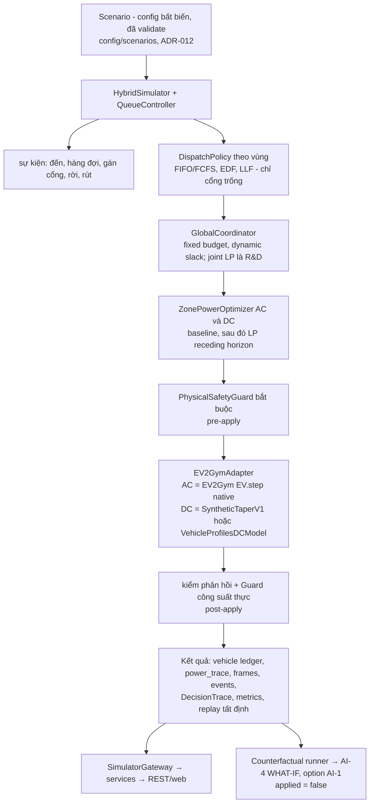

- DC là extension tự viết, **không** phải EV2Gym native. Đường sạc VF3 synthetic, VF8 proxy EVKX, VF9 / UNKNOWN
  generic Simolin 2025 — không curve nào là đo OEM.
- Setpoint ≠ công suất thực nhận; η chuyển đổi 0,95 và η sạc 0,98 chỉ tính một lần.
- Guard tách hai lớp: vật lý (lưới, tủ, cổng, xe) và chính sách (ngân sách vùng, quyền, phê duyệt). Đếm riêng
  `rejected_allocation_count` và `applied_constraint_violation_count`.

## Đích B — Dataflow ứng dụng (master context §10.2 · ADR-013, ADR-014)

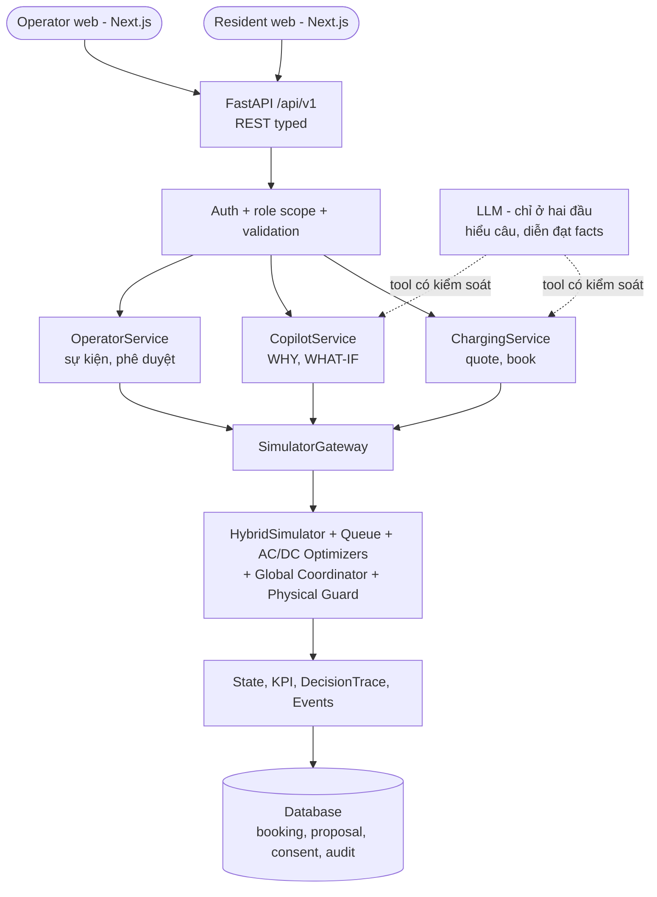

- **Workflow xác định là xương sống** ([ADR-013](adr/ADR-013-workflow-xac-dinh-llm-hai-dau.md)): LLM không nằm trên
  đường cấp công suất, không tạo lệnh, không tắt Guard, không tự duyệt SLA. LangGraph giữ cho hội thoại + HITL.
- **AI-4 WHY** đọc `DecisionTrace`; **WHAT-IF** chạy sandbox cách ly, luôn `applied=false`; **AI-1** chỉ đưa option đã
  mô phỏng và qua Guard, chờ duyệt, re-verify trước khi ghi `vehicle_revisions`
  ([ADR-014](adr/ADR-014-decision-trace-counterfactual-hitl.md)).
- "Live" trên web là **live simulation state**, không phải số liệu trụ sạc thật.
- Bảng `proposals`, `consents`, `vehicle_revisions`, `audit_log` chưa có migration (xem
  [`docs/plan/40-database.md`](plan/40-database.md) §0).

## 0. Nguyên tắc 3 trụ

> **AI hiểu yêu cầu và hỗ trợ điều phối — Bộ tối ưu tính phương án — Bộ kiểm tra an toàn
> kiểm soát thực thi.** (Brief §4)

| Trụ | Package | Được làm | KHÔNG được làm |
|---|---|---|---|
| 1. AI hiểu yêu cầu (F1) | `src/llm_chat/` (chat cư dân; `src/agents/` dành cho AI-1 / AI-4) | trích `ChargeRequest`, hỏi lại chỗ thiếu, giải thích lịch | tự tính kWh, tự quyết công suất, gửi lệnh trạm (FR5) |
| 2. Bộ tối ưu (F2/F3) | `src/optimizer/` | tính `SchedulePlan` từ `PlanningContext` | đọc file/DB/API, gọi LLM, gửi lệnh trạm |
| 3. Bộ kiểm tra (F4) | `src/guard/` | kiểm 7 luật FR12, phê duyệt, khẩn cấp, **là cửa duy nhất tới trạm** | phụ thuộc LLM (phải chạy được khi LLM sập) |

Các ranh giới trên được khoá bằng `tests/test_architecture.py`: import sai tầng thì CI đỏ.

## 1. Bối cảnh hệ thống

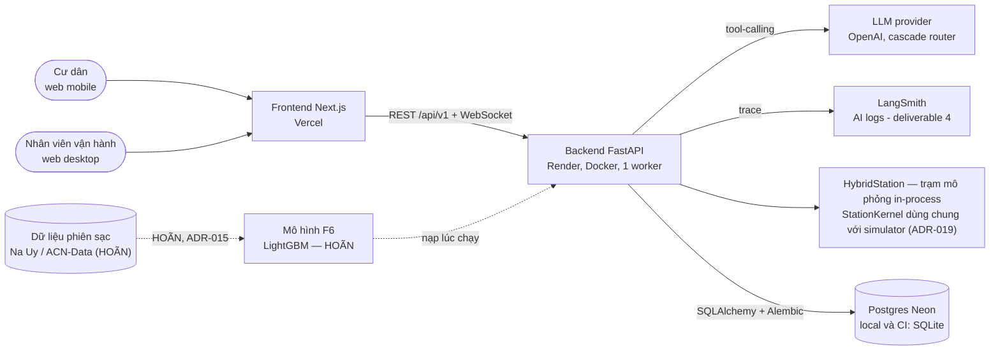

(cũ, thay bởi ADR-011 / ADR-015 / ADR-018 / ADR-019) Không còn phương án ACN-Sim. Backend dùng `HybridStation` trên
kernel chung với `HybridSimulator` (EV2Gym-first); `LiveStation` đã xoá. Nhánh dữ liệu phiên sạc → LightGBM F6 **HOÃN** khỏi sprint 20–26/11.

Ngoài phạm vi (Brief §7): OCPP/cột sạc thật, thanh toán thật, app di động riêng, nhiều
bãi sạc, SCADA/EVN, digital twin 3D, RL quy mô lớn.

## 2. Thành phần backend

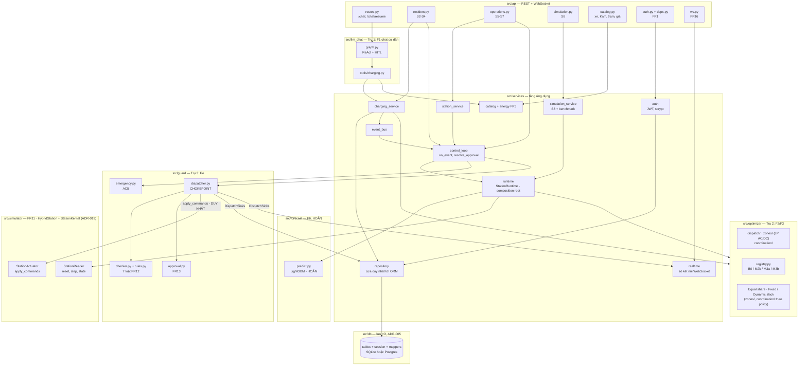

Mũi tên nghĩa là "được phép gọi". Ba điều sơ đồ này khoá lại:

- Không có mũi tên nào từ `llm_chat` (và `agents`, AI-1 / AI-4) tới `optimizer`, `guard`, `simulator` hay `db`: chỉ đi
  qua `services` (FR5, ADR-019).
- Không có mũi tên nào từ `api` tới `guard`, `optimizer`, `simulator` hay `db`: router chỉ gọi `services`; quyết định
  phê duyệt đi qua `control_loop.resolve_approval` (ADR-007).
- `dispatcher` không tự biết ghi nhật ký vào đâu: nó nhận `DispatchSinks`. Chế độ chạy thật (`runtime.get_runtime`)
  trỏ sinks tới `repository` + `realtime`; benchmark (`runtime.build_sim_runtime`) trỏ sinks vào bộ nhớ.

## 3. Agent F1 — LangGraph ReAct + HITL

> (sửa một phần bởi ADR-013) Graph dưới đây là code hiện có. Hướng đích: workflow xác định là xương sống, LLM chỉ ở
> hai đầu (intake / intent / patch có schema và diễn đạt kết quả); LangGraph giữ cho hội thoại + HITL interrupt.

Giữ harness ReAct của template (ADR-001). ChargePilot thêm tool sạc, bộ nhớ theo phiên chat và đánh dấu
`confirm_booking` là tool rủi ro: `interrupt()` của graph chính là bước cư dân bấm
"Xác nhận" ở màn S3 (FR2).

State (`src/llm_chat/state.py:AgentState`) ngoài các field của vòng ReAct còn có: `turn_context` (server đặt mỗi lượt:
`now`, `timezone`, `vehicle_model`, `display_name`), `history` (giữ 20 tin gần nhất), `draft_request` (các trường
`ChargeRequest` đã thu được — thiếu thì hỏi lại, không đoán), `proposal` (`ScheduleProposal` gần nhất, payload của S3).
`resident_id` **không** nằm trong state: nó đi trong `config["configurable"]` (ADR-006), LLM không đọc / ghi được.
Prompt của `reason` và `finalize` nằm ở `prompts/reason.md`, `prompts/finalize.md`.

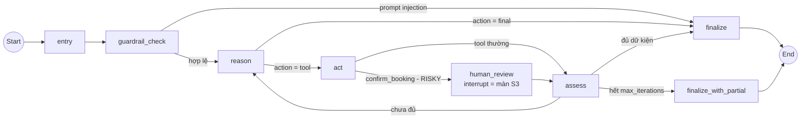

| Tool | Gọi tới | Trạng thái |
|---|---|---|
| `lookup_vehicle` | `services.catalog` | chạy thật |
| `estimate_charging_energy` | `services.energy` (FR3) | chạy thật |
| `propose_charging_plan(request)` | `charging_service.quote` — what-if, chưa giữ chỗ; kết quả lưu vào `state.proposal` | tool chạy thật, service stub T2.2 |
| `confirm_booking(request)` — RISKY | `charging_service.book` sau khi cư dân xác nhận; idempotency key `chat:<thread>` | tool chạy thật, service stub T2.2 |
| `get_queue_status` | `charging_service.queue_status` (US2) | tool chạy thật, service stub T2.2 |
| `explain_schedule` | `charging_service.explain` (US3) | tool chạy thật, service stub T2.5 |

Bốn tool dưới lấy `resident_id` bằng `_current_resident_id(config)`; thiếu danh tính phía server thì tool báo lỗi rõ
ràng thay vì nhận giá trị do LLM điền. Tool demo của template (`knowledge.py`, `mcp_tool.py`, `send_email`) còn trong
registry tới T2.5.

Hai cơ chế HITL khác nhau, không nhầm lẫn:

1. **Xác nhận đặt lịch (S3)**: interrupt của LangGraph, đi qua `/chat/resume`.
2. **Phê duyệt lệnh điều khiển (S4, S7)**: `guard/approval.py`, đi qua `/resident/approvals/{id}` và `/operator/approvals/{id}`.

## 4. Luồng AC1 — đặt lịch qua chat

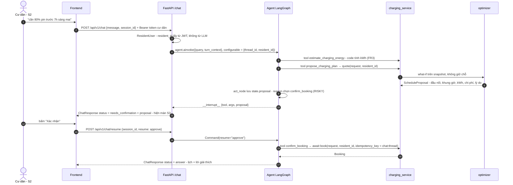

Không khả thi thì `ScheduleProposal` bắt buộc có ít nhất 1 `Alternative` (FR4, validator
ở `src/models/charging.py`). Nhà cung cấp LLM lỗi thì `/chat` trả 503 `llm_unavailable` và web chuyển sang form
`/resident/book`: `POST /energy/estimate` → `POST /resident/quote` → `POST /resident/bookings` (header
`Idempotency-Key`). Form đi cùng `charging_service` với Agent (NFR khả dụng). Bấm "Xác nhận" hai lần chỉ tạo một
booking; mỗi cư dân tối đa một booking đang hiệu lực (ràng buộc ở DB, lần thứ hai trả 409).

## 5. Luồng AC2 — đến trực tiếp khi hết đầu nối

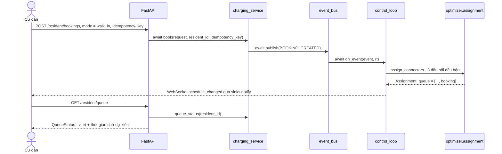

Với chiến lược C, `departure_forecast` (F6) giúp ước lượng khi nào đầu nối được giải
phóng, nên thời gian chờ dự kiến chính xác hơn. Forecast không bao giờ nới deadline (FR9).
(cũ, thay bởi ADR-015) F6 HOÃN; ước lượng chờ dùng giờ rời khai báo. "8 đầu nối" ở trên là bản cũ — số cổng lấy từ
config / API (fixture nền 4 cổng, ADR-010), hàng đợi tách theo vùng AC / DC.

## 6. Luồng FR8 — vòng điều khiển theo sự kiện

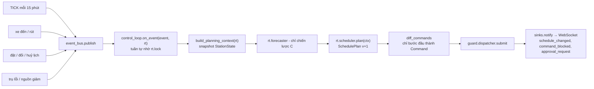

Sự kiện được xử lý **ngay trong request** đã gây ra nó (ADR-007); vòng nền `control_loop.run_forever` (TICK, bước
simulator, hết hạn phê duyệt) tắt mặc định (`CONTROL_LOOP_ENABLED=false`) cho tới khi hết stub.

Benchmark (`simulation_service`) chạy cùng `on_event` này với `StationRuntime` khác — `build_sim_runtime(scenario,
strategy)`: đồng hồ mô phỏng, sinks vào bộ nhớ — nên con số offline phản ánh đúng code production (MT4, MT5).

## 7. Luồng AC4 — điều chỉnh cần cư dân phê duyệt

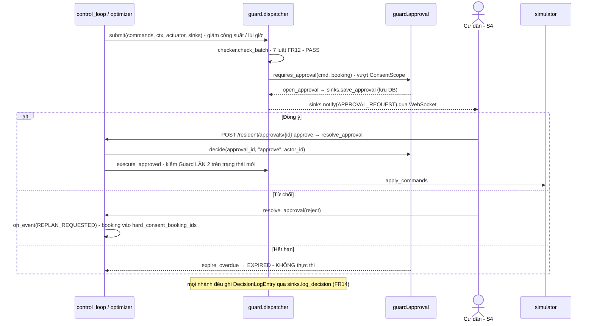

Router không gọi thẳng `src.guard`: `POST /resident/approvals/{id}` và `POST /operator/approvals/{id}` đều đi qua
`control_loop.resolve_approval`. Chỉ người được hỏi mới quyết định được; quyết định hai lần trả 409.

Wireframe S4 có dòng "Tự áp dụng sau 04:12", mâu thuẫn với AC4. Code theo PRD: hết hạn
thì không thực thi (xem `PROJECT_CONTEXT.md` §0.2).

## 8. Luồng AC5 — bảo vệ khẩn cấp khi nguồn giảm

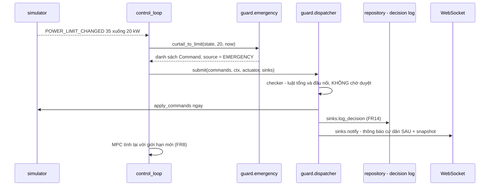

`emergency.py` không import Agent hay optimizer. Bảo vệ vẫn chạy khi LLM hoặc solver gặp sự cố.
(cũ) Số "35 xuống 20 kW" là của bãi 8 × 7 kW. Kịch bản demo mới: lưới 106 → 50 kW (hoặc mức tạo xung đột đã kiểm)
— **[GIẢ ĐỊNH]**, không phải sự cố có thật (master context §3.4).

## 9. Mô hình dữ liệu

### 9.1 Hợp đồng dữ liệu (Pydantic, `src/models/`)

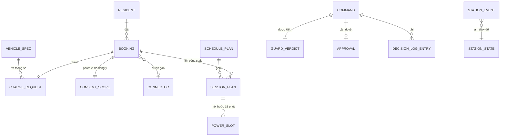

Định nghĩa đầy đủ là Pydantic ở `src/models/`: `charging.py`, `control.py`, `station.py`,
`events.py`, `simulation.py`, `identity.py`, `api.py`. Mọi thời gian đều là `AwareDatetime` (bắt buộc có
múi giờ), vì dữ liệu Na Uy, ACN và Việt Nam khác múi giờ.

### 9.2 Bảng lưu trữ (SQLAlchemy, `src/db/tables.py` — ADR-005)

Mỗi bảng = vài **cột khoá** để lọc / sắp xếp / ràng buộc + cột `payload` (JSON) là `model_dump` của model Pydantic
tương ứng. `src/models/` không biết gì về ORM; chuyển đổi nằm ở `src/db/mappers.py`.

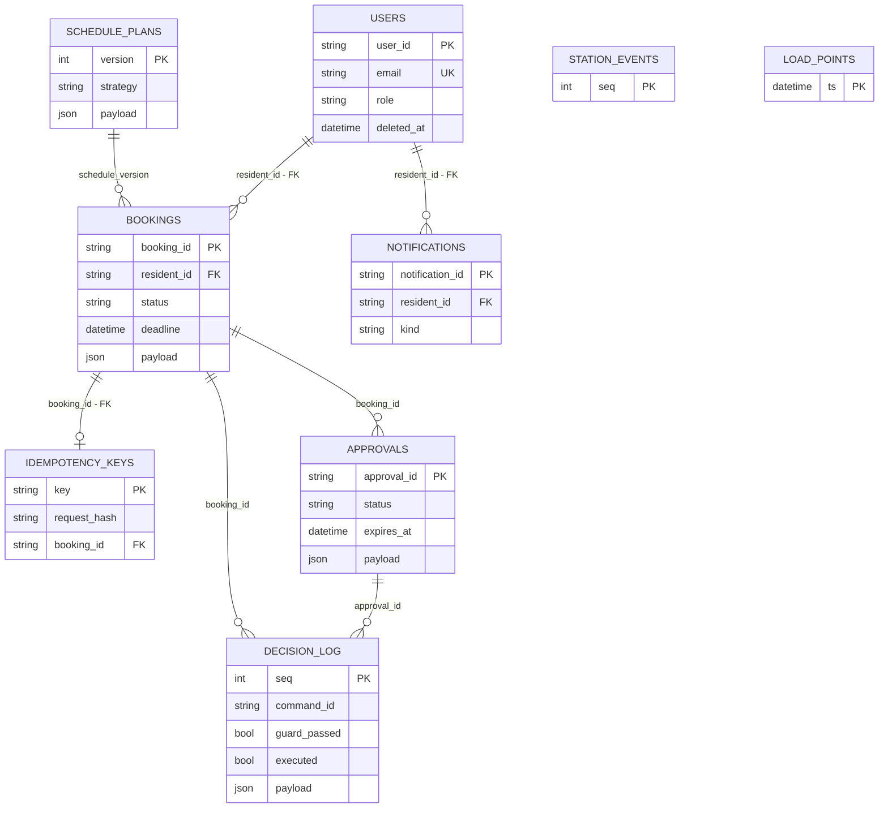

- Quan hệ ghi "FK" là khoá ngoại thật; các quan hệ còn lại là tham chiếu logic qua cột khoá.
- `decision_log` **chỉ thêm** (FR14): repository không có hàm sửa hay xoá (có test kiểm).
- Mỗi cư dân tối đa một booking đang hiệu lực — ràng buộc ở mức DB (unique index có điều kiện).
- `station_events` và `load_points` là chuỗi thời gian độc lập, không có khoá ngoại.
- Chi tiết cột, index, chính sách migration: [`docs/plan/40-database.md`](plan/40-database.md) §3, §7.

## 10. Triển khai

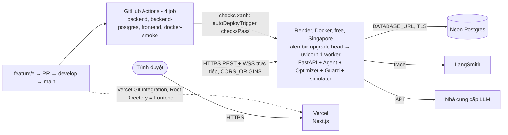

| Môi trường | Nhánh | Backend | Web | DB |
|---|---|---|---|---|
| Local | bất kỳ | `make migrate` + `make run` | `npm run dev` | SQLite `data/app.db` |
| Test | `develop` | Render `p019-backend-test` (`render.test.yaml`) | Vercel preview | Neon, nhánh / database riêng |
| Production | `main` | Render `p019-backend` (`render.yaml`) | Vercel production | Neon chính |

- Trình duyệt gọi **thẳng** backend (REST + WebSocket), không đi qua Vercel.
- Render free: instance ngủ khi không có request → web gọi `/health` để đánh thức và hiện banner. Ổ đĩa tạm: chưa
  đặt `DATABASE_URL` thì backend dùng SQLite và **mất dữ liệu sau mỗi lần restart** — bản deploy phải trỏ Neon.
- Image chỉ cài `requirements-runtime.txt`; container chạy migration trước khi mở cổng, đúng một worker (ADR-005, ADR-007).
- CI (`.github/workflows/ci.yml`) có 4 job: `backend` (ruff, format, pytest, docs, OpenAPI snapshot, eval offline),
  `backend-postgres` (migration lên / kiểm lệch / xuống / lên trên Postgres 16 + test repository), `frontend`
  (type sinh từ OpenAPI không lệch, lint, typecheck, test, build), `docker-smoke` (build image, `/health` + `/ready`).
  Workflow chưa từng chạy trên GitHub (chưa push); nhánh `develop` chưa được tạo.
- Biến môi trường và checklist trước demo: [`docs/plan/50-devops.md`](plan/50-devops.md) §6, §9.

## 11. Bảng thành phần

| Thành phần | Công nghệ | Owner | Mục đích |
|---|---|---|---|
| Frontend | Next.js 16 (App Router), TypeScript, Tailwind 4, TanStack Query, `openapi-fetch`; biểu đồ thêm ở T3.6 | TV4 | 2 vai trò, 8 màn S1–S8 (F5) |
| API | FastAPI, Pydantic v2, PyJWT | TV3 | REST contract-first + WebSocket, envelope lỗi |
| Agent | LangGraph 1.x, LangChain | TV3 | F1 tiếp nhận yêu cầu |
| Optimizer | LP liên tục + receding horizon (không phải MILP); SciPy `linprog` / HiGHS là hướng R&D. (cũ: "LP/MILP — HiGHS hoặc OR-Tools") | TV1 | Dispatch + AC/DC optimizer + Global Coordinator (MVP-2/3) |
| Forecast | LightGBM — **HOÃN** (ADR-015) | TV2 | F6 dự báo lúc rút đầu nối |
| Guard | Python thuần, xác định; hai lớp vật lý + chính sách (ADR-011) | TV3 | F4 kiểm lệnh, phê duyệt, khẩn cấp |
| Simulator | Một `HybridSimulator` EV2Gym 2.0.0 (AC native, DC extension) — v1.2 ở `feature/simulator`, chưa merge. (cũ: "EV2Gym / ACN-Sim") | TV3 + TV1 | FR11 trạm giả lập |
| Copilot | `DecisionTrace` + counterfactual + Proposal/HITL (ADR-014) — chưa có code | TV3 | AI-4 WHY / WHAT-IF, AI-1 |
| Storage | SQLAlchemy 2 + Alembic; SQLite (local, CI), Postgres Neon (deploy) | TV3 | người dùng, booking, lịch, phê duyệt, nhật ký, thông báo |
| Observability | LangSmith + decision log + `X-Request-ID` | TV3 | trace Agent, FR14 |
