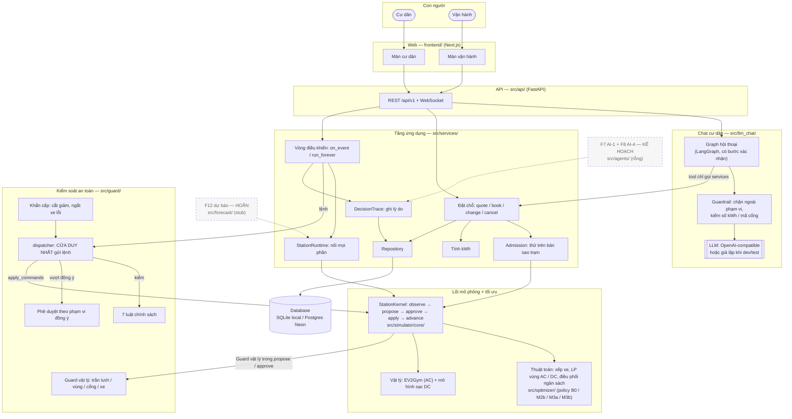
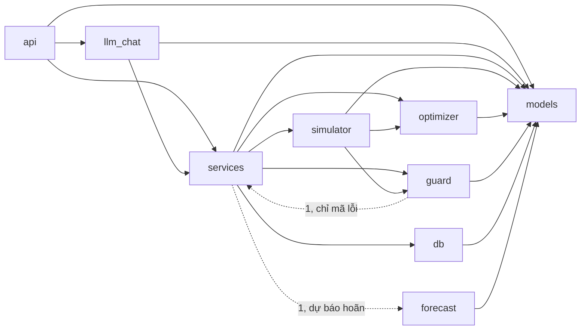
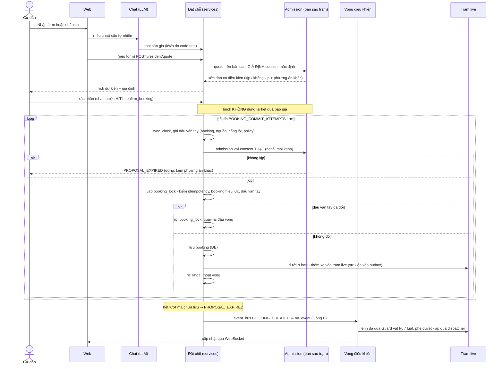
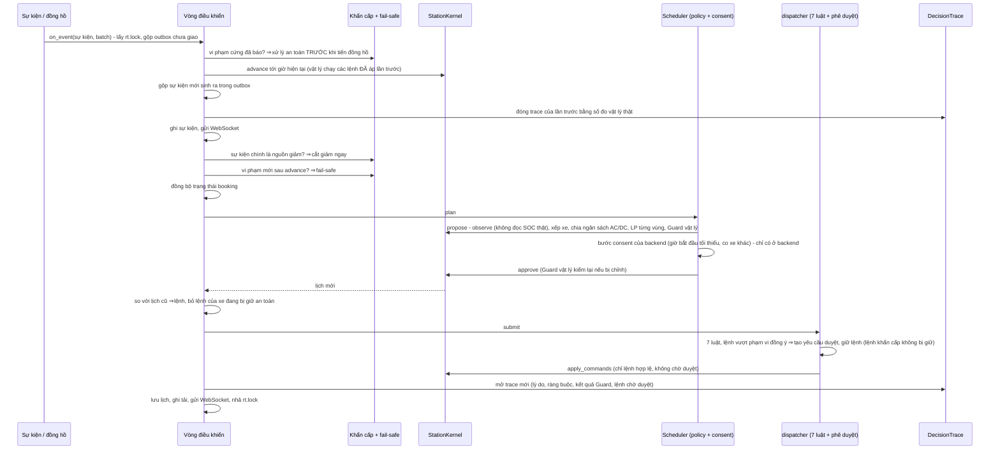

# Hiểu hệ thống ChargePilot — bốn tầng

> Deliverable #3 (sơ đồ kiến trúc). Viết lại ngày 2026-11-24 theo **code thực tế** tại commit `ce23136`; bản cũ (mô tả
> `LiveStation`, kiến trúc "đích" ADR-011) xem `git log -- docs/architecture_diagram.md`. Khi tài liệu mâu thuẫn
> code: code đúng.
>
> **Cách đọc:** mỗi tầng đọc riêng được.
> - Tầng 1 — Nghiệp vụ: hệ thống làm gì, vì sao, nếu sai thì sao. Không cần biết code.
> - Tầng 2 — Kiến trúc: các khối, ai gọi ai, dữ liệu đi đâu, AI và an toàn nằm ở đâu.
> - Tầng 3 — Nguyên lý: mỗi chức năng chạy theo nguyên lý nào, chọn thuật toán gì, vì sao.
> - Tầng 4 — Kiểm chứng: bằng chứng nằm ở [`docs/FEATURE_REGISTRY.md`](FEATURE_REGISTRY.md); mục 4 ở đây chỉ nói
>   "làm sao biết nó đúng".
>
> Mã chức năng theo PRD v0.4 (F1–F15). Mã cũ trong code (F6 / F7 / F8 cũ) tra ở registry §1.1.
> Trong sơ đồ: khối **nét liền** = đã có code; khối **nét đứt, chữ "KẾ HOẠCH"** = chưa có code.

---

## Tầng 1 — Nghiệp vụ

### 1.1 Bài toán

Một bãi xe chung cư (mô phỏng) có 4 cổng sạc: 2 cổng AC chậm (11 kW mỗi cổng) và 2 cổng DC nhanh (60 kW mỗi cổng),
nhưng đường điện cả khu chỉ cho **106 kW**. Nếu cả 4 cổng chạy hết công suất thì cần 142 kW, vượt giới hạn. Mỗi cư dân
muốn xe đủ pin trước giờ đi; giá điện thay đổi theo giờ; nguồn điện có thể bị giảm đột ngột hoặc một tủ sạc có thể hỏng.

ChargePilot quyết định **xe nào cắm cổng nào, mỗi xe được bao nhiêu kW trong từng phút** để: không bao giờ vượt giới
hạn điện (an toàn), càng nhiều xe đủ pin đúng hạn càng tốt, chờ ít, tốn ít tiền điện. Mọi thứ chạy trên **mô phỏng**,
không điều khiển trạm thật. Thông số trạm là giả định của nhóm (ADR-010), chưa phải thông số VinFast / Vinhomes.

### 1.2 Ví dụ một buổi tối

1. 18:00, chị A nhắn: "xe VF8 còn 20%, cần 80% trước 7 giờ sáng". Hệ thống hiểu câu này thành phiếu yêu cầu, tính
   ra số kWh cần nạp (code tính, không để AI đoán), báo lịch dự kiến và hỏi chị A xác nhận.
2. Chị A xác nhận. Hệ thống xếp xe vào cổng AC, dời phần lớn việc sạc sang giờ điện rẻ sau 22:00 vì vẫn kịp hạn.
3. 20:30 nguồn điện bị giảm. Hệ thống **lập tức** giảm công suất các cổng về mức an toàn, không chờ ai duyệt, rồi tính
   lại lịch cho mọi xe.
4. Lịch mới làm xe chị A bắt đầu muộn hơn mức chị đã đồng ý trước. Hệ thống không tự áp, mà tạo yêu cầu phê duyệt.
5. Chị A hỏi "sao xe em chưa sạc?". Hệ thống trả lời từ nhật ký quyết định, không để AI bịa lý do.

### 1.3 Các chức năng quan trọng

| Chức năng | Làm gì | Vì sao cần | Nếu làm sai | Nếu bỏ đi | Hiện trạng |
|---|---|---|---|---|---|
| **F1** Tiếp nhận yêu cầu | Biến form / câu chat thành phiếu (xe, % pin, giờ đi), tính kWh | Đầu vào của mọi quyết định | Sai giờ đi / sai kWh ⇒ xe thiếu pin | Không có đầu vào | Có; chat mới thử với AI giả lập |
| **F2** Xếp xe + chia công suất | Chọn xe vào cổng, chia kW từng phút cho từng xe và hai vùng AC / DC | Lõi giá trị: đúng hạn, ít chờ, rẻ | Xe trễ hạn, tốn tiền | Hệ thống chỉ còn chia đều | Có, đã test |
| **F3** Phản ứng sự cố | Khi giới hạn điện đổi / tủ hỏng: tính lại ngay | Điện thật luôn biến động | Lịch cũ vượt giới hạn mới | Không chịu được sự cố | Có, đã test |
| **F4** Kiểm soát an toàn + duyệt | Trên backend, mọi lệnh tới trạm qua **một cổng kiểm tra duy nhất** (simulator R&D chạy độc lập chỉ có Guard vật lý); lệnh vượt phạm vi đồng ý thì chờ người duyệt | Chặn lệnh sai trước khi gây hại; giữ quyền của cư dân | Quá tải, cấp điện sai xe | Không có lưới an toàn | Có, đã test; luồng duyệt đề nghị AI-1 chưa có |
| **F5** Web | Màn cư dân và màn vận hành | Cách con người dùng hệ thống | Hiển thị sai trạng thái | Không demo được | Một phần; nhánh giao diện chưa gộp |
| **F6** Nhật ký lý do + thử giả định | Ghi lại vì sao mỗi quyết định được đưa ra; chạy thử "nếu…" trên bản sao | Nền cho AI giải thích, không bịa | AI giải thích sai | Không có AI-4 / AI-1 | Ghi lý do: có. Thử giả định: chỉ dùng nội bộ |
| **F7** AI-1 thương lượng | Phát hiện xe sắp trễ, đề xuất đổi lịch, xin chủ xe đồng ý | Giữ được nhiều cam kết hơn | Đề xuất làm xe khác trễ | Mất một trong hai tính năng AI chính | **Chưa có code** |
| **F8** AI-4 trợ lý giải thích | Trả lời "vì sao" / "nếu… thì sao" từ nhật ký lý do | Người dùng tin và hiểu hệ thống | Giải thích sai sự thật | Mất tính năng AI trục chính | **Chưa có code** (chỉ có giải thích đơn giản) |
| **F9** Benchmark | So sánh các chính sách trên 5 kịch bản (2 đúng bãi hiện tại, 3 kịch bản cũ) | Chứng minh tối ưu tốt hơn cách đơn giản | Kết luận sai về giá trị | Không có bằng chứng giá trị | Có baseline đóng băng, **chỉ dùng làm regression**: bỏ sót sự cố hỏng cổng, tải vượt năng lực (registry §3.1) |

AI dùng ở đâu (nghĩa hẹp, PRD §1.1): **LLM** chỉ ở hai đầu — hiểu câu của người (F1) và diễn đạt kết quả đã tính (F8,
chưa có). **Quyết định công suất không dùng LLM**: đó là thuật toán tối ưu xác định (F2), luôn qua kiểm soát an toàn (F4).

---

## Tầng 2 — Kiến trúc và phụ thuộc

### 2.1 Bản đồ hiện trạng

### 2.2 Trách nhiệm từng khối

| Khối | Trách nhiệm | Nhận từ | Trả cho |
|---|---|---|---|
| Web | Hiển thị, gửi yêu cầu | Người dùng | API |
| API | Xác thực JWT, định tuyến, chuẩn hoá lỗi; **không chứa logic nghiệp vụ** | Web | Services, chat graph |
| Chat cư dân | Hiểu câu tiếng Việt → gọi tool; hỏi lại khi thiếu; xin xác nhận trước khi đặt chỗ | API `/chat` | Services (qua tool) |
| Services | Nghiệp vụ: đặt chỗ, tính kWh, vòng điều khiển, ghi nhật ký | API, chat | Lõi, Guard, Repository |
| Admission | Thử yêu cầu mới trên **bản sao** trạm để báo "có kịp không" trước khi nhận | Đặt chỗ | Đặt chỗ (ước tính có điều kiện) |
| StationKernel | Một vòng quyết định chung cho backend và simulator độc lập | Runtime | Thuật toán, vật lý, Guard |
| Thuật toán (optimizer) | Tính lịch công suất; **không biết** DB, API, LLM | Kernel (trạng thái quan sát) | Kernel (đề xuất) |
| Guard | Kiểm mọi lệnh; chỉ `dispatcher` gửi lệnh tới trạm | Kernel, vòng điều khiển | Trạm mô phỏng, nhật ký |
| Repository / DB | Lưu người dùng, booking, lịch, phê duyệt, nhật ký, trace | Services | Services |

### 2.3 Phụ thuộc thực tế

Đếm import giữa các package trong `src/` ngày 24/11 (số = số câu import). Ranh giới được khoá bằng
`tests/test_architecture.py`.

Điểm cần biết khi quản lý:
- **`src/models/`** là hợp đồng dữ liệu dùng chung; mọi khối phụ thuộc vào nó. Đổi ở đây ảnh hưởng toàn hệ thống.
- **`src/services/`** là nơi nối mọi thứ (~4.200 dòng). Thay đổi ở đây có phạm vi ảnh hưởng rộng nhất.
- Simulator dùng thuật toán và Guard vật lý **trực tiếp** để chạy độc lập không cần backend (ADR-019). Tài liệu cũ nói
  điều ngược lại; code và test kiến trúc mới là đúng.
- Chat **không** được gọi thẳng lõi / Guard / DB; chỉ qua services (test kiến trúc khoá).

### 2.4 Điểm dùng AI, điểm an toàn, xử lý lỗi

| Loại | Ở đâu | Bản chất |
|---|---|---|
| AI — LLM đầu vào | Chat cư dân (F1) | Hiểu câu → tool; không quyết định công suất |
| AI — LLM đầu ra | F8 (KẾ HOẠCH) | Diễn đạt lý do có sẵn trong trace |
| AI — tối ưu | Thuật toán F2 | LP xác định, không học máy |
| An toàn 1 | Guard vật lý | Không vượt trần lưới 106 kW, trần vùng AC 22 / DC 120 kW, trần cổng / xe; không cấp điện cổng trống / xe đầy |
| An toàn 2 | 7 luật chính sách | Tổng công suất, công suất cổng, chống bật tắt liên tục, trạng thái cũ, quyền, phiên bản lịch, lệnh mâu thuẫn |
| An toàn 3 | Một cửa gửi lệnh | Trên backend (live, bản sao báo giá, `/simulation/run`), chỉ `src/guard/dispatcher.py` gọi `apply_commands` (test kiến trúc khoá import; không bắt alias động). Simulator R&D độc lập áp thẳng qua kernel với Guard vật lý, không có 7 luật / phê duyệt |
| An toàn 4 | Fail-safe sau khi áp | Nếu vẫn vi phạm: dừng ở phút đó, co công suất về trần hoặc ngắt xe lỗi, giữ an toàn, báo vận hành |
| An toàn 5 | Guardrail chat | Chặn ngoài phạm vi / prompt injection; câu trả lời có số kWh / mã cổng không khớp kết quả tool thì bị chặn |
| Quyền | JWT, `resident_id` lấy phía server | AI không đọc / ghi được danh tính |
| Lỗi thuật toán | Kernel | Không giải được LP ⇒ ghi trạng thái solver vào trace; lệnh vẫn qua Guard |
| Lỗi API | Envelope `{detail, code, request_id}` | Lỗi có mã, truy được request |
| Đặt chỗ đồng thời | Khoá trong RAM + "dấu vân tay" trạng thái | Trạng thái đổi giữa chừng ⇒ tính lại hoặc báo hết hạn. **Chỉ đúng với 1 worker** |

### 2.5 Ba luồng nghiệp vụ chính

**Luồng A — Cư dân đặt lịch sạc (form hoặc chat)**

Theo `src/services/charging_service.py` (`quote:221–232`, `book:235–305`). Sửa lần 2 ngày 25/11 (review N3): vẽ rõ vòng
thử lại — mỗi lượt chạy admission **ngoài** khoá, chỉ commit khi "dấu vân tay" không đổi.

Báo giá và booking là **ước tính có điều kiện** (không phải SLA): chỉ đúng trong một worker, không biết xe chưa đặt hay
sự cố tương lai.

**Luồng B — Một lần tính lại (`control_loop.on_event`)**

Thứ tự lời gọi trong **một** lần `on_event` (`src/services/control_loop.py:66–137`), chạy tuần tự dưới `rt.lock`.
**Phạm vi gộp** (sửa lần 2, review N3): một lần `on_event` chỉ gộp các sự kiện được truyền cùng lời gọi (`batch`) và các
sự kiện còn trong outbox lúc nó lấy khoá. **Không** bảo đảm mọi sự kiện cùng thời điểm chỉ sinh một lần tính lại:
- `event_bus.publish` (request đặt / đổi / huỷ, bơm sự cố, TICK) gọi `on_event` cho **từng** sự kiện;
- `on_minute` (`control_loop.py:146–160`; dùng bởi `run_forever`, `deliver_pending`, benchmark, admission) gọi `on_event`
  **riêng** cho mỗi `POWER_LIMIT_CHANGED`, rồi **một** lần cho mọi sự kiện còn lại.

Vật lý của lệnh vừa áp chỉ chạy ở lần `advance` **kế tiếp**; trace mở ở cuối lần này và được đóng ở đầu lần sau.

**Luồng C — Sự cố: nguồn giảm, cổng hỏng, vi phạm sau khi áp**

Sửa lần 2 (review N3) theo `simulation_service.inject_incident:375–389`, `hybrid_station.inject_incident:373–409`,
`kernel.fault_port:503–515`, `control_loop.on_event:66–137`. Điểm quan trọng: **trạng thái trạm đổi trước** (giới hạn nguồn
mới, hoặc cổng bị đánh dấu hỏng và xe đã bị rút về đầu hàng chờ), **sau đó** sự kiện mới được phát; vòng điều khiển phản
ứng sau khi nhận sự kiện. Chỉ nguồn giảm đi đường cắt giảm khẩn cấp; vi phạm cứng sau khi áp đi đường fail-safe.

```mermaid
sequenceDiagram
    participant E as Vận hành / kịch bản
    participant S as simulation_service
    participant K as Trạm (HybridStation + kernel)
    participant L as Vòng điều khiển
    participant EM as Khẩn cấp / fail-safe
    participant D as dispatcher
    participant O as Vận hành (WebSocket)
    E->>S: POST /simulation/incident
    S->>K: dưới rt.lock - sync_clock rồi inject_incident
    alt nguồn giảm
        K->>K: đặt giới hạn nguồn mới, tăng state_version
    else cổng hỏng
        K->>K: fault_port - đánh dấu hỏng, rút xe trên cổng, đưa xe về ĐẦU hàng chờ, tăng state_version
    else cổng phục hồi
        K->>K: restore_port
    end
    K-->>S: trả sự kiện (trạng thái ĐÃ đổi)
    S->>S: nhả rt.lock
    S->>L: event_bus.publish ⇒ on_event (luồng B)
    alt POWER_LIMIT_CHANGED
        L->>EM: sau advance - curtail_to_limit, độc lập optimizer
        EM->>D: lệnh EMERGENCY (không chờ duyệt)
        D->>K: áp ngay
    else CONNECTOR_FAULT / RESTORED
        L->>L: không có bước cắt giảm khẩn cấp
    end
    L->>K: tính lại lịch cho mọi xe, áp qua dispatcher
    Note over K,L: lần advance sau phát hiện vi phạm cứng ⇒ trạm dừng ở phút vi phạm, HARD_LIMIT_VIOLATED vào outbox
    K-->>L: HARD_LIMIT_VIOLATED (on_event kế tiếp, xử lý trước hoặc ngay sau advance)
    alt vi phạm tổng công suất (tủ / vùng / lưới)
        L->>EM: co đều về mọi trần
    else vi phạm của một xe (mô hình sạc / nhận điện)
        L->>EM: ngắt cổng xe lỗi, giữ an toàn booking đó
    end
    EM->>D: lệnh an toàn
    L->>O: sự kiện hard_limit_violated (+ loại vi phạm), log lỗi
```

Giữa lúc trạm đổi trạng thái (nhả `rt.lock`) và lúc `on_event` lấy lại khoá, setpoint cũ vẫn còn trên trạm. Tài liệu
**không** kết luận đây là lỗi: nếu vật lý tiến trong khoảng đó, kernel ghi vi phạm và fail-safe xử lý; chưa có test cho
khoảng này (liên quan audit U1, task R-6).

---

## Tầng 3 — Nguyên lý kỹ thuật

| Chức năng | Nguyên lý | Công nghệ / thuật toán | Vì sao chọn | Giới hạn đã biết |
|---|---|---|---|---|
| F1 | LLM chỉ điền trường phiếu theo schema; thiếu thì hỏi lại; kWh = dung lượng × (mục tiêu − hiện tại) / hiệu suất | LangGraph ReAct + bước xác nhận (HITL); Pydantic validate | Template AI20K có sẵn harness HITL + eval offline (ADR-001) | Chưa thử LLM thật; parser giờ của chế độ giả lập có lỗi đã biết |
| F2 xếp xe | Xe chờ được xếp theo độ gấp (LLF: ít thời gian dư nhất trước) | Luật xác định | Đơn giản, giải thích được | Không dự báo xe sắp đến |
| F2 chia công suất | Mỗi phút giải bài toán tối ưu tuyến tính cho cửa sổ phía trước, chỉ áp bước đầu (receding horizon) | LP liên tục, SciPy `linprog` (HiGHS) | Nhanh (p95 tính lại 1,5–16 ms trên 100 run, LỊCH SỬ @`a9def2f`), tối ưu chi phí có ràng buộc hạn; không cần MILP | Phụ thuộc giờ đi khai báo là đúng |
| F2 điều phối hai vùng | Chia 106 kW giữa AC và DC: chia cố định (`fixed_share`, M3a) hoặc theo độ gấp (`dynamic_slack`, M3b) | Luật xác định | So sánh được hai cách trong benchmark | Chọn mặc định là quyết định nghiệp vụ (D-2) |
| F2 policy | Một policy = bộ (xếp xe, LP AC, LP DC, điều phối). B0 = FCFS + chia đều; M2b = LLF + LP DC; M3a = LLF + LP AC/DC + chia cố định; M3b = như M3a + chia theo độ gấp | `src/optimizer/registry.py`, B0–M3b đóng băng | Tái lập được số liệu MVP-2/3 | Thêm policy mới phải đăng ký, không sửa bản đóng băng |
| F2 consent (chỉ backend) | Sau Planning Core, xe có hạn "bắt đầu chậm nhất" theo đồng ý của cư dân được nâng lên mức tối thiểu; xe khác bị co đều theo tủ → vùng → lưới; rồi Guard vật lý kiểm lại | `src/services/hybrid_planner.py` (`SimulatorScheduler.decide`) | Simulator độc lập không biết cư dân | Simulator R&D không có bước này ⇒ kết quả có thể khác backend khi consent có hiệu lực; chưa có differential test qua bước này. Vị trí đúng chờ Human quyết (registry D-6) |
| F3 | Sự kiện vào hàng đợi, mọi consumer tiến đồng hồ cùng một cách; không bỏ sự kiện | Vòng sự kiện async, một worker | Đảm bảo phản ứng sự cố không bị mất | Không chạy nhiều worker |
| F4 | Kiểm lệnh **sau** tối ưu, độc lập với AI: vật lý trước, chính sách sau, một cửa gửi | Python thuần, xác định; ngưỡng sai số 1e-7 | Chạy được cả khi LLM / optimizer lỗi (ADR-002, ADR-017) | Phê duyệt đề nghị AI-1 chưa có |
| F6 trace | Mỗi lần tính lại ghi một bản ghi có cấu trúc (policy, giới hạn, ràng buộc chặn, kết quả Guard), gắn `correlation_id` vào mọi lệnh | Bảng `decision_traces` + file JSONL | Lý do chỉ lấy từ dữ kiện, không do LLM tạo | Chưa có AI đọc trace |
| F6 sandbox | Thử trên bản sao trạm (fork); thành phần có trạng thái phải tự sao chép | `fork()` + kiểm cách ly | Thử "nếu…" không ảnh hưởng trạm thật | Mới dùng cho báo giá |
| Quan sát | Thuật toán chỉ thấy trạng thái quan sát (mặc định = hoàn hảo); vật lý và KPI dùng sự thật | `observation_model` của kernel | Tránh "gian lận" bằng dữ liệu tương lai / SOC thật | Chưa mô phỏng nhiễu cảm biến |

---

## Tầng 4 — Làm sao biết nó đúng

Chi tiết từng yêu cầu → test → bằng chứng: [`docs/FEATURE_REGISTRY.md`](FEATURE_REGISTRY.md) §3. Tóm tắt:

| Chức năng | Câu hỏi kiểm chứng | Bằng chứng hiện có | Chưa có |
|---|---|---|---|
| F1 | Câu chat có thành phiếu đúng? kWh có đúng công thức? | Test chat với AI giả lập; test kWh | Đo với LLM thật (MT9) |
| F2 | Có tốt hơn cách đơn giản (B0)? | Benchmark 100 run, LỊCH SỬ @`a9def2f` (regression; tải vượt năng lực, nên **chưa** trả lời được câu hỏi này); golden MVP-1/2/3 (LỊCH SỬ) | Bộ kịch bản "khả thi" cho MT1 (I-1); so policy cùng mức phục vụ |
| F3 | Sự cố có được phản ứng ngay, không mất sự kiện? | Test sự kiện, test fail-safe ĐẠT 24/11 | Chạy trên bản deploy |
| F4 | Lệnh sai có bị chặn? Có đường nào vòng qua Guard? | Test 7 luật + Guard vật lý + test kiến trúc ĐẠT 24/11; 0 vi phạm / 100 run (LỊCH SỬ, **cho tải đã chạy** — 40/160 sự cố hỏng cổng bị bỏ) | Benchmark sự cố hỏng cổng trên bãi hiện tại; review độc lập ADR-014 / 018 phần C |
| F6 | Trace có khớp quyết định thật? Sandbox có cách ly? | Test trace + test cách ly ĐẠT 24/11 | — |
| F7, F8 | — | — | Chưa có code |

---

## Phụ lục A — Dữ liệu lưu trữ

10 bảng (`src/db/tables.py`, migration `0001`–`0003`): `users`, `bookings`, `idempotency_keys`, `schedule_plans`,
`approvals`, `decision_log`, `notifications`, `station_events`, `load_points`, `decision_traces`. Mỗi bảng có vài cột
khoá + cột `payload` JSON (ADR-005). `decision_log` chỉ thêm, không sửa / xoá. Mỗi cư dân tối đa một booking hiệu lực
(ràng buộc DB). **Chưa có** các bảng cho AI-1 (`proposals`, `consents`, `vehicle_revisions`, `audit_log` — ADR-014).

## Phụ lục B — Triển khai

Web (Vercel) → backend (Render, Docker, một worker) → Postgres Neon. CI 6 job chạy trên runner tự host `team-19` (máy
ảo trên laptop — phải bật mới chạy). Lần CI gần nhất trên `develop` thất bại (22/11). Chi tiết và hiện trạng:
[`docs/plan/56-deploy-render-image.md`](plan/56-deploy-render-image.md) §0, [`docs/plan/50-devops.md`](plan/50-devops.md).
