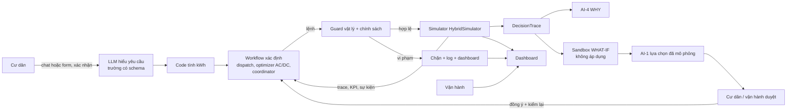

# ChargePilot — Tổng quan nghiệp vụ cần đạt

| Đề tài | Nhóm | Ngày lập | Cập nhật | Nguồn |
|---|---|---|---|---|
| SC-16 | T019 | 2026-11-20 | 2026-11-21 | PRD v0.4 [`docs/PRD.md`](PRD.md) (đang viết song song) · master context v1.0 của Hiếu, 20/11 (chưa đưa vào repo) · ADR-010…015 |

> Báo cáo này tóm tắt **những gì sản phẩm phải làm được về mặt nghiệp vụ**. Nó không mô tả cách cài đặt.
> Nguồn yêu cầu là **PRD v0.4** (đang viết) cùng master context 20/11. Khi báo cáo này mâu thuẫn với PRD v0.4, PRD
> đúng. Bản 20/11 của file này lấy PRD v0.2 làm "nguồn đã chốt" — **(cũ, thay bởi PRD v0.4 + ADR-010…015)**.
>
> Nhãn: **[MỤC TIÊU]** = yêu cầu đang hướng tới, chưa đạt · **[GIẢ ĐỊNH]** = điều kiện mô phỏng / synthetic ·
> **[HOÃN]** = không nằm trên đường găng sprint 20–26/11 · **[R&D — CHƯA XÁC MINH]** = số của nhánh thử nghiệm, đang
> chạy lại.
>
> ID tính năng F1–F8 và FR1–FR18 dưới đây là **ID của PRD v0.2**, giữ để truy vết. PRD v0.4 có thể đánh số lại; đối
> chiếu `docs/PRD.md` khi bản đó xong.

---

## 1. Tóm tắt

**Bài toán.** Một bãi sạc gần chung cư / khu đô thị có ít đầu nối, gồm cả **AC** và **DC**, và giới hạn nguồn điện.
Xe đến không đều, mỗi xe có mức pin và giờ rời khác nhau. Quy tắc đến trước phục vụ trước (FIFO/FCFS) hoặc chia đều
công suất giữ được an toàn nhưng không tối ưu đồng thời thời gian chờ, tỷ lệ đạt mục tiêu pin, giá điện theo giờ và
công bằng. Khi nguồn giảm hoặc đầu nối lỗi, cam kết đã nhận có thể trở nên bất khả thi. Người dùng khó hiểu vì sao bị
giảm công suất hoặc phải chờ; vận hành cần thử giải pháp trước khi đổi cấu hình.

Mức độ chứng minh pain point: hợp lý về cơ chế, phù hợp brief SC-16; **chưa có số liệu vận hành tại trạm cụ thể**.

**Giải pháp.** ChargePilot là web app hai vai trò (cư dân và vận hành), chạy trên **mô phỏng** (không điều khiển trụ
sạc thật). Lõi là một **workflow xác định**:

> **Điều phối hàng đợi → Tối ưu công suất AC / DC → Điều phối ngân sách toàn bãi → Bộ kiểm tra an toàn.**

AI có giá trị ở hai đầu: **hiểu ngôn ngữ người dùng** và **giải thích có bằng chứng, thử phản thực tế, hỗ trợ
thương lượng có sự đồng ý**. AI không tính công suất và không vượt bộ kiểm tra an toàn.

**Phải đạt ở Release Candidate 26/11/2026** (master context §12–13, đều **[MỤC TIÊU]**):

1. Cư dân khai báo yêu cầu sạc qua chat hoặc form, kiểm tra và xác nhận; backend tạo yêu cầu hợp lệ hoặc trả
   "không khả thi" kèm lý do.
2. Simulator chạy queue, gán cổng, tối ưu AC / DC, điều phối ngân sách, Guard; web cư dân và vận hành đọc cùng một
   trạng thái mô phỏng.
3. Vận hành bơm sự cố giảm nguồn; hệ thống tính lại và ghi lý do.
4. **AI-4 WHY**: trả lời vì sao xe / cổng / vùng bị giảm công suất, bám dữ liệu trace của đúng lần chạy.
5. **AI-4 WHAT-IF**: thử giả định trên bản cách ly, so sánh KPI trước / sau, **không áp dụng** vào lần chạy thật.
6. **AI-1**: phát hiện nguy cơ trễ, đưa 1–2 lựa chọn đã được simulator tính và Guard kiểm; cư dân đồng ý / từ chối;
   hệ thống kiểm lại rồi mới ghi thay đổi; có audit.
7. So sánh baseline vs optimized trên cùng input / seed; báo cả thắng, hoà, thua.

---

## 2. Bối cảnh và vấn đề

| Vấn đề | Biểu hiện | Hệ quả cho người dùng |
|---|---|---|
| Tranh chỗ sạc | Ít đầu nối, nhiều xe đến cùng lúc; xe sạc xong vẫn chiếm cổng | Cư dân phải chờ, không biết chờ bao lâu |
| Áp lực nguồn | Tổng nhu cầu AC + DC có thể vượt nguồn cấp cho bãi | Vận hành không thấy tải tổng, phải cắt tay |
| Chi phí điện | Sạc vào giờ giá cao (biểu giá TOU **[GIẢ ĐỊNH]**) | Chi phí vận hành tăng |
| Biến động | Xe đến trực tiếp, đổi yêu cầu, tủ lỗi, nguồn giảm | Lịch cố định nhanh chóng sai, cam kết có thể không giữ được |
| Thiếu minh bạch | Người dùng không hiểu vì sao bị giảm công suất / phải chờ | Mất niềm tin; vận hành khó đánh giá giải pháp trước khi đổi cấu hình |

Hệ thống phải giải quyết **đồng thời**:

1. **Đáp ứng nhu cầu cư dân:** mỗi xe có mức pin hiện tại, mức pin mong muốn, giờ rời và loại sạc AC / DC riêng.
2. **Tối ưu tài nguyên:** gán cổng trống và chia công suất trong giới hạn lưới, tủ, cổng, xe.
3. **Thích ứng với biến động:** tính lại khi có sự kiện.
4. **Vận hành an toàn:** không vượt giới hạn vật lý; thay đổi cam kết phải có người đồng ý.
5. **Giải thích và thử được:** mọi lý do và kết quả thử đều lấy từ simulator, không do AI tự đặt.

---

## 3. Người dùng

| | Cư dân sở hữu xe điện | Nhân viên vận hành / BQL bãi sạc |
|---|---|---|
| **Vai trò** | Gửi yêu cầu sạc và giờ lấy xe; xem xe **của mình**; hỏi WHY; thử WHAT-IF với cam kết của mình; đồng ý / từ chối đổi cam kết | Xem tổng trạng thái bãi, công suất AC / DC, hàng đợi, cảnh báo; thử sự cố / đổi nguồn trong sandbox; duyệt can thiệp thuộc thẩm quyền; xem audit |
| **Không được** | Xem SOC hay dữ liệu nhận diện của cư dân khác; đổi giới hạn hạ tầng | Vượt Guard; duyệt thay cư dân các thay đổi cam kết của cư dân |
| **Mục tiêu** | Xe đủ pin đúng hạn, ít chờ, hiểu vì sao | Khai thác tốt bãi, không vượt giới hạn, giảm điều phối tay |
| **Kênh** | Điện thoại (web mobile-first) | Máy tính (web desktop-first) |

Hệ thống tính toán là workflow định nghĩa rõ; Agent không tự quyết cấp điện vượt Guard, không phê duyệt thay người dùng.

**Khách hàng tiềm năng:** ban quản lý khu đô thị / chung cư, hoặc đơn vị vận hành hạ tầng sạc. **Chưa có khảo sát
thị trường hay người dùng thật**; không cam kết có người mua hay tỷ lệ tiết kiệm cụ thể.

### User stories

| ID | Ai | Muốn gì | Tính năng (ID PRD v0.2 / hướng mới) |
|:---:|---|---|:---:|
| US1 | Cư dân | Chọn mẫu xe, nhắn *"cần 80% pin trước 7h sáng mai"* để hệ thống xếp cổng và khung giờ | F1, F2 |
| US2 | Cư dân đến khi hết cổng | Biết vị trí trong hàng đợi (theo vùng AC / DC) và thời gian chờ dự kiến | F1, F2 |
| US3 | Cư dân | Biết vì sao lịch / công suất như vậy (WHY), bằng dữ liệu của xe mình | F1 · AI-4 |
| US4 | Cư dân | Được hỏi trước khi cam kết (mức pin, giờ rời) bị đổi | F4 · AI-1 |
| US5 | Vận hành | Xem realtime các đầu nối AC / DC, hàng đợi, công suất so với giới hạn, phiên có nguy cơ trễ | F3, F5 |
| US6 | Vận hành | Hệ thống tự tính lại khi tủ lỗi hoặc nguồn giảm | F2, F3 |
| US7 | Vận hành | Duyệt / từ chối can thiệp; xem lệnh bị chặn kèm lý do; xem audit | F4, F5 |
| US8 | Vận hành | Xem so sánh baseline vs optimized trên cùng kịch bản | F5, F7 |
| US9 | Vận hành | Hỏi "nếu nguồn còn 50 kW thì sao?" và thấy KPI trước / sau mà **không** đổi lần chạy thật (WHAT-IF) | AI-4 |
| US10 | Cư dân | Thử "nếu tôi giảm mục tiêu từ 80% xuống 75%?" chỉ với xe của mình (WHAT-IF) | AI-4 |

---

## 4. Phạm vi

### 4.1 Cấu hình bãi mô phỏng — fixture nền `mvp1` (ADR-010)

Đây là **tham số cấu hình của fixture regression**, không phải số đo tại Việt Nam và **không phải topology chốt cuối**.
Quan sát tham khảo (trụ AC ~11 kW Type 2, DC ~60 kW CCS2 ở khu đô thị) chỉ là gợi ý chọn cấu hình.

| Tham số | Giá trị (`mvp1`, `scenario_id` = `evening_9cars_hybrid_v1`) |
|---|---|
| Số bãi | 1 |
| AC | 2 tủ × 1 cổng 11 kW |
| DC | 1 tủ × 2 cổng 60 kW; giới hạn tủ 120 kW (tổng hai cổng, cap vật lý) |
| Lưới | 106 kW phía lưới cho cả bãi |
| Ngân sách chính sách | AC 22 kW, DC 78 kW (output). 22 + 78 = 100 kW output ≈ 105,263 kW phía lưới khi η = 0,95 |
| Hiệu suất | η chuyển đổi 0,95; η sạc vào pin 0,98 — mỗi loại chỉ tính một lần |
| Bước mô phỏng | 1 phút; DC rút sau 5 phút khi sạc xong |
| Workload | 9 lượt xe (4 AC, 5 DC) trên 4 đầu nối |
| Nguồn | `supply_mode: shared | independent`; nguồn chung AC / DC là **[GIẢ ĐỊNH]** |
| Hồ sơ xe DC | VF3 (curve synthetic), VF8 thế hệ 2026 (proxy từ VF8 Plus đời cũ EVKX), VF9 123 kWh và UNKNOWN (generic Simolin 2025). **Không curve nào là đo OEM** |

> (cũ, thay bởi ADR-010) PRD v0.2: 8 đầu nối × 7 kW AC, giới hạn 35 kW, bước 15 phút, cửa sổ ~24 giờ. Bản 20/11 của
> file này còn ghi "nếu ADR-010 được duyệt thì phải sửa PRD §1 trước" — nay PRD v0.4 đang được viết theo ADR-010.
> Code và `config/*.yaml` của skeleton vẫn theo bản cũ cho tới khi làm task tương ứng.

Kịch bản khác không được nhầm với fixture nền: `vinfast_dc_2port_120kw` (kiểm thử hồ sơ xe DC, lưới 150 kW); sự cố
demo giảm lưới 106 → 50 kW (**[GIẢ ĐỊNH]**, phải chạy thử để chắc có xung đột có phương án khả thi).

### 4.2 Trong và ngoài phạm vi

| ✅ Trong phạm vi | ⛔ Ngoài phạm vi / HOÃN |
|---|---|
| Một bãi sạc mô phỏng hỗn hợp AC + DC | Kết nối / điều khiển trụ sạc thật (OCPP), production-grade charger control |
| Web hai vai trò, triển khai trực tuyến | Thanh toán thật |
| Tiếp nhận yêu cầu qua chat hoặc form, cùng một đường nghiệp vụ | Ứng dụng di động riêng; nhiều bãi / nhiều khu đô thị |
| Hàng đợi, gán cổng, tối ưu công suất AC / DC, điều phối ngân sách vùng | **[HOÃN]** F6 / F12 dự báo lúc rút (LightGBM), F13 mức linh hoạt học được |
| Guard xác định hai lớp vật lý + chính sách | **[HOÃN]** AI-2 ML anomaly (có thể giữ luật advisory) |
| Mô phỏng sự cố: tủ lỗi, nguồn giảm | **[KHÔNG CHỌN]** AI-3 learned scheduling |
| AI-4 WHY + WHAT-IF (trục chính MVP-4) | **[HOÃN]** AI-4 HOW-TO tối ưu đa chiều |
| AI-1 phát hiện xung đột + thương lượng có HITL (bổ trợ) | **[HOÃN]** RAG, vector DB, RL, multi-agent, FR30a câu hỏi mở nhiều bước |
| Đánh giá baseline vs optimized, fixed vs dynamic | SCADA, EVN, hệ thống điện thực |
| F14 chiếm cổng: Should, chỉ trạng thái `FINISHED_PLUGGED` | Nhắc / phí chiếm cổng |

---

## 5. Năng lực nghiệp vụ

### 5.1 Danh sách tính năng

| ID (v0.2) | Tính năng | Ưu tiên | Kết quả nghiệp vụ | Ghi chú 21/11 |
|:---:|---|:---:|---|---|
| F1 | Tiếp nhận yêu cầu sạc bằng ngôn ngữ tự nhiên | 🔴 Must | Hiểu đúng, hỏi lại chỗ thiếu, cư dân xác nhận | LLM ở đầu vào (ADR-013) |
| F2 | Hàng đợi, gán cổng, tối ưu lịch | 🔴 Must | Mỗi xe có cổng, khung giờ, công suất; tính lại khi có sự kiện | Dispatch + AC / DC optimizer |
| F3 | Cân bằng phụ tải động | 🔴 Must | Không vượt giới hạn lưới / tủ / cổng / xe | Global Coordinator + Guard |
| F4 | Kiểm soát an toàn & phê duyệt | 🔴 Must | Không lệnh sai nào tới trạm; thay đổi cam kết cần đồng ý; có nhật ký | Guard hai lớp (ADR-011), Proposal / HITL (ADR-014) |
| F5 | Web hai vai trò | 🔴 Must | Mỗi vai trò thấy đúng dữ liệu của mình | Lọc theo role cả REST, WS, Copilot |
| F6 | Dự báo thời điểm rút đầu nối | **[HOÃN]** | — | ADR-015 |
| F7 | Mô phỏng sự cố & đánh giá đối chứng | 🟠 Should | Bằng chứng định lượng trên cùng seed | Baseline vs optimized |
| F8 | Cá nhân hoá theo cấu hình | 🟡 Could | Lưu mẫu xe, mức pin, phạm vi đồng ý | — |
| AI-4 | Decision Copilot: WHY + WHAT-IF | 🔴 Must (MVP-4) | Giải thích có bằng chứng; thử phản thực tế không áp dụng | ADR-014 |
| AI-1 | Phát hiện xung đột + thương lượng SLA có HITL | 🟠 Should (bổ trợ) | Lựa chọn đã mô phỏng, chờ đồng ý, kiểm lại trước khi áp | ADR-014 |
| F14 | Chiếm cổng sau khi sạc xong | 🟠 Should | Hiện trạng thái `FINISHED_PLUGGED`; AC giữ cổng tới giờ rời khai báo, DC rút sau 5 phút | Simulator v1.2 đã mô phỏng; chưa làm nhắc / phí |

### 5.2 Yêu cầu chức năng theo năng lực

**Chung**

- **FR1** Đăng nhập theo 2 vai trò `resident` và `operator`; phân quyền theo vai trò.

**F1 · Tiếp nhận yêu cầu**

- **FR2** Trích đủ trường bắt buộc: mẫu xe, hình thức AC / DC, % pin hiện tại, % pin mong muốn, giờ đến, giờ rời, chế
  độ (`reservation` | `walk_in`). Thiếu thì **hỏi lại**, không đoán. Cư dân **xác nhận** trước khi chốt. Danh sách
  trường cuối cùng theo PRD v0.4.
- **FR3** Điện năng do **code tính**: điện vào pin = dung lượng khả dụng × Δ%pin; điện lưới = điện ra trạm ÷ η chuyển
  đổi; không tính hiệu suất hai lần.
- **FR4** Không đáp ứng được thì trả "không khả thi" kèm lý do và **ít nhất 1 phương án thay thế** đã được tính.
- **FR5** AI **không tự quyết công suất**, không tạo lệnh trạm, không ghi đè điều kiện an toàn.

**F2 · Hàng đợi và tối ưu**

- **FR6** Tối ưu công suất bằng **LP liên tục + receding horizon** (chỉ áp block đầu, giải lại khi có sự kiện), không
  phải MILP. Mỗi phương án thoả giới hạn lưới, vùng, tủ, cổng, xe. Solver lỗi thì fallback xác định, Guard vẫn chạy.
- **FR7** Gán cổng trống theo chính sách (FIFO/FCFS, EDF, LLF); xe đã cắm không bị "dời cổng" vô hình.
- **FR8** Tính lại khi: xe đến / rút, đặt lịch mới, đổi yêu cầu, tủ lỗi, nguồn giảm.
- **FR9** Giờ rời cư dân khai báo là **cam kết cứng**; chỉ đổi qua Proposal đã được đồng ý.

**F3 · Cân bằng phụ tải**

- **FR10** Theo dõi giới hạn theo thời gian; khi giới hạn đổi thì phân bổ lại. `supply_mode: independent` thì không
  chuyển ngân sách xuyên nguồn.
- **FR11** Một simulator `HybridSimulator` EV2Gym-first (AC native, DC extension tự viết) — ADR-011. (cũ: "EV2Gym ưu
  tiên, ACN-Sim dự phòng"). Hiện trạng 22/11: backend dùng `LiveStation`, HybridSimulator là R&D offline (ADR-016).

**F4 · Kiểm soát an toàn & phê duyệt**

- **FR12** Mọi lệnh đi qua Guard xác định, hai lớp: **vật lý** (lưới, tủ, cổng, xe; trước và sau khi áp) và **chính
  sách** (ngân sách vùng, quyền, phiên bản trạng thái). Lệnh vi phạm bị chặn, ghi log, hiện trên dashboard, không tới
  simulator. Đếm riêng lệnh bị từ chối và vi phạm đã áp.
- **FR13** Ba mức can thiệp: (1) tự tối ưu trong vùng không vi phạm cam kết; (2) đổi cam kết cần cư dân đồng ý;
  (3) sự cố / khẩn cấp theo luật vận hành, không cho AI vượt cấp. Cơ chế cụ thể của bảo vệ khẩn cấp vẫn chờ xác nhận.
- **FR14** Nhật ký quyết định và audit: ai / thành phần nào đề xuất, Guard kết luận gì, ai duyệt, lúc nào, phiên bản
  trạng thái nào.

**F5 · Web hai vai trò**

- **FR15** Cư dân thấy: yêu cầu, trạng thái xe mình, vị trí hàng đợi, WHY, WHAT-IF của mình, thẻ đề nghị AI-1.
- **FR16** Vận hành thấy: topology lấy từ API (fixture nền 4 cổng), công suất AC / DC so với giới hạn, hàng đợi, sự
  kiện ràng buộc, workbench WHY / WHAT-IF, bảng KPI trước / sau, proposal / audit.

**AI-4 · Decision Copilot**

- **WHY** Mỗi lý do có reason code + nguồn bằng chứng + đúng đối tượng / interval. Thiếu bằng chứng thì nói rõ, không
  đoán. Cư dân chỉ thấy dữ liệu tổng hợp không nhận diện của người khác.
- **WHAT-IF** Patch có schema, whitelist thao tác; chạy cùng engine, cùng charging model, cùng seed, cùng sự kiện ngoài;
  trả delta KPI và xe đổi trạng thái đúng hạn; **luôn `applied=false`**. Tăng nguồn vượt hạ tầng đã lắp phải gắn nhãn
  "hạ tầng giả định".

**AI-1 · Thương lượng có HITL**

- Phát hiện nguy cơ trễ → liệt kê lựa chọn có giới hạn → chạy phản thực tế + Guard + kiểm ảnh hưởng xe khác → hiện
  lựa chọn khả thi kèm giả định → người dùng duyệt → kiểm `state_version`, mô phỏng lại → ghi `vehicle_revisions` hiệu
  lực từ T → audit + thông báo. Không có lựa chọn khả thi thì nói rõ, không bịa.

### 5.3 Màn hình nghiệp vụ

| Vai trò | Màn | Phục vụ nghiệp vụ |
|---|---|---|
| Chung | S1 Đăng nhập | FR1 · vai trò lấy từ tài khoản |
| Cư dân | S2 Trang chủ | Trạng thái xe, hàng đợi, chat |
| Cư dân | S3 Xác nhận lịch | Xem phương án trước khi chốt (FR2, FR4) |
| Cư dân | Đặt lịch bằng form | Đường dự phòng khi AI lỗi, cùng đường nghiệp vụ |
| Cư dân | S4 Đề nghị điều chỉnh | Thẻ đề nghị AI-1: đồng ý / từ chối (MVP-4) |
| Cư dân | WHY / WHAT-IF của xe mình | AI-4 (MVP-4) |
| Vận hành | S5 Dashboard | Topology từ API, công suất AC / DC, sự cố, lệnh bị chặn |
| Vận hành | S6 Hàng đợi & lịch | Hàng đợi theo vùng, tính lại lịch |
| Vận hành | S7 Duyệt lệnh | Hàng chờ duyệt, lệnh bị chặn, nhật ký / audit |
| Vận hành | S8 Mô phỏng | Chạy kịch bản, bơm sự cố, so sánh baseline vs optimized |
| Vận hành | Copilot workbench | WHY / WHAT-IF toàn bãi, bảng KPI trước / sau (MVP-4) |

Spec UI chi tiết hiện có: [`docs/plan/21-ui-spec.md`](plan/21-ui-spec.md) (viết cho bãi cũ; màn Copilot chưa có spec).

---

## 6. Quy tắc nghiệp vụ bất biến

Những điều **không được vi phạm** dù cài đặt thế nào. Mỗi quy tắc phải có test khoá lại.

| # | Quy tắc | Nguồn |
|---|---|---|
| BR1 | Không vượt giới hạn lưới, vùng, tủ, cổng, mức xe chấp nhận; Guard không tự nới giới hạn | FR6, FR12, ADR-010 |
| BR2 | **Mọi** lệnh tới simulator đều qua Guard; AI không bao giờ gửi lệnh thẳng | FR5, ADR-002, ADR-011 |
| BR3 | kWh và mọi số liệu do code / simulator tính; số AI nói ra phải khớp đúng đối tượng, thời điểm, đơn vị | FR3, ADR-013 |
| BR4 | Giờ rời cư dân khai báo là cam kết cứng; chỉ đổi qua Proposal đã đồng ý | FR9, ADR-014 |
| BR5 | Thiếu thông tin thì hỏi lại, không đoán; cư dân xác nhận trước khi đặt | FR2 |
| BR6 | Không đáp ứng được thì nói rõ lý do và đưa ít nhất 1 phương án đã tính | FR4 |
| BR7 | Đổi cam kết **chỉ thực thi sau khi cư dân đồng ý** và kiểm lại trạng thái; hết hạn thì **không** áp dụng | FR13, ADR-014 |
| BR8 | Bảo vệ khẩn cấp chạy không chờ AI; thông báo sau và ghi log | FR13 |
| BR9 | Mọi quyết định có nhật ký và audit | FR14 |
| BR10 | Danh tính cư dân lấy từ phiên đăng nhập; AI không đọc / ghi được; cư dân không thấy dữ liệu người khác | FR1, ADR-006 |
| BR11 | Mỗi cư dân tối đa 1 booking đang hiệu lực *(mặc định của nhóm, Q6)* | Plan 00 §9 |
| BR12 | AI lỗi thì cư dân vẫn đặt lịch được bằng form | NFR khả dụng |
| BR13 | Optimized không tốt hơn baseline thì **không** tuyên bố cải thiện; báo cả thắng / hoà / thua | ADR-015 |
| BR14 | WHAT-IF **không bao giờ** áp vào lần chạy thật | ADR-014 |
| BR15 | Setpoint gửi xuống ≠ công suất xe thực nhận; hiệu suất chỉ tính một lần | ADR-010 |
| BR16 | Không bịa số liệu, khảo sát, người dùng; số chỉ lấy từ `eval/evidence/`; không tráo SLA gốc thành SLA sau thương lượng | ADR-015 |

> (cũ) BR4 bản 20/11: "dự báo không được nới hạn này" — F6 HOÃN. BR13 bản 20/11: "Nếu C không tốt hơn B" — thay bởi
> so sánh baseline vs optimized.

---

## 7. Luồng nghiệp vụ chính

| Luồng | Kích hoạt | Kết quả nghiệp vụ mong muốn |
|---|---|---|
| **Đặt lịch qua chat** | Cư dân nhắn nhu cầu | Cổng, khung giờ, kWh, lý do; cư dân xác nhận rồi mới chốt |
| **Đặt lịch bằng form** | AI lỗi hoặc cư dân chọn form | Cùng kết quả như chat, cùng `charging_service` |
| **Đến trực tiếp khi hết cổng** | Mọi cổng của vùng AC / DC bận | Vào hàng đợi vùng tương ứng, thấy vị trí và thời gian chờ dự kiến |
| **Tối ưu lại khi có sự kiện** | Xe đến / rút, tủ lỗi, nguồn giảm | Lịch mới hợp lệ, không vượt giới hạn, có trace |
| **WHY** | Cư dân / vận hành hỏi | Lý do có reason code + bằng chứng; thiếu thì nói thiếu |
| **WHAT-IF** | Cư dân / vận hành thử giả định | Bảng KPI trước / sau; lần chạy thật không đổi |
| **Thương lượng AI-1** | Hệ thống thấy nguy cơ trễ | 1–2 lựa chọn đã tính; đồng ý → kiểm lại → ghi revision + audit |
| **Chặn lệnh sai** | Lệnh vượt giới hạn, sai quyền, trạng thái cũ | Bị chặn, hiện trên dashboard, không tới simulator |
| **Đánh giá đối chứng** | Vận hành chạy kịch bản | Baseline vs optimized cùng seed; báo thắng / hoà / thua |

---

## 8. Mục tiêu đo lường

Mọi chỉ số **đo trên mô phỏng**, cùng scenario / seed / charging model. Mọi ngưỡng dưới đây là **[MỤC TIÊU]**.

| | Mục tiêu | Ngưỡng | Ghi chú |
|:---:|---|---|---|
| MT1 | Xe đủ pin đúng hạn | ≥ 95% yêu cầu đã chấp nhận **[MỤC TIÊU]**, phụ thuộc workload / nguồn | Báo theo cam kết đang hiệu lực **và** cam kết gốc |
| MT2 | Thời gian chờ | Báo mean và p95, ghi rõ tính trên xe đã bắt đầu hay mọi xe đến | — |
| MT3 | Chi phí điện | Báo chi phí TOU synthetic; con số % mục tiêu chưa thống nhất (§12) | Không phải hoá đơn EVN |
| MT4 | An toàn | **0** vi phạm đã áp; báo riêng số lệnh bị từ chối | Trace mô phỏng |
| MT5 | Tính lại nhanh | p95 ≤ 2 s cho lần tính lại lịch ở quy mô demo **[MỤC TIÊU]** | Không gồm LLM / HTTP |
| MT6 | Kiểm soát & phê duyệt | 100% lệnh qua Guard; test từng luật | — |
| MT7 | Giá trị AI dự báo | **[HOÃN]** cùng F6 | — |
| MT8 | Copilot | Độ đúng từng claim so với bằng chứng; tỷ lệ khẳng định không có căn cứ; WHAT-IF lặp lại cho cùng kết quả | Chưa đặt ngưỡng |
| MT9 | AI-1 | Recall / precision phát hiện xung đột trên nhãn mô phỏng; tỷ lệ lựa chọn khả thi; SLA gốc vs SLA sau thương lượng; số xe khác bị ảnh hưởng; độ trễ tạo lựa chọn | Acceptance của người dùng là synthetic, phải ghi rõ |

**Bằng chứng đã chạy lại ngày 21/11** (`eval/evidence/2026-11-21/`, simulator v1.2 @ `d15871a`):

| Kịch bản | Đúng hạn | Wait mean / p95 (started only) | Peak lưới | Điện lưới / vào pin | Vi phạm |
|---|---|---|---|---|---|
| `mvp1` FIFO/FCFS | 9/9 | 51,11 / 135 phút | 105,263 kW | 239,527 / 223,000 kWh | 0 rejected, 0 applied |
| `mvp1` + EDF demo | 9/9 | 54,56 / 135 phút | 86,316 kW | như trên | 0 |
| `vinfast_dc_2port_120kw` (lưới 150 kW) | 8/9 | 44,78 / 135 phút | 149,474 kW | remaining demand 26,189 kWh | 0 |

Kết luận rút ra được: fixture `mvp1` **không đủ phân biệt chính sách** (FIFO và EDF đều 9/9). Đây là kết quả fixture
regression, không phải benchmark chứng minh tối ưu.

**Chất lượng Agent** (ngưỡng nhóm đề xuất ở plan 30, giữ): trích đúng từng trường ≥ 90%, cả yêu cầu ≥ 80%, hỏi lại khi
thiếu ≥ 95%, câu tấn công / ngoài phạm vi xử lý an toàn 100%, kWh khớp code 100% — đều **[MỤC TIÊU]**.

---

## 9. Tiêu chí nghiệm thu

| | Given | When | Then |
|:---:|---|---|---|
| **AC1** Đặt lịch | Cư dân nhắn "cần 80% trước 7h" hoặc điền form | Gửi, xác nhận | Nhận cổng, khung giờ, kWh, lý do; kWh khớp FR3; hoặc "không khả thi" + phương án |
| **AC2** Hết cổng | Mọi cổng của vùng bận | Cư dân đến trực tiếp | Vào hàng đợi vùng, thấy vị trí và thời gian chờ dự kiến |
| **AC3** Giờ cao điểm | Kịch bản tối, giới hạn theo kịch bản | Chạy mô phỏng | Không vượt giới hạn **và** báo tỷ lệ đúng hạn (mục tiêu ≥ 95% **[MỤC TIÊU]**) |
| **AC4** Đổi cam kết | Hệ thống cần đổi mức pin / giờ rời | — | Chỉ thực thi sau khi cư dân đồng ý và kiểm lại trạng thái; hết hạn thì không áp; có audit |
| **AC5** Nguồn giảm | Lưới giảm (vd 106 → 50 kW, **[GIẢ ĐỊNH]**) | — | Giảm công suất ngay, không vượt giới hạn mới; tính lại; có log |
| **AC6** Chặn lệnh sai | Bộ lệnh vi phạm | — | **100%** bị chặn, hiện trên dashboard, không tới simulator |
| **AC7** Đánh giá | — | — | Báo cáo baseline vs optimized cùng seed, gắn commit; báo thắng / hoà / thua |
| **AC8** Deploy | — | — | Web có live URL, đăng nhập được bằng cả 2 vai trò |
| **AC9** WHY | Có trace của lần chạy | Hỏi vì sao xe / vùng bị giảm | Mọi lý do có reason code + bằng chứng đúng đối tượng; thiếu thì nói thiếu |
| **AC10** WHAT-IF | Lần chạy đang diễn ra | Thử giả định | Bảng KPI trước / sau; lần chạy thật và `state_version` không đổi; chạy lại cho cùng kết quả |
| **AC11** HITL | Có xung đột có phương án khả thi | Cư dân đồng ý / từ chối | Đồng ý → kiểm lại → ghi revision + audit; proposal cũ / sai chủ / duyệt hai lần bị từ chối |

> (cũ) AC3, AC5 bản 20/11 dùng giới hạn 35 kW của PRD v0.2. AC9–AC11 là đề xuất theo master context §12–13; chốt theo
> PRD v0.4.

---

## 10. Đánh giá và đối chứng

| Phương án | Vai trò |
|---|---|
| **Baseline** — FIFO cho AC, FCFS cho DC, chia công suất cơ bản, ngân sách cố định | Mốc vận hành (MVP-1) |
| **MVP-2** — DC queue-aware LP + AC baseline | Đo giá trị tối ưu DC |
| **MVP-3 fixed** — AC + DC optimizer, ngân sách vùng cố định | Đo giá trị optimizer |
| **MVP-3 dynamic** — AC + DC optimizer, coordinator động | Đo giá trị điều phối ngân sách |

> (cũ, thay bởi ADR-015) Đối chứng A / B / C / D của PRD v0.2 (C = optimizer + dự báo lúc rút, D = oracle). Phương án C
> HOÃN cùng F6.

**Nguyên tắc:** cùng scenario / seed / physics / charging model / cách tính KPI, chỉ đổi policy; báo ngày, commit,
phiên bản Python / EV2Gym / SciPy, cấu hình optimizer; giữ golden regression `mvp1`, `mvp1` + EDF, fixture VinFast DC;
nghiệm thu MVP-2 cần có **trường hợp baseline thua** trên cùng workload. Không dùng thông tin tương lai ở nhánh tính
lịch online.

**Số R&D đã chạy lại 21/11** ([`RD_RERUN.md`](../eval/evidence/2026-11-21/RD_RERUN.md), workload synthetic, nhánh
chưa merge): 270 run, 0 applied violation; SLA `evening_mixed` 0,8667 → 0,9444 (5 seed, chưa kiểm định thống kê); AI-1
55,6% đạt SLA sau thương lượng với hồ sơ người dùng **synthetic** — không phải bằng chứng hành vi cư dân thật.

**Dữ liệu:**

| Nguồn | Dùng để | Trạng thái |
|---|---|---|
| Workload synthetic có seed | Fixture, baseline, stress, so sánh policy | Chấp nhận cho MVP, phải gắn provenance |
| VinFast OEM / EVKX / Simolin 2025 | Dung lượng pin, công suất DC tham chiếu, hình dạng curve | Nguồn tham khảo; không phải curve đo VinFast |
| Dữ liệu Na Uy 2024 / 2021, ACN-Data | Hành vi cắm / rút, huấn luyện dự báo | **[HOÃN]** cùng F6; chưa coi là đại diện Việt Nam |

---

## 11. Yêu cầu phi chức năng

| Nhóm | Phải đạt |
|---|---|
| ⚡ Hiệu năng | p95 ≤ 2 s cho lần tính lại lịch ở quy mô demo **[MỤC TIÊU]**; tác vụ dài (lựa chọn AI-1, what-if phức tạp) chạy nền, có thông báo |
| 🛡️ An toàn | Guard là code xác định, có test từng luật; AI **không bao giờ** gửi lệnh thẳng tới simulator |
| 🔒 Riêng tư | Chỉ dữ liệu công khai hoặc giả lập; lọc dữ liệu theo role ở REST, WS và Copilot; cho phép sửa / xoá thông tin; không commit API key |
| 🔁 Khả dụng | AI lỗi vẫn đặt lịch được bằng form; LLM không sẵn sàng → 503 có hướng dẫn |
| 🔍 Quan sát được | Log lệnh, kết luận Guard, người duyệt; `DecisionTrace`; audit |
| 🧪 Tái lập | Benchmark gắn commit + môi trường; demo khởi động lại được bằng một lệnh |
| 🚀 Triển khai | Web có live URL; backend chạy bằng Docker |
| ♿ Truy cập | WCAG 2.1 AA; trạng thái đầu nối không chỉ dựa vào màu |

---

## 12. Điểm chưa chốt

| # | Vấn đề | Hiện trạng | Cần ai |
|---|---|---|---|
| 1 | **Mục tiêu giảm chi phí (MT3)** | Brief đặt 15%, báo cáo mentor ghi "chưa đặt X%"; chưa có thực nghiệm | Nhóm |
| 2 | **Cơ chế bảo vệ khẩn cấp (FR13 mức 3)** | Chờ xác nhận | Ban tổ chức |
| 3 | **AC1 / MT5 ≤ 2 s có tính độ trễ AI không** (Q3) | Mặc định: đo riêng phần không dùng AI | Mentor |
| 4 | **Thứ tự xác nhận** (Q12) | Mặc định: một lần xác nhận cho cả dữ liệu trích xuất lẫn phương án | Mentor |
| 5 | **Nguồn chung AC / DC tại site thật** | **[GIẢ ĐỊNH]**; giữ hai kịch bản `shared` / `independent` | Nhóm + mentor |
| 6 | **Chọn thuật toán MVP-3** (fixed share / dynamic slack / joint LP) | Chọn theo kết quả nhiều workload / seed, không theo một family | Nhóm |
| 7 | **Đánh số yêu cầu PRD v0.4** | File này giữ ID v0.2; cần map lại khi PRD v0.4 xong | Nhóm |
| 8 | **Kiểm chứng người dùng thật** | Pain point và mức chấp nhận nhượng bộ chưa qua người dùng thật | Nhóm |

> (cũ) Mục 5 "Simulator dự phòng (Q13)" và mục 6 "Bãi hybrid AC/DC (ADR-010) — Proposed" bản 20/11 đã được giải quyết
> bởi ADR-010, ADR-011. Mục 7–8 về dữ liệu Na Uy chuyển sang HOÃN cùng F6.

---

## 13. Lộ trình và cổng kiểm chứng — sprint 20–26/11/2026

| Gate | Ngày | Cổng nghiệp vụ phải qua |
|---|---|---|
| Contract freeze | 20/11 | Hợp đồng gateway, request / state / trace / patch, role scope, đơn vị / giờ thống nhất |
| Integration Gate 1 | 22/11 | Form / chat → backend → simulator thật hoặc gateway gắn nhãn fixture; MVP-2 có benchmark CLI + trace |
| MVP-3 + AI-4 | 24/11 | AC + DC optimized, coordinator, Guard / KPI; WHY / WHAT-IF trên simulator thật, isolation |
| HITL E2E | 25/11 | Xung đột → lựa chọn đã mô phỏng → proposal → duyệt → kiểm lại → revision + audit qua API |
| Release Candidate | 26/11 | E2E trình duyệt 2 vai trò, benchmark gắn commit, hồi quy MVP-1, không mock trong luồng nghiệm thu |

Mọi gate là **[MỤC TIÊU]**. **Trạng thái 21/11:** skeleton contract-first (stub 501), simulator v1.2 MVP-1 chạy được ở
branch `feature/simulator` nhưng chưa merge vào nhánh tích hợp; MVP-2/3 và Copilot mới có ở nhánh R&D chưa duyệt.

> (cũ, thay bởi sprint trên) Lộ trình W1–W4 (16/11 – 13/12) của PRD v0.2.

---

## 14. Rủi ro nghiệp vụ

| Rủi ro | Mức | Ảnh hưởng | Giảm thiểu |
|---|:---:|---|---|
| Sprint 7 ngày quá ngắn cho MVP-3 + AI-4 + AI-1 | 🔴 Cao | Trượt gate | Contract-first + gateway fixture gắn nhãn; ưu tiên WHY / WHAT-IF trước AI-1 |
| Fixture nền không phân biệt chính sách | 🔴 Cao | Không chứng minh được giá trị tối ưu | Thêm workload khó hơn; báo trung thực thắng / hoà / thua |
| Merge simulator v1.2 vào skeleton lệch interface | 🟠 TB | Chậm Integration Gate 1 | Một bề mặt `base.py` + gateway; contract test chạy trên cả fixture và engine thật |
| Copilot nói sai nguyên nhân dù số đúng | 🟠 TB | Mất niềm tin | Reason code + evidence filter; thiếu bằng chứng thì nói thiếu |
| Lựa chọn AI-1 chậm (nhiều giây) | 🟠 TB | Demo không mượt | Job nền + thông báo; giảm không gian tìm |
| Mô phỏng chưa đại diện cho Việt Nam | 🟢 Thấp | Kết quả khó khái quát | Ghi rõ giả định; tham số trong file cấu hình |

---

## 15. Truy vết nhanh: mục tiêu → nghiệm thu → yêu cầu

| Mục tiêu | Nghiệm thu | Yêu cầu chức năng | Quy tắc |
|---|---|---|---|
| MT1 đúng hạn | AC3 | FR6, FR8, FR9 | BR4 |
| MT2 giảm chờ | AC2, AC7 | FR7 | — |
| MT3 chi phí | AC7 | FR6 | BR13 |
| MT4 an toàn | AC3, AC5, AC6 | FR6, FR10, FR12 | BR1, BR2, BR8, BR15 |
| MT5 tính lại nhanh | AC1 | FR8 | — |
| MT6 kiểm soát & phê duyệt | AC4, AC5, AC6, AC11 | FR12, FR13, FR14 | BR2, BR7, BR8, BR9 |
| MT8 Copilot | AC9, AC10 | AI-4 WHY / WHAT-IF | BR3, BR14, BR16 |
| MT9 AI-1 | AC11 | AI-1 | BR4, BR7, BR16 |
| Trải nghiệm cư dân | AC1, AC2, AC4, AC9, AC10 | FR1–FR5, FR15 | BR3, BR5, BR6, BR10, BR12 |
| Trải nghiệm vận hành | AC6, AC7, AC8, AC9, AC10 | FR16 | BR2, BR9 |
