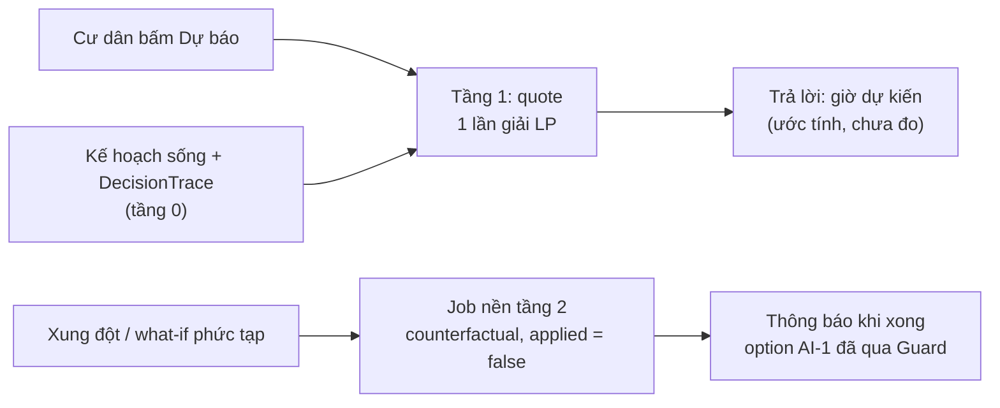

# Kiến trúc trả lời 3 tầng: dự báo thời điểm sạc nhanh, không mô phỏng cho từng người

| Ngày | Trạng thái | Liên quan |
|---|---|---|
| 2026-11-20 | Đề xuất ban đầu | `docs/PRD.md` · ADR-007 (`StationRuntime`, `control_loop`) |
| 2026-11-21 | **Giữ tầng 0, tầng 1 và job nền cho phương án AI-1. Phần tương lai mẫu từ F12 và định cỡ 100 cổng: HOÃN / R&D** | [ADR-014](../adr/ADR-014-decision-trace-counterfactual-hitl.md) (job nền, DecisionTrace, counterfactual) · [ADR-015](../adr/ADR-015-pham-vi-mvp4-va-quy-tac-bang-chung.md) (F12 hoãn, quy tắc bằng chứng) · PRD v0.4 [`docs/PRD.md`](../PRD.md) |

> Mọi con số thời gian và CPU trong tài liệu này là **ước tính để định cỡ**, hoặc là số của nhánh R&D
> `experiment/claude-chargepilot-fullstack-ai` chưa chạy lại (ghi **[R&D — CHƯA XÁC MINH]**). **Chưa có số nào được đo**
> trên code của nhánh tích hợp. Fixture nền hiện tại là `mvp1` 4 cổng (ADR-010), không phải 100 cổng.

### Thay đổi so với bản 20/11

| Mục | Bản 20/11 | 21/11 |
|---|---|---|
| Tầng 0 — đọc kế hoạch sống + `DecisionTrace` | Đề xuất | **Giữ** — cũng là nguồn cho AI-4 WHY |
| Tầng 1 — `quote` một lần giải LP | Đề xuất | **Giữ** |
| Tầng 2 — job nền | Phương án AI-1 + what-if phức tạp + tương lai mẫu | **Giữ cho phương án AI-1 và what-if phức tạp**; phần tương lai mẫu **HOÃN** |
| K tương lai mẫu từ dự báo F12, khoảng tin cậy giờ xong | Đề xuất | **HOÃN / R&D** — F12 hoãn (ADR-015) |
| Định cỡ CPU cho 100 cổng / 1.000 cư dân | Ước tính | **HOÃN / R&D** — ngoài fixture nền 4 cổng |
| Đề xuất đưa vào PRD (§9 cũ) | 4 mục | Chỉ còn mục 1–2 dạng đề xuất; mục 3–4 HOÃN |

---

## 1. Bài toán

Cách làm ban đầu: cư dân điền form, bấm **"Dự báo thời điểm"**, rồi hệ thống dựng một môi trường mô phỏng riêng
(container) để chạy lại cảnh xe đến sạc trong vài giờ tới. Xong mới trả lời.

Cách này vướng hai chỗ:

| Vướng mắc | Chi tiết |
|---|---|
| **Chờ lâu** | Một lần mô phỏng trọn vẹn = chạy optimizer ở **từng bước**. Số bước nhân thời gian mỗi lần quyết định tăng nhanh theo cửa sổ và số cổng; cộng thời gian khởi động container. Ví dụ định cỡ cũ (100 cổng, bước 1 phút, 10 giờ, ~92 ms mỗi lần quyết định — số R&D này **không tái lập** khi chạy lại 21/11 (`joint_lp` 125,8 ms, `dynamic_slack` 40,32 ms @100 cổng, `RD_RERUN.md` §3), nguồn `D:\VIN\simulation\docs\experimental\results\MVP23_BENCHMARK.md`) cho ra ~55 s — **ước tính, HOÃN / R&D** |
| **Không định cỡ được phần cứng** | Mỗi câu hỏi tốn một lần mô phỏng, nên CPU tăng **theo số người hỏi** |

Nguyên nhân chung: **mô phỏng lại từ đầu cho từng người, mỗi lần họ hỏi.**

## 2. Ý tưởng chính

Hệ thống **lúc nào cũng có sẵn một kế hoạch** cho mọi xe trong cửa sổ hiện tại. Đó là thứ optimizer giải ra ở mỗi lần
tính lại (LP liên tục + receding horizon), và nó đã chứa câu trả lời *"xe nào sạc lúc nào, đủ pin lúc mấy giờ"*.

- Hỏi *"bao giờ xe tôi xong?"* là **đọc** kế hoạch, không phải **chạy** lại.
- Việc nặng (mô phỏng trọn vẹn cho phương án AI-1) chạy **nền**, không chặn người dùng.

## 3. Ba tầng trả lời

| Tầng | Trạng thái 21/11 | Dùng khi | Cách làm | Thời gian | Chặn người dùng? |
|---|---|---|---|---|---|
| **0 · Đọc kế hoạch sống** | **Giữ** | "Xe tôi bao giờ xong?" · "Tôi đứng thứ mấy?" · WHY | Đọc kế hoạch hiện tại + `DecisionTrace` | Ước tính: tức thì | Không |
| **1 · `quote`** | **Giữ** | Bấm "Dự báo" trên form mới · đổi lịch | Thêm yêu cầu vào, **giải LP một lần** cho cả cửa sổ (không chạy từng bước) | Ước tính: < 1 s ở quy mô demo — **chưa đo** | Có, nhưng ngắn |
| **2 · Job nền** | **Giữ một phần** | Phương án AI-1 · what-if phức tạp của vận hành | Mô phỏng trọn vẹn (counterfactual, `applied=false`) trong hàng worker có ưu tiên | Ước tính: vài giây tới vài chục giây mỗi việc; chạy lại 21/11: sinh phương án AI-1 p50 5,93 s, max 10,47 s **[ĐÃ XÁC MINH 21/11, `eval/evidence/2026-11-21/RD_RERUN.md` §4]** | **Không**: xong thì thông báo |
| 2b · Tương lai mẫu theo chu kỳ | **HOÃN / R&D** | Khoảng tin cậy giờ xong | K kịch bản mẫu từ dự báo F12 | — | — |

**Ngân sách thời gian cho nút "Dự báo"** (ước tính, chưa đo):

| Bước | Ước tính |
|---|---|
| Kiểm phiếu + tính kWh (code) | < 50 ms |
| `quote` (1 lần giải LP) | < 1 s |
| LLM diễn đạt (tuỳ chọn, qua grounding gate) | 1–3 s |
| **Tổng** | ≈ 1–4 s; không có LLM thì < 1,5 s |

Mục tiêu tính lại lịch p95 ≤ 2 s ở quy mô demo là **[MỤC TIÊU]** (không gồm LLM / HTTP).

## 4. (HOÃN / R&D) Tính phần "tương lai không chắc chắn" theo chu kỳ

> Giữ để làm sau. Phụ thuộc F12 dự báo hành vi, đã **HOÃN** khỏi sprint 20–26/11 (ADR-015). Không triển khai, không
> hiển thị khoảng tin cậy trong sprint.

1. Cứ mỗi chu kỳ, hoặc khi có sự kiện lớn (nguồn giảm, tủ lỗi), worker sinh **K tương lai mẫu** (ví dụ K = 20): xe đến
   thêm theo dự báo F12; ai rời sớm, ai đỗ quá giờ, ai không đến; giới hạn nguồn giữ nguyên hay giảm.
2. Chạy kế hoạch trên K tương lai đó và lưu **phân phối giờ xong** của từng xe.
3. Khi cư dân hỏi, `quote` cho giờ dự kiến, khoảng tin cậy đọc từ bộ đã tính sẵn.

Chi phí phần này phụ thuộc **số bãi × số kịch bản mẫu**, không phụ thuộc số người hỏi.

## 5. Không dùng container cho mỗi yêu cầu

Tạo container cho mỗi yêu cầu tốn thêm thời gian khởi động và tài nguyên. Dùng **một process backend + một hàng worker
cố định** là đủ. Nhánh R&D dùng `ProcessPoolExecutor`, giới hạn số worker bằng `CP_OPTIONS_WORKERS` — đây là code R&D
**chưa merge**, chỉ tham khảo.

Hàng worker có **thứ tự ưu tiên**: bảo vệ khẩn cấp > phương án AI-1 cho xung đột > what-if theo yêu cầu.
(Tương lai mẫu theo chu kỳ: HOÃN.)

Ràng buộc kiến trúc hiện tại: container chạy **một worker** uvicorn, trạng thái trong RAM (ADR-007). Job nền phải chạy
trong cùng process hoặc pool con của nó; WHAT-IF chạy trên session / config cách ly, không mutate lần chạy thật
(ADR-014).

## 6. (HOÃN / R&D) Ước tính CPU cho một bãi 100 cổng

> Ngoài fixture nền 4 cổng. Giữ để tham khảo; **chưa đo, không dùng làm lý do quyết định**.

**Giả định cũ:** 1 bãi, 100 cổng, khoảng 1.000 cư dân, giờ cao điểm.

| Tải | Ước tính cũ |
|---|---|
| `quote` của cư dân: 300 lượt/giờ × ~0,1 s | ~30 s CPU/giờ |
| Tương lai mẫu: 20 kịch bản × ~10 s mỗi 15 phút | ≈ 0,2 nhân trung bình |
| Phương án AI-1 khi nguồn giảm: ~50 xe, chạy nền | Vài phút trên 8 nhân; chỉ lúc có sự cố |

Kết luận cũ ("một máy 4–8 nhân là đủ") **chưa được kiểm chứng**.

## 7. Giảm chi phí tầng 2

| Cách | Trạng thái | Hiệu quả (ước tính, chưa đo) |
|---|---|---|
| **Lọc nhanh, kiểm kỹ ít:** chấm điểm phương án bằng một lần giải LP, chỉ mô phỏng trọn vẹn 2–3 phương án sẽ hiển thị | Giữ | ~4–6 lần |
| **Bước thô khi chạy giả định:** 5 phút thay vì 1 phút | Giữ, phải đo độ lệch so với bước 1 phút | ~5 lần |
| **Cắt cửa sổ:** chỉ mô phỏng tới giờ rời cuối của các xe liên quan (`known_at` đã cắt một phần) | Giữ | Tuỳ kịch bản |
| **Dùng lại lần chạy gốc:** mọi what-if trên cùng `state_version` dùng chung một lần chạy gốc | Giữ | Bớt 1 lần mỗi câu hỏi |
| **Gộp sự kiện:** gom thay đổi trong một cửa sổ ngắn rồi tính lại một lần | Giữ | Không tăng theo số thay đổi |

## 8. Giới hạn phải nói rõ

- Câu trả lời ở tầng 0–1 là **dự kiến**, không phải cam kết. Thứ bảo đảm an toàn vẫn là cam kết đã nhận, Guard, và
  AI-1 khi phát hiện không còn kịp.
- LP dùng **xấp xỉ** cho đường taper (AC và DC). Phải đo độ lệch giữa giờ xong theo `quote` và giờ xong theo mô phỏng
  trọn vẹn.
- Phương án AI-1 có thể cũ khi trạng thái đổi: trước khi áp phải kiểm `state_version` và mô phỏng lại (ADR-014).
- (HOÃN) Khoảng tin cậy chỉ tốt bằng dự báo F12 và số kịch bản mẫu K.

## 9. Đề xuất đưa vào PRD v0.4

1. **NFR độ trễ** (đề xuất, chờ nhóm): phản hồi cho cư dân khi đặt lịch / dự báo / WHAT-IF đơn giản có ngưỡng trên rõ
   ràng; phương án AI-1 và what-if phức tạp chạy nền, có thông báo khi xong. Con số ngưỡng **[MỤC TIÊU]**, chốt ở PRD.
2. **Kiến trúc trả lời:** kế hoạch sống → `quote` bằng một lần giải LP → job nền cho việc nặng.
3. (HOÃN) Câu trả lời dự báo luôn có khoảng tin cậy — phụ thuộc F12.
4. **Benchmark cần thêm** khi có thời gian: độ lệch giờ xong giữa `quote` và mô phỏng trọn vẹn; thời gian một lần mô
   phỏng trọn vẹn và thời gian phương án AI-1 trên fixture nền. (HOÃN / R&D: đo ở 16 / 50 / 100 cổng, CPU theo K.)
