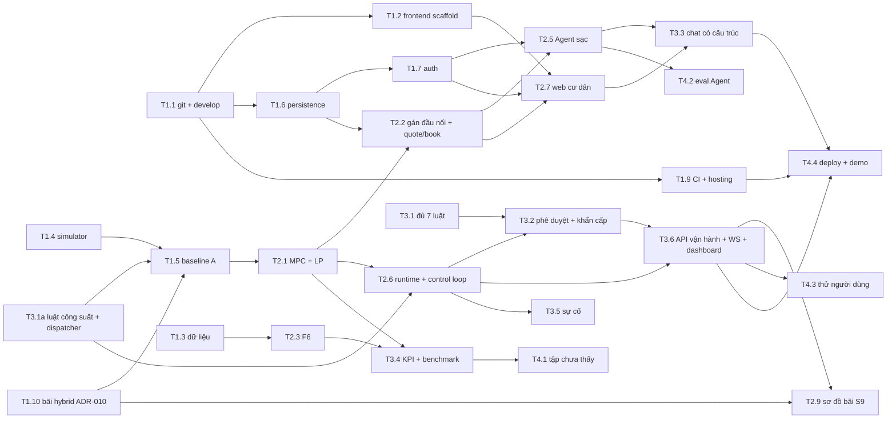

# Plan 00 — Tổng quan, roadmap W1–W4, critical path

> **Cập nhật 21/11/2026 theo ADR-010…015.** Đọc §0 trước. Nội dung từ §1 trở đi là plan Pha A (17/11), giữ để truy vết;
> đoạn nào đã bị thay có ghi "(cũ, thay bởi …)". Roadmap W1–W4 tới 13/12 **không còn dùng** — thay bằng sprint
> 20–26/11 (§0.3).

## 0. Cập nhật 21/11 — hướng nghiên cứu SC-16 mới

Nguồn: master context v1.0 của Hiếu, 20/11 (chưa đưa vào repo); PRD v0.4 [`docs/PRD.md`](../PRD.md) (đang viết song
song); ADR [010](../adr/ADR-010-bai-hybrid-ac-dc.md) · [011](../adr/ADR-011-mot-simulator-sau-be-mat-cong-khai.md) ·
[012](../adr/ADR-012-mot-danh-muc-xe-va-kich-ban.md) · [013](../adr/ADR-013-workflow-xac-dinh-llm-hai-dau.md) ·
[014](../adr/ADR-014-decision-trace-counterfactual-hitl.md) · [015](../adr/ADR-015-pham-vi-mvp4-va-quy-tac-bang-chung.md).

### 0.1 Bảng thay đổi so với plan Pha A

| Chủ đề | Plan Pha A (17/11) | Thay bởi (21/11) |
|---|---|---|
| Bài toán | 1 bãi 8 đầu nối × 7 kW, giới hạn 35 kW | 1 bãi hybrid AC + DC; fixture nền `mvp1`: 2 cổng AC 11 kW, 1 tủ DC 2 cổng 60 kW (tủ 120 kW), lưới 106 kW, ngân sách AC 22 / DC 78 kW, 9 lượt xe — fixture, không chốt cuối (ADR-010) |
| Bước mô phỏng | 15 phút, horizon 24 h | 1 phút ở fixture `mvp1` |
| Simulator | EV2Gym ưu tiên, ACN-Sim dự phòng, adapter sau `StationReader` / `StationActuator` | Đích: một `HybridSimulator` EV2Gym-first (ADR-011). **Hiện tại (22/11):** backend dùng `LiveStation` sau `StationReader` / `StationActuator`; `HybridSimulator` v1.2 đã merge, chỉ chạy R&D offline (ADR-016) |
| Optimizer | MPC + LP; MILP gán đầu nối "nếu kịp"; `highspy` | Dispatch (FIFO/FCFS, EDF, LLF) + AC/DC optimizer + Global Coordinator; **LP liên tục + receding horizon**, không phải MILP; SciPy `linprog` / HiGHS là hướng R&D |
| Agent | ReAct graph điều phối tool | Workflow xác định là xương sống; LLM ở hai đầu; LangGraph cho hội thoại + HITL (ADR-013) |
| Giá trị AI | F6 dự báo lúc rút (LightGBM), đối chứng C vs B | **AI-4 Decision Copilot (WHY + WHAT-IF)** là trục chính; AI-1 SLA negotiation + HITL bổ trợ (ADR-014) |
| F6 / F12 forecast, F13, AI-2 ML, AI-3, RAG, vector DB, RL, multi-agent, FR30a | F6 Should, làm từ tuần 2 | **HOÃN** khỏi sprint (ADR-015) |
| F14 chiếm cổng | — | Should; chỉ `FINISHED_PLUGGED` (AC giữ cổng tới giờ rời khai báo, DC rút sau 5 phút — simulator đã mô phỏng); chưa làm nhắc / phí |
| Bảng DB | 9 bảng | + `proposals`, `consents`, `vehicle_revisions`, `audit_log` — **việc cần làm, chưa có migration** ([40 §0](40-database.md)) |
| Lộ trình | W1–W4, 16/11 – 13/12 | Sprint 20–26/11, 5 gate (§0.3) |

### 0.2 Bằng chứng đã chạy lại ngày 21/11 (`eval/evidence/2026-11-21/`)

- Simulator v1.2 @ `d15871a`, Python 3.12.10, EV2Gym 2.0.0: `pytest src/simulator/tests` = 112 passed với
  `PYTHONUTF8=1`; 109 passed / 3 failed với encoding mặc định cp1258.
- `mvp1` FIFO/FCFS: 9/9 đúng hạn; wait mean / p95 (started only) 51,11 / 135 phút; peak lưới 105,263 kW; điện lưới
  239,527 kWh; điện vào pin 223,000 kWh; 0 rejected allocation; 0 applied violation.
- `mvp1` + EDF demo: 9/9; wait mean 54,56 phút, p95 135; peak lưới 86,316 kW; năng lượng như trên.
- `vinfast_dc_2port_120kw` (lưới 150 kW, DC budget 120): 8/9 đúng hạn; wait mean 44,78; peak lưới 149,474 kW;
  remaining demand 26,189 kWh; 0 violation.
- Skeleton @ `8f6f08a`: ruff sạch; pytest 247 passed / 94 skipped. Sau T1.10 phần contract (working tree 21/11):
  ruff sạch; pytest 261 passed / 94 skipped; `check_docs` PASS; frontend gen:api / lint / test / typecheck đạt
  (`raw/final-check.txt`, `raw/t110-*.txt`).
- Kết luận: fixture `mvp1` **không đủ phân biệt chính sách** (FIFO và EDF đều 9/9). MVP-2/3 cần workload khó hơn.
- R&D @ `1736d41` chạy lại ([`RD_RERUN.md`](../../eval/evidence/2026-11-21/RD_RERUN.md)): 270 run khớp 0 sai lệch tất
  định; AI-1 / AI-2 / AI-3 khớp số đã báo; **không tái lập**: latency `joint_lp` (≤ 14 / ≤ 92 ms) và latency AI-1 cũ
  (10,2 / 26,3 s → nay 5,93 / 10,47 s). Chọn coordinator MVP-3 là câu hỏi mở.

### 0.3 Sprint 20–26/11 (thay §5)

| Gate | Ngày | Definition of Done | Task chính (gợi ý; nhóm phân công) |
|---|---|---|---|
| Contract freeze | 20/11 | `SimulatorGateway`, request / state / trace / patch, role scope, đơn vị / giờ thống nhất | ADR-010…015, PRD v0.4 |
| Integration Gate 1 | 22/11 | Form/chat → backend → simulator thật hoặc gateway gắn nhãn fixture; MVP-2 có CLI benchmark + trace; AI-4 tools chạy offline | merge simulator v1.2, `base.py` mới, gateway, T1.7 auth, `quote` / `book` |
| MVP-3 + AI-4 | 24/11 | AC + DC optimized, Global Coordinator, Guard / KPI; WHY / WHAT-IF trên simulator thật; WHAT-IF isolation | optimizer AC/DC, coordinator fixed vs dynamic, `DecisionTrace`, counterfactual |
| HITL E2E | 25/11 | Conflict → option đã mô phỏng → proposal → approval → re-verify → revision + audit qua API | AI-1, bảng proposal / consent / revision / audit |
| Release Candidate | 26/11 | E2E trình duyệt 2 vai trò, benchmark gắn commit, hồi quy MVP-1, demo restart được, không mock trong luồng nghiệm thu | web S1–S8 + Copilot, deploy |

Mọi gate là **[MỤC TIÊU]**, chưa gate nào được ghi nhận là đạt. Mục tiêu p95 ≤ 2 s cho lần tính lại lịch và
≥ 95% đúng hạn là **[MỤC TIÊU]**, không phải kết quả.

> Trạng thái: **Pha A đã được duyệt 2026-11-17** (xem §8). Pha B (skeleton) đã hiện thực theo plan này; trạng thái
> mới nhất ở [`docs/handoff/HANDOFF.md`](../handoff/HANDOFF.md).
> **Đổi plan 2026-11-19** (xem §12, chờ nhóm duyệt): bãi hybrid AC + DC chung một khu ([ADR-010](../adr/ADR-010-bai-hybrid-ac-dc.md));
> giao diện cư dân thay bằng bộ thiết kế `docs/mockups/cu-dan/`; giao diện vận hành theo nhánh `buivanlam`; thêm màn S9
> Sơ đồ bãi cho cả hai vai trò.
> Nguồn yêu cầu: PRD v0.2 (15/11/2026) trên Drive. Nguồn sự thật kỹ thuật: code trong `src/` (CODE WINS).
> Các plan con: [10-backend](10-backend.md) · [20-frontend](20-frontend.md) · [30-ai](30-ai.md) ·
> [40-database](40-database.md) · [50-devops](50-devops.md).

## 1. Mục tiêu

Biến skeleton contract-first hiện có (72 stub, 124 test xanh) thành một bộ khung mà 4 thành viên có thể
điền logic song song trong 4 tuần (16/11 – 13/12/2026; cũ, thay bởi sprint 20–26/11 ở §0.3) mà không phải thương lượng
lại interface:

1. Mỗi FR/AC của PRD map tới ít nhất 1 module và 1 test (test có thể `skip` kèm task ID).
2. Mọi luồng chính có sequence diagram dùng **tên hàm thật** (xem [10-backend §6](10-backend.md)).
3. Ranh giới kiến trúc được khoá bằng `tests/test_architecture.py`, không bằng lời.
4. App luôn khởi động được: `/health` 200, `/docs` đủ endpoint, phần chưa làm trả 501 kèm task ID.

## 2. Phạm vi

| Trong phạm vi plan | Ngoài phạm vi |
|---|---|
| Backend FastAPI, Agent F1, Optimizer F2/F3, Guard F4, Forecast F6, Simulator, DB, Frontend S1–S8, CI/CD, deploy free tier. (21/11: Forecast F6 HOÃN; thêm Copilot AI-4 + AI-1 HITL — §0) | Viết logic nghiệp vụ thật (thuộc task `[Txx]` của nhóm) · OCPP, thanh toán, đa bãi (PRD "Won't") |

Lưu ý phạm vi màn hình: yêu cầu của phiên này ghi "S1–S6", nhưng Wireframe có **S1–S8** và S7 (duyệt lệnh) là
Must theo FR16/US7. Plan phủ đủ S1–S8; S8 (F7, Should) xếp ưu tiên sau. Xem câu hỏi mở Q1.

## 3. Hiện trạng đã kiểm chứng (16/11/2026)

- `ruff check` PASS · `pytest` 124 passed / 10 skipped · `check_docs.py` PASS · 72 stub `[Txx]`.
- `ruff format --check` **đang FAIL: 20 file** (có từ baseline, phần lớn là file template).
- Toàn bộ skeleton chưa commit, nằm trên `main`. Chưa có `develop`, chưa có `frontend/`.
- Chưa kiểm chứng: build Docker, deploy Render, EV2Gym trên Python 3.12, schema dữ liệu Na Uy.

## 4. Bảng task (ID cũ giữ nguyên nghĩa; ID in đậm là ID mới đề xuất)

Owner theo PRD §12: TV1 tối ưu + eval · TV2 dữ liệu + F6 · TV3 backend, simulator, Guard, Agent · TV4 web + deploy.

| ID | Việc | Owner | Phụ thuộc | Plan |
|---|---|---|---|---|
| **T1.1** | Commit skeleton, tạo `develop`, branch protection, format một lần | TV4 + cả nhóm | duyệt Pha A | 50 |
| **T1.2** | Tạo `frontend/`, route stub S1–S8, API client typed, màn 501 | TV4 | T1.1 | 20 |
| T1.3 | Tải + chuẩn hoá dữ liệu Na Uy/ACN → `ChargingSession`, EDA — **HOÃN** (ADR-015) | TV2 | — | 30 |
| T1.4 | Simulator adapter (EV2Gym, dự phòng ACN-Sim) — cổng Go/No-Go. (cũ, thay bởi ADR-011: merge `HybridSimulator` v1.2 sau `base.py` mới + `SimulatorGateway`) | TV3 + TV1 | — | 30 |
| T1.5 | Baseline A (FCFS/EDF) chạy thật qua Guard trên simulator | TV1 | T1.4, T3.1a | 30 |
| T1.6 | Persistence: SQLAlchemy + Alembic sau `services/repository.py` | TV3 | T1.1 | 40 |
| T1.7 | Auth JWT 2 vai trò, seed tài khoản demo | TV3 | T1.6 | 10 |
| **T1.8** | Quy ước API: error envelope, request id, `/ready` | TV3 | — | 10 |
| **T1.9** | CI mở rộng, tách requirements, Neon + Vercel + Render test | TV4 | T1.1 | 50 |
| **T1.10** | Đổi sang bãi hybrid theo ADR-010: sửa PRD §1, `config/station.yaml` + `site_layout.yaml`, `src/models/station.py`, `test_catalog.py`, port `core.py` của MVP-1 vào `src/simulator/` | TV3 + TV1 | duyệt ADR-010 | 00 §12, 30 §4 |
| T2.1 | MPC + LP (`mpc.py`, `lp_model.py`). (21/11: LP liên tục + receding horizon trong `Algorithms`, MVP-2/3) | TV1 | T1.5 | 30 |
| T2.2 | Gán đầu nối, hàng đợi, `quote` / `book` / `cancel` / `queue_status`, idempotency | TV1 + TV3 | T2.1, T1.6 | 10, 30 |
| T2.3 | F6: feature, train, evaluate — **HOÃN** (ADR-015) | TV2 | T1.3 | 30 |
| T2.4 | Danh mục 5–10 xe có nguồn, `verified: true` | TV3 | — | 30 |
| T2.5 | Agent sạc: `resident_id` phía server, prompt, tool, gỡ tool demo | TV3 | T1.7, T2.2 | 30 |
| T2.6 | `event_bus`, `runtime`, `control_loop.on_event` | TV3 | T2.1, T3.1a | 10 |
| T2.7 | Frontend cư dân S1–S4 nối API thật, theo bộ thiết kế `cu-dan` | TV4 | T1.2, T1.7, T2.2 | 20, 21 §0.5 |
| **T2.9** | Màn S9 Sơ đồ bãi: `/operator/map` + `/resident/map`; backend G22–G24 | TV4 + TV3 | T1.10, T3.6 | 20, 21 §2.8 §3.5 |
| **T2.8** | Đổi yêu cầu (`change`), hồ sơ cư dân F8, sửa/xoá thông tin | TV3 | T2.2 | 10 |
| T3.1 | 7 luật Guard. **T3.1a** = 2 luật công suất + `dispatcher.submit` đường thẳng, cần ngay W1 | TV3 | — | 10 |
| T3.2 | Phê duyệt, khẩn cấp, `execute_approved`, xếp tay | TV3 | T3.1, T2.6 | 10 |
| **T3.3** | Chat có cấu trúc trên web (payload S3), `explain` | TV3 + TV4 | T2.5, T2.7 | 20, 30 |
| T3.4 | KPI + benchmark B/C/D + Oracle. (21/11: benchmark baseline vs optimized, fixed vs dynamic; C = forecast HOÃN) | TV1 | T2.1, T2.3 | 30 |
| T3.5 | Kịch bản sự cố, `inject_incident` | TV1 | T2.6 | 30 |
| T3.6 | API vận hành + WebSocket + dashboard S5–S8 | TV3 + TV4 | T2.6, T3.2 | 10, 20 |
| T3.7 | Đo MT5 (p95 tính lại ≤ 2 s) | TV1 + TV3 | T2.6 | 30 |
| T4.1 | Đánh giá trên tập chưa thấy, phân tích ca thất bại | TV1 + TV2 | T3.4 | 30 |
| T4.2 | Eval Agent ≥ 50 câu có nhãn | TV3 | T2.5 | 30 |
| **T4.3** | Thử với người dùng, accessibility, mobile | TV4 | T3.6 | 20 |
| T4.4 | Deploy live URL, checklist trước demo | TV4 | T1.9 | 50 |
| **T4.5** | Tài liệu bàn giao: README, sơ đồ, video | cả nhóm | — | 50 |

## 5. Roadmap theo tuần (đối chiếu PRD §12) — (cũ, thay bởi sprint 20–26/11 ở §0.3)

| Tuần | Cổng kiểm chứng (PRD) | Task phải xong | Bằng chứng |
|---|---|---|---|
| W1 16–22/11 | Go/No-Go: mô phỏng bãi hybrid (2 AC × 11 kW, 1 DC × 2 × 60 kW, lưới 106 kW — ADR-010), baseline FCFS chạy thật. *Trước 19/11: 8 đầu nối, 35 kW* | T1.1–T1.9, **T3.1a** | `make benchmark --strategies A_fcfs` ra bảng; `/auth/login` chạy; `frontend/` build |
| W2 23–29/11 | Luồng đầu–cuối tạo lịch hợp lệ, có log | T2.1–T2.8 | Form S3 → `book` → `on_event` → `decision_log` có bản ghi `executed=true` |
| W3 30/11–06/12 | Có metric ban đầu; lệnh sai bị chặn | T3.1–T3.7 | 7 test luật bỏ `skip`; `eval/results/benchmark.md` có A/B/C; S7 hiện lệnh bị chặn |
| W4 07–13/12 | Demo trọn luồng + bảng đối chứng + giới hạn | T4.1–T4.5 | Live URL 2 vai trò; báo cáo A–D + MAE; eval Agent ≥ 50 câu |

## 6. Đồ thị phụ thuộc và critical path

**Critical path:** T1.4 → T1.5 → T2.1 → T2.2 → T2.6 → T3.2 → T3.6 → T4.4. Chậm một ngày ở chuỗi này là chậm demo.

Hai điểm rút ra từ đồ thị mà kế hoạch tuần của PRD chưa thể hiện:

1. **Guard phải có bản tối thiểu ngay W1**, không đợi W3. ADR-002 bắt mọi lệnh (kể cả benchmark) đi qua
   `guard/dispatcher.py`, mà 7 luật trong `guard/rules.py` hiện đều `raise NotImplementedError`. Không có T3.1a thì
   baseline A không chạy được và cổng Go/No-Go fail vì lý do không liên quan tới simulator.
2. **TV3 nằm trên critical path cả 4 tuần** (simulator, DB, auth, control loop, Guard, Agent). Gợi ý: TV1 nhận T3.1a
   (đi cùng T1.5 của TV1), TV4 nhận phần client của T3.3. Việc phân công do nhóm quyết.

## 7. Truy vết FR/AC → module → test (bản tổng; chi tiết ở từng plan)

`⏭` = test đã có ở dạng `skip`; `＋` = test sẽ thêm ở Pha B (dạng `skip` kèm task ID nếu logic chưa có).

| Yêu cầu | Module | Test |
|---|---|---|
| FR1, AC8 | `api/auth.py`, `api/deps.py`, `services/auth.py` | `test_api/test_contract.py` (401/403) · ＋ `test_services/test_auth.py` |
| FR2 | `models/charging.py`, `agents/tools/charging.py` | `test_models/test_contracts.py` · `test_agents/test_charging_tools.py` |
| FR3 | `services/energy.py` | `test_services/test_energy.py` |
| FR4 | `ScheduleProposal`, `charging_service.quote` | `test_models` · ＋ `test_services/test_charging_service.py` |
| FR5 | ranh giới import | `test_architecture.py` |
| FR6 | `optimizer/mpc.py`, `lp_model.py` | ⏭ `test_optimizer/test_strategies.py` · ＋ `test_optimizer/test_lp_model.py` |
| FR7, AC2 | `optimizer/assignment.py`, `simulator/parking_queue.py` | ＋ `test_optimizer/test_assignment.py` · ＋ `test_api/test_flows.py::test_walk_in_when_full` |
| FR8 | `services/control_loop.py`, `event_bus.py`, `runtime.py` | ＋ `test_services/test_control_loop.py` |
| FR9 | `PlanningContext`, LP ràng buộc (4) | ⏭ `test_forecast_never_relaxes_declared_deadline` |
| FR10, FR11 | `simulator/*` | `test_simulator/test_factory.py` · ＋ `test_simulator/test_adapter_contract.py` |
| FR12, AC6 | `guard/rules.py`, `checker.py` | `test_guard/test_checker.py` · ⏭ `test_each_rule_blocks_its_violation` |
| FR13, AC4, AC5 | `guard/approval.py`, `emergency.py`, `dispatcher.py` | ＋ `test_guard/test_approval.py`, `test_emergency.py`, `test_dispatcher.py` |
| FR14 | `DecisionLogEntry`, `repository.append_decision` | ＋ `test_services/test_repository.py` |
| FR15, FR16 | `api/resident.py`, `operations.py`, `ws.py`, `frontend/` | `test_contract.py` · ＋ `frontend` typecheck + test client |
| FR17, MT7 | `forecast/*` | ＋ `test_forecast/test_features.py` (chống rò rỉ nhãn) |
| FR18, AC7 | `config/scenarios/`, `simulation_service`, `simulator/kpi.py` | `test_services/test_catalog.py` · ＋ `test_simulator/test_kpi.py` |
| AC1 | `api/routes.py`, `agents/graph.py`, `charging_service` | `test_agents/test_charging_tools.py` · ＋ `test_api/test_flows.py::test_chat_booking` |
| AC3 | `simulation_service.run_scenario` | ⏭ `test_peak_evening_respects_limit_and_meets_deadlines` |
| MT5 | `control_loop.on_event` | ⏭ `test_replan_p95_under_two_seconds` |

## 8. Quyết định (đã duyệt 2026-11-17)

**Kết quả duyệt của người dùng, 2026-11-17:**

- **Đã duyệt toàn bộ**: Dependency D1–D6 · ADR-005…009 · Interface I1–I10 · câu hỏi mở Q1–Q13 (lấy theo cột "Mặc định
  trong plan"; các mục ghi "cần mentor xác nhận" vẫn phải hỏi mentor, nhưng skeleton làm theo mặc định).
- **P1**: để sau — **không commit, không push, không tạo nhánh** cho tới khi được yêu cầu.
- **P2**: duyệt — chạy `ruff format src/ tests/` (không commit), sau đó mới đưa bước format vào đề xuất CI.
- **P3**: duyệt — ban đầu chỉ đưa diff đề xuất; người dùng duyệt áp ngày 2026-11-17, `.github/workflows/ci.yml` hiện
  có 4 job (xem [50 §4](50-devops.md)).
- **P4**: người dùng duyệt diff cụ thể ở Pha C (2026-11-17) — `CLAUDE.md` đã cập nhật theo ChargePilot.
- **P5**: không phải vấn đề — repo do ban tổ chức cấp, PR vào `main` do nhóm tự merge.
- **R1–R13** (từ bản review AI tech stack, xem `docs/handoff/HANDOFF.md` §6.1): **chưa được quyết**. Skeleton Pha B chỉ làm
  phần đúng với cả hai hướng (không tái cấu trúc graph của Agent, không thêm simulator tự viết, giữ `highspy` ở dạng comment).

Chi tiết và lý do nằm ở plan con tương ứng. Sau khi được duyệt, mỗi ADR sẽ được viết vào `docs/adr/` ở trạng thái
`Proposed` trong bước đầu của Pha B.

### 8.1 Dependency mới

| # | Gói | Lý do | Task | Plan |
|---|---|---|---|---|
| D1 | `sqlalchemy>=2.0`, `alembic>=1.14` | ORM + migration chạy được trên cả SQLite và Postgres | T1.6 | 40 §4 |
| D2 | `psycopg[binary]>=3.2` (thay cho `psycopg2-binary` ghi trong tech-stack) | Driver Postgres cho Neon; bản 3 là dòng đang phát triển, SQLAlchemy 2 hỗ trợ sẵn | T1.6 | 40 §4 |
| D3 | `pyjwt>=2.8` | Ký/kiểm JWT. Băm mật khẩu dùng `hashlib.scrypt` của stdlib nên **không cần `bcrypt`** | T1.7 | 10 §4 |
| D4 | `highspy`, `numpy`, `lightgbm`, `ev2gym` / `acnportal` (đã ghi sẵn dạng comment trong `requirements.txt`) | Bật khi làm task tương ứng; không cài ở Pha B | T1.4, T2.1, T2.3 | 30 |
| D5 | Tách `requirements-dev.txt` (ruff, pytest, pytest-asyncio, httpx, pandas, jupyter) — khi làm đã đổi thành `requirements-runtime.txt` + `requirements.txt`, xem [50 §5](50-devops.md) | Image Render hiện cài cả công cụ dev; RAM/thời gian build gói free có hạn | T1.9 | 50 §5 |
| D6 | npm: `openapi-typescript` (dev), `openapi-fetch`, `@tanstack/react-query`, `recharts`, `vitest` + `@testing-library/react` (dev); Tailwind theo `create-next-app` | Type sinh từ OpenAPI, cache + retry khi backend ngủ, biểu đồ tải, test client | T1.2 | 20 §4 |

Không đề xuất thêm: Redis, Celery, vector DB, thư viện Gantt, `langgraph-checkpoint-*` (giữ `MemorySaver`, xem 30 §3.6).

### 8.2 ADR mới (đề xuất)

| ADR | Quyết định | Plan |
|---|---|---|
| ADR-005 | Persistence: SQLAlchemy 2 đồng bộ + Alembic; SQLite local, Neon Postgres khi deploy; package `src/db/` nằm sau `services/repository.py` | 40 |
| ADR-006 | Danh tính: JWT HS256, tài khoản demo seed từ biến môi trường, `/chat` yêu cầu token cư dân, `resident_id` truyền qua `RunnableConfig`, WebSocket xác thực bằng bản tin đầu | 10 §4, 30 §3 |
| ADR-007 | `StationRuntime` là composition root; `on_event(event, rt)`; service ghi dữ liệu chuyển sang `async`; vòng nền tắt mặc định (demo theo yêu cầu) | 10 §5 |
| ADR-008 | Quy ước API: error envelope bổ sung `code` / `task_id` / `request_id`, `Idempotency-Key` cho booking, phân trang | 10 §3 |
| ADR-009 | Frontend Next.js trong `frontend/`; type sinh từ `openapi.json` được commit; không import gì từ backend | 20 |

### 8.3 Thay đổi interface công khai

| # | Thay đổi | Ảnh hưởng | Plan |
|---|---|---|---|
| I1 | `POST /chat`, `/chat/resume` yêu cầu token `resident` (hiện đang mở) | Test `test_api/test_routes.py` phải thêm override user | 10 §2 |
| I2 | `ChatResponse` thêm `status`, `proposal`, `pending` (giữ nguyên 3 field cũ) | Chỉ thêm, không phá client cũ | 10 §2 |
| I3 | `control_loop.on_event(event, rt)`; `dispatcher.submit(..., sinks)`; `book` / `cancel` / `replan` / `manual_assign` / `inject_incident` thành `async` | Toàn là stub, chưa có caller thật | 10 §5 |
| I4 | Router không gọi thẳng `src.guard`; quyết định phê duyệt đi qua `control_loop.resolve_approval` | Thêm ranh giới `api` vào test kiến trúc | 10 §5 |
| I5 | Contract bổ sung: `StationState.sessions`, `Booking.max_charge_power_kw`, `GuardContext.bookings`, `PlanningContext.oracle_bookings` + `hard_consent_booking_ids`, `StationReader.inject_incident`, `KpiReport.delivered_energy_kwh`, payload WebSocket có kiểu, khối `optimizer:` trong `config/station.yaml` | Field mới đều có default, trừ `Booking.max_charge_power_kw` (bắt buộc) | 10 §7, 30 §5, 30 §7 |
| I9 | `AgentState` thêm `history`, `draft_request`, `turn_context`, `proposal`; `AgentDecision` thêm `draft_request`; prompt chuyển từ Python ra `prompts/*.md` | Test harness cũ phải vẫn xanh | 30 §3.2, 30 §3.7 |
| I10 | `eval/run_eval.py` thêm `--out`; `Dockerfile` chạy migration trong `CMD`; `.env.example` đổi giá trị mặc định | Không đổi hành vi mặc định của eval | 50 §4–6 |
| I6 | `services/repository.py` thêm hàm (user, notification, load point, event, idempotency, `init` / `ping`) | Chỉ thêm | 40 §5 |
| I7 | WebSocket: token gửi trong bản tin đầu thay vì `?token=` | Docstring `api/ws.py` đổi; chưa có client | 10 §8 |
| I8 | 12 endpoint mới (hồ sơ, đổi lịch, lịch của tôi, chi tiết đầu nối, sự kiện, đọc thông báo, `/ready`…) | Chỉ thêm | 10 §2 |

### 8.4 Việc cần bạn quyết về quy trình

| # | Câu hỏi | Đề xuất |
|---|---|---|
| P1 | Skeleton đang chưa commit trên `main`, chưa có `develop`. Commit thế nào? | Commit skeleton hiện tại lên `develop` (tạo từ `main`), Pha B làm trên `feature/skeleton-v2` |
| P2 | `ruff format --check` fail 20 file | Một commit riêng `style: ruff format` trước Pha B, rồi mới thêm bước format vào CI |
| P3 | `.github/` thuộc CODEOWNERS của ban tổ chức. `ci.yml` hiện **đã có thay đổi chưa commit** từ phiên trước | Tôi đưa diff `ci.yml` để bạn duyệt, không tự sửa (50 §4) |
| P4 | `CLAUDE.md` đã lỗi thời (mock-first, RAG pipeline) | Đề xuất diff ở Pha C |
| P5 | `CODEOWNERS` có dòng `*` trỏ về nhóm của ban tổ chức: nếu repo bật "Require review from Code Owners" thì mọi PR phải chờ họ | Hỏi ban tổ chức trong W1 (50 §3) |

## 9. Câu hỏi mở (mâu thuẫn với PRD hoặc PRD chưa nói)

Các mục đã ghi trong `PROJECT_CONTEXT.md` §0.2 (tên ChargeMind, số liệu wireframe 150 kW / 11 kW, "tự áp dụng sau
04:12", FR13 chờ BTC, MT3 15%, nguồn dữ liệu, LangGraph chờ mentor) vẫn mở và không lặp lại ở đây.

| # | Vấn đề | Mặc định trong plan |
|---|---|---|
| Q1 | Phiên này yêu cầu "S1–S6", Wireframe có S1–S8 | Làm đủ S1–S8, S8 sau cùng |
| Q2 | Yêu cầu phiên gọi AC2 là "đổi lịch"; PRD AC2 là "đến trực tiếp khi hết đầu nối". "Đổi yêu cầu" thuộc FR8 | Vẽ cả hai luồng |
| Q3 | AC1 "≤ 2 s" có gồm độ trễ LLM không? Vòng ReAct cần tối thiểu 2–3 lượt gọi LLM | Đo riêng: pipeline không-LLM theo MT5; độ trễ LLM báo cáo riêng. Cần mentor xác nhận |
| Q4 | Wireframe S1 có nút chọn vai trò; `LoginRequest` không có `role` | Vai trò suy từ tài khoản, bỏ nút chọn |
| Q5 | S2 "Gợi ý giờ rẻ (F6)" nhưng PRD định nghĩa F6 là dự báo lúc rút đầu nối | Chip giờ rẻ lấy từ `/tariff`, không dùng ML |
| Q6 | Một cư dân có được nhiều booking đang hiệu lực không? S2 chỉ hiện một lịch | Tối đa 1 booking hiệu lực; cái thứ hai trả 409 |
| Q7 | Trạm là simulator: "realtime" trên S5 chạy theo đồng hồ nào? | Đồng hồ mô phỏng có hệ số `SIM_TIME_SCALE`, mặc định 1 |
| Q8 | Dữ liệu Na Uy có giờ rời do người dùng khai báo không? Nếu không, mốc "giờ khai báo" của F6 chỉ đo được trên ACN-Data | Xác minh ở T1.3, ghi rõ giả định trong báo cáo MT7 |
| Q9 | NFR "cho phép sửa/xoá thông tin" áp dụng tới đâu? | Endpoint hồ sơ cư dân: xem, sửa, xoá (ẩn danh hoá booking cũ) |
| Q10 | `gpt-4o` / `gpt-4o-mini` được tech-stack ghi là đã bị đánh dấu Deprecated | Chọn model ở T2.5 theo trang giá hiện hành; chỉ đổi biến môi trường |
| Q11 | Phần template còn lại (RAG node, `knowledge.py`, `mcp_tool.py`, `chroma_persist_dir`) | Gỡ ở T2.5 cùng tool demo, sau khi chuyển test harness |
| Q12 | FR2 ghi "xác nhận với cư dân **trước khi gửi sang bộ tối ưu**"; thiết kế hiện tại chạy `quote` (what-if, không giữ chỗ) trước rồi mới xác nhận ở S3 | Một lần xác nhận ở S3 cho cả dữ liệu trích xuất lẫn phương án (30 §3.5). Cần mentor xác nhận |
| Q13 | Cả EV2Gym lẫn ACN-Sim đều không qua Go/No-Go thì sao? FR11 chỉ nêu hai simulator đó | Simulator rời rạc tự viết sau cùng interface, chỉ khi mentor đồng ý (30 §4) |

## 10. Rủi ro tổng

| Rủi ro | Mức | Giảm thiểu |
|---|---|---|
| EV2Gym không chạy trên Python 3.12 hoặc không mô hình được hàng đợi | Cao | Go/No-Go ngày 3 của W1; ACN-Sim dự phòng; giữ nguyên `StationReader` / `StationActuator`. (21/11: đã có bằng chứng EV2Gym 2.0.0 chạy trên Python 3.12.10 ở simulator v1.2; rủi ro mới là merge v1.2 vào skeleton và gateway) |
| TV3 quá tải trên critical path | Cao | Chuyển T3.1a cho TV1, phần client T3.3 cho TV4 |
| RAM Render free không đủ khi nạp HiGHS + LightGBM + simulator | TB | Đo ngay khi bật từng gói; tách dependency dev; chạy benchmark ở local/CI |
| Backend ngủ làm mất trạng thái trong RAM (simulator, checkpoint chat) | TB | Booking / lịch / nhật ký ở Postgres; khôi phục lúc khởi động; frontend xử lý phiên chat hết hạn |
| Độ trễ LLM vượt 2 s của AC1 | TB | Q3; giảm số vòng (`propose_charging_plan` tự tính kWh) |
| C không tốt hơn B (F6 không giúp) | TB | Báo cáo trung thực theo PRD §8. (21/11: F6 HOÃN) |
| Fixture `mvp1` không phân biệt chính sách (FIFO, EDF đều 9/9) | Cao | Workload / kịch bản khó hơn trong `config/scenarios/`; báo cả thắng / hoà / thua (ADR-015) |
| Số R&D chưa chạy lại bị dùng làm lý do quyết định | TB | Chỉ dùng số trong `eval/evidence/`; số khác gắn **[R&D — CHƯA XÁC MINH]** |

## 11. Definition of Done của plan (Pha A)

- [x] 6 file trong `docs/plan/`, mỗi file có mục tiêu, phạm vi, cấu trúc thư mục, contract, luồng dữ liệu, map
      FR/AC, rủi ro, task + phụ thuộc, DoD.
- [x] Danh sách quyết định chờ duyệt (mục 8) và câu hỏi mở (mục 9).
- [x] Người dùng duyệt (2026-11-17, xem §8) → vào Pha B.

## 12. Đổi plan 2026-11-19 (chờ nhóm duyệt)

Nguồn: MVP-1 starter `chargepilot-mvp1-starter`, bộ thiết kế `ChargePilot_CuDan` (đã chép vào
[`docs/mockups/cu-dan/`](../mockups/cu-dan/HUONG-DAN.md)), nhánh `origin/buivanlam` (commit `876607b`, `d77e628`).

| # | Thay đổi | Thay cho | Ảnh hưởng | Chi tiết |
|---|---|---|---|---|
| C1 | **Bãi hybrid AC + DC chung một khu**: 2 tủ AC × 1 cổng 11 kW, 1 tủ DC × 2 cổng 60 kW, lưới 106 kW, ngân sách AC 22 / DC 78 kW, hiệu suất chuyển đổi 95 %, hàng đợi FIFO theo vùng, DC rút sau 5 phút | 8 đầu nối AC × 7 kW, 35 kW | PRD §1, config, model, simulator, LP, Guard, mọi số trên UI. Code chưa đổi (task T1.10) | [ADR-010](../adr/ADR-010-bai-hybrid-ac-dc.md), 30 §4–5 |
| C2 | **Giao diện cư dân = bộ `cu-dan`** (6 màn: Trang chủ, Đặt lịch, Phương án/Lịch sạc, Thông báo, Đề nghị điều chỉnh, Hồ sơ, tổng 72 tình huống) | 6 mockup cư dân cũ `docs/mockups/resident*.html` (chỉ còn để tham khảo) | Bố cục, chữ, luồng của màn cư dân; spec 21 §2 vẫn giữ bảng endpoint ↔ field | 21 §0.5 |
| C3 | **Giao diện vận hành = nhánh `buivanlam`** (4 màn S5–S8 đã code trong `frontend/src/app/operator/*`, `RoleShell`, `globals.css`) | mockup `operator*.html` | Bố cục và token màu của vận hành. Nhánh chưa merge vào `develop` | 21 §0.5 |
| C4 | **Một bộ token "Forest & Amber"** cho cả hai vai trò (`--deep #163d34`, `--amber #ffce70`, font Be Vietnam Pro) | token xanh dương ở 21 §1.1 | `globals.css`; tương phản phải tính lại (E7) | 21 §1.1 |
| C5 | **Màn mới S9 · Sơ đồ bãi**: vận hành `/operator/map` (đầy đủ), cư dân `/resident/map` (rút gọn, chỉ lộ xe của mình) | — | 2 route, backend thêm G22–G24 | 21 §2.8, §3.5; mockup `docs/mockups/cu-dan/resident-map.html`, `docs/mockups/van-hanh/operator-map.html` |

**Câu hỏi mở mới**

| # | Vấn đề | Mặc định trong plan |
|---|---|---|
| Q14 | C1 lệch PRD v0.2 §1 (8 × 7 kW). Ai sửa PRD, và mentor có chấp nhận đổi bài toán không? | Sửa PRD trước T1.10; chưa được duyệt thì code giữ 8 × 7 kW |
| Q15 | EV2Gym chưa có động học DC (`EV.step(type='DC')` raise `NotImplementedError`). Cổng Go/No-Go của T1.4 đổi thế nào? | AC chạy trên EV2Gym; DC dùng adapter tự viết port từ MVP-1 `core.py`. Cần mentor đồng ý (Q13) |
| Q16 | Bộ `cu-dan` dùng số cũ (A07, 7 kW → 3,5 kW). Sửa số trong mockup hay chỉ sửa khi code? | Không sửa mockup của người thiết kế; code lấy mọi số từ API |
| Q17 | Cư dân có được thấy ô nào đang trống không (lộ thông tin sử dụng của hàng xóm)? | Chỉ thấy 3 mức "Đang dùng / Trống / Tạm ngưng", không có xe, SOC hay giờ rời của người khác |
| Q18 | Bước MPC 15 phút có quá thô cho phiên DC 30–60 phút không? | T2.1 đo cả bước 15 phút và 5 phút, ghi kết quả vào ADR-010 |

