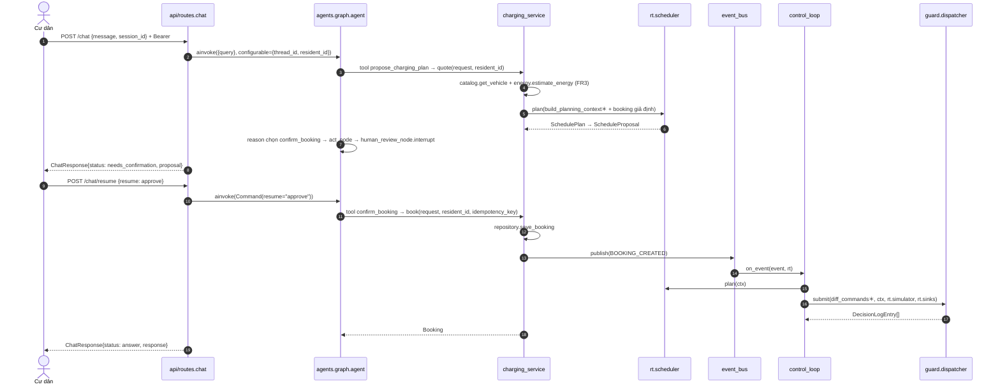
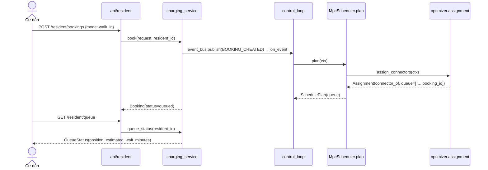
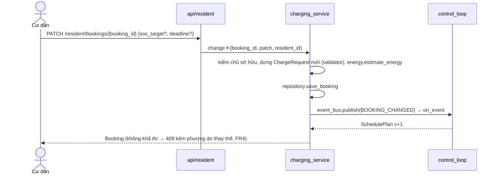
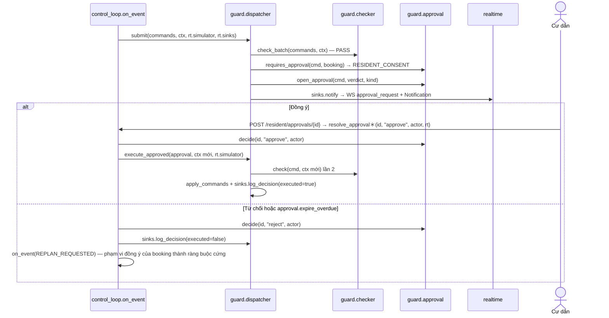
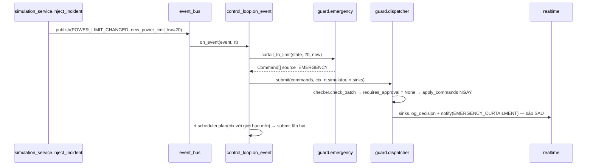
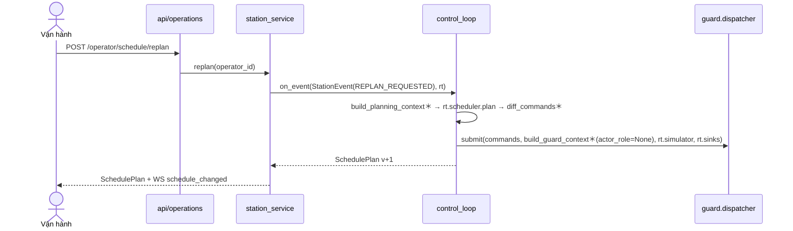

# Plan 10 — Backend (FastAPI, services, Guard, realtime)

> **Hiện trạng 23/11/2026 (ADR-019, refactor Unified Core Phase 4) — đọc trước, ưu tiên hơn nội dung bên dưới:**
> backend chạy `HybridStation` trên một kernel `StationKernel` dùng chung với `HybridSimulator`; `LiveStation` và LP
> backend A–D (`mpc`, `lp_model`, `assignment`, `baselines`, `strategies`) **đã xoá**, A–D bỏ khỏi `StrategyName` /
> OpenAPI / S8. Policy hiện hành: B0 / M2b / M3a / M3b (`src/optimizer/registry.py`). Benchmark S8 = baseline có version
> (`eval/evidence/2026-11-23-refactor-phase3-baseline/`); bảng A–D cũ là archive deprecated. Quote / booking = admission
> trên bản fork, kết quả là ước tính có điều kiện, không phải SLA. Chỗ nào bên dưới còn nhắc `LiveStation` / A–D /
> `lp_model` là plan lịch sử.
>
> **Cập nhật 21/11/2026 theo ADR-010…015.** Đọc §0 trước; từ §1 trở đi là plan Pha A (17/11), vẫn đúng với code
> skeleton hiện có, trừ chỗ ghi "(cũ, thay bởi …)". Bảng thay đổi tổng: [00-overview §0](00-overview.md).

## 0. Cập nhật 21/11 — backend theo hướng mới

Tên thành phần dưới đây lấy từ master context v1.0 (Hiếu, 20/11 — chưa đưa vào repo) §10 và ADR; chữ ký **chưa khoá**,
chưa có trong code.

| Việc | Mô tả | ADR |
|---|---|---|
| `SimulatorGateway` | **Chưa làm dưới tên này** — hiện `src/services/runtime.py` dựng `HybridStation` (kernel chung với simulator, ADR-019) và admission chạy trên `runtime.fork_runtime`. Đích: adapter duy nhất giữa `src/services` và `HybridSimulator`: `create_session`, `get_state`, `submit_request`, `advance`, `replan`, `get_decision_trace`, `simulate_what_if`, `apply_approved_revision`, `get_kpis`. Quy đổi SOC % ↔ fraction, giờ có múi giờ ↔ `HH:MM` của engine (giờ > 24 cho ngày sau), ID ổn định | [ADR-011](../adr/ADR-011-mot-simulator-sau-be-mat-cong-khai.md) |
| `FixtureSimulatorGateway` | Cài đặt theo cùng interface để UI / API làm song song; **gắn nhãn fixture**, không dùng trong luồng nghiệm thu | ADR-011 |
| `src/simulator/base.py` mới | Thay `StationReader` / `StationActuator`; `runtime.py` hiện import `src.simulator.base.StationSimulator` (bản cũ), không khớp layout `src/simulator/src/…` của v1.2 — phải sửa khi merge | ADR-011 |
| Guard hai lớp | Lớp vật lý (lưới / tủ / cổng / xe, pre + post apply) và lớp chính sách (ngân sách vùng, quyền, phê duyệt). Vẫn là chokepoint (ADR-002) | ADR-011 |
| `CopilotService` | WHY đọc `DecisionTrace`; WHAT-IF qua `simulate_what_if`, luôn `applied=false`; phân quyền theo role (cư dân chỉ xe của mình) | [ADR-014](../adr/ADR-014-decision-trace-counterfactual-hitl.md) |
| Proposal / HITL (AI-1) | Vòng đời `PROPOSED → APPROVED / REJECTED / EXPIRED → APPLIED / APPLY_FAILED`; TTL, `state_version`, idempotency, re-verify trước apply; 409 khi stale | ADR-014 |
| Job nền | Tác vụ dài (option AI-1, what-if phức tạp) chạy nền, không chặn request; xem [`docs/design/kien-truc-tra-loi-3-tang.md`](../design/kien-truc-tra-loi-3-tang.md) | ADR-014 |
| Copilot cho Operator | `/chat` hiện chỉ nhận token cư dân; Operator hỏi AI-4 cần endpoint / tool theo role, không mở quyền mù | ADR-014 |
| Mã lỗi | 401/403 quyền · 409 stale / xung đột · 422 validation · 501 chưa làm · 503 LLM không sẵn sàng | ADR-008, ADR-014 |

Đoạn cũ bị ảnh hưởng: §5.1 `StationRuntime.forecaster` (F6 HOÃN, ADR-015) và `simulator: StationSimulator`
(thay bằng gateway, ADR-011). Persistence mới: [40 §0](40-database.md).

> Trạng thái: đề xuất Pha A, chờ duyệt. ID quyết định (D/ADR/I/Q) và task tham chiếu [00-overview](00-overview.md).
> Ký hiệu: ✅ đã chạy thật · 🧩 stub có sẵn · 🆕 đề xuất thêm ở Pha B (stub `[Txx]` → 501).

## 1. Mục tiêu và phạm vi

Hoàn thiện hợp đồng backend để frontend dựng đủ S1–S8 và để Agent, form thủ công, benchmark đi **cùng một đường
nghiệp vụ**. Phạm vi: `src/api`, `src/services`, `src/guard`, phần hợp đồng trong `src/models`. Optimizer, forecast,
simulator xem [30-ai](30-ai.md); lưu trữ xem [40-database](40-database.md).

## 2. Cấu trúc thư mục (tới từng file)

```text
src/
├── main.py                 sửa: handler DomainError, middleware X-Request-ID, GET /ready, lifespan (init DB, runtime lười)
├── config.py               sửa: jwt_ttl_minutes, control_loop_enabled, sim_time_scale
├── api/
│   ├── deps.py             ✅ giữ; thêm get_runtime_dep để test override
│   ├── routes.py           sửa: /chat + /chat/resume nhận ResidentUser (I1), trả ChatResponse có cấu trúc (I2)
│   ├── auth.py             🧩 /auth/login, /auth/me
│   ├── catalog.py          ✅ /vehicles, /energy/estimate, /station/config, /tariff
│   ├── resident.py         🧩 7 endpoint có sẵn + 🆕 8 endpoint (mục 3)
│   ├── operations.py       🧩 9 endpoint có sẵn + 🆕 3 endpoint; bỏ import src.guard (I4)
│   ├── simulation.py       ✅/🧩 giữ
│   └── ws.py               🧩 sửa giao thức: xác thực bằng bản tin đầu (I7)
├── services/
│   ├── errors.py           🆕 DomainError + mã lỗi (mục 4)
│   ├── runtime.py          🆕 StationRuntime — composition root (mục 6)
│   ├── realtime.py         🆕 sổ kết nối WebSocket + broadcast theo vai trò / user (mục 8)
│   ├── auth.py             🧩 authenticate, decode_token + 🆕 get_profile, update_profile, delete_account,
│   │                          ensure_seed_users
│   ├── charging_service.py 🧩 quote, book, cancel, current_booking, queue_status, explain + 🆕 change, session_view
│   ├── station_service.py  🧩 overview, load_history, current_plan, replan, manual_assign + 🆕 connector_detail,
│   │                          recent_events, list_bookings
│   ├── control_loop.py     🧩 on_event, run_forever + 🆕 resolve_approval, build_planning_context,
│   │                          build_guard_context, diff_commands
│   ├── event_bus.py        🧩 subscribe, publish
│   ├── simulation_service.py 🧩 giữ
│   ├── repository.py       🧩 + hàm mới (xem 40 §5)
│   └── catalog.py, energy.py, llm.py   ✅ giữ
├── guard/
│   ├── rules.py, checker.py, approval.py, emergency.py   giữ chữ ký; GuardContext thêm `bookings`
│   └── dispatcher.py       🧩 thêm tham số `sinks: DispatchSinks` (I3)
└── models/
    ├── api.py              + ErrorResponse, ErrorCode, ResidentProfile, ProfileUpdateRequest, BookingChangeRequest,
    │                         ResidentSessionView, ConnectorDetail
    ├── schemas.py          ChatResponse + status, proposal, pending
    ├── events.py           + WS_PAYLOAD_MODELS, WsMessageType.PONG, EventType.REPLAN_REQUESTED
    ├── station.py          + SessionProgress, StationState.sessions
    └── charging.py         + Booking.max_charge_power_kw
scripts/export_openapi.py   🆕 ghi frontend/openapi.json (xem 20 §5)
tests/
├── test_api/test_flows.py            🆕 AC1, AC2, AC4, AC5 đầu–cuối (skip kèm task ID)
├── test_api/test_errors.py           🆕 envelope lỗi, 501 có task_id
├── test_api/test_openapi_snapshot.py 🆕 openapi.json đã commit khớp app.openapi()
├── test_services/test_auth.py, test_charging_service.py, test_control_loop.py, test_event_bus.py   🆕
└── test_guard/test_dispatcher.py, test_approval.py, test_emergency.py                              🆕
```

## 3. API theo màn hình

Tất cả dưới prefix `/api/v1`. Cột "Service" là hàm thật (hoặc hàm đề xuất) mà handler gọi.

| Màn | Method + path | Vai trò | Service | Trạng thái · task |
|---|---|---|---|---|
| S1 | `POST /auth/login` | công khai | `auth.authenticate` | 🧩 T1.7 |
| S1 | `GET /auth/me` | bất kỳ | `deps.get_current_user` | 🧩 T1.7 |
| S2 | `GET /vehicles` · `GET /tariff` · `GET /station/config` | công khai | `catalog.*` | ✅ |
| S2 | `POST /chat` · `POST /chat/resume` | resident | `agents.graph.agent.ainvoke` | ✅ (cần key) · sửa I1, I2 ở T2.5 |
| S2 | `GET /resident/bookings/current` | resident | `charging_service.current_booking` | 🧩 T2.2 |
| S2 | `GET /resident/session` | resident | `charging_service.session_view` | 🆕 T2.2 — trạng thái sạc, % pin ước tính (FR15) |
| S2 | `GET /resident/queue` | resident | `charging_service.queue_status` | 🧩 T2.2 |
| S2 | `GET /resident/notifications` | resident | `repository.list_notifications` | 🧩 T1.6 |
| S2 | `POST /resident/notifications/{notification_id}/read` | resident | `repository.mark_notification_read` | 🆕 T3.2 |
| S2 | `GET` · `PUT` · `DELETE /resident/profile` | resident | `auth.get_profile` · `update_profile` · `delete_account` | 🆕 T2.8 (F8, Q9) |
| S3 | `POST /energy/estimate` | công khai | `energy.estimate_energy` | ✅ |
| S3 | `POST /resident/quote` | resident | `charging_service.quote` | 🧩 T2.2 |
| S3 | `POST /resident/bookings` (+ header `Idempotency-Key`) | resident | `charging_service.book` | 🧩 T2.2 |
| S3 | `PATCH /resident/bookings/{booking_id}` | resident | `charging_service.change` | 🆕 T2.8 (FR8 "đổi yêu cầu") |
| S3 | `DELETE /resident/bookings/{booking_id}` | resident | `charging_service.cancel` | 🧩 T2.2 |
| S3 | `GET /resident/explanation` | resident | `charging_service.explain` | 🆕 T2.5 — "Vì sao?" không cần LLM (US3) |
| S4 | `GET /resident/approvals/{approval_id}` | resident | `repository.get_approval` | 🆕 T3.2 |
| S4 | `POST /resident/approvals/{approval_id}` | resident | `control_loop.resolve_approval` | 🧩 T3.2 (đổi nơi gọi, I4) |
| S5 | `GET /operator/station` | operator | `station_service.overview` | 🧩 T3.6 |
| S5 | `GET /operator/load?hours=` | operator | `station_service.load_history` | 🧩 T3.6 |
| S5 | `GET /operator/connectors/{connector_id}` | operator | `station_service.connector_detail` | 🆕 T3.6 — popup chi tiết cột |
| S5 | `GET /operator/events?limit=` | operator | `station_service.recent_events` | 🆕 T3.6 — "Sự kiện gần nhất" |
| S6 | `GET /operator/schedule?date=` | operator | `station_service.current_plan` | 🧩 T3.6 (thêm query `date`) |
| S6 | `GET /operator/bookings?status=` | operator | `station_service.list_bookings` | 🆕 T3.6 — chi tiết hàng chờ |
| S6 | `POST /operator/schedule/replan` | operator | `station_service.replan` | 🧩 T2.6 |
| S6 | `POST /operator/queue/{booking_id}/assign` | operator | `station_service.manual_assign` | 🧩 T3.2 |
| S7 | `GET /operator/approvals?status=` | operator | `repository.list_approvals` | 🧩 T1.6 |
| S7 | `POST /operator/approvals/{approval_id}` | operator | `control_loop.resolve_approval` | 🧩 T3.2 (I4) |
| S7 | `GET /operator/commands/blocked` · `GET /operator/decision-log` | operator | `repository.list_decisions` | 🧩 T1.6 |
| S8 | `GET /simulation/scenarios` | operator | `catalog.list_scenarios` | ✅ |
| S8 | `POST /simulation/runs` · `POST /simulation/incidents` · `GET /simulation/benchmark` | operator | `simulation_service.*` | 🧩 T3.4, T3.5 |
| — | `WS /ws/operator` · `WS /ws/resident` | theo token | `realtime.*` | 🧩 T3.6 |
| — | `GET /health` (liveness) · `GET /ready` (DB + config) | công khai | — | ✅ · 🆕 T1.8 |

Nút "Xuất báo cáo" của S8 làm ở frontend từ JSON của `GET /simulation/benchmark`, không cần endpoint riêng.

## 4. Quy ước API (ADR-008) và xác thực (ADR-006)

### 4.1 Error envelope

Giữ `detail` để không phá client hiện có, bổ sung 3 field:

```json
{ "detail": "[T2.2] quote — optimizer what-if…", "code": "not_implemented", "task_id": "T2.2", "request_id": "9f1c…" }
```

| HTTP | `code` | Nguồn |
|---|---|---|
| 401 | `unauthenticated` | thiếu token, token sai / hết hạn |
| 403 | `forbidden` | sai vai trò; cư dân đụng booking / approval của người khác |
| 404 | `not_found` | xe, kịch bản, booking, approval không tồn tại |
| 409 | `booking_conflict` · `idempotency_mismatch` · `approval_already_decided` · `proposal_expired` | xung đột trạng thái |
| 422 | — (giữ nguyên dạng mặc định của FastAPI, `detail` là mảng) | body sai schema |
| 501 | `not_implemented` (+ `status: "not_implemented"` như hiện tại) | `NotImplementedError("[Txx] …")` |
| 503 | `llm_unavailable` · `database_unavailable` | nhà cung cấp LLM lỗi → frontend chuyển sang form (NFR khả dụng) |

`src/services/errors.py` định nghĩa `DomainError(code, http_status, detail)`. Lý do có lớp này: service được gọi
từ cả router lẫn tool của Agent nên không được ném `HTTPException` của FastAPI; router map sang HTTP, tool map sang
JSON `{"error": code}` cho vòng `reason` kế tiếp.

`routes.py` hiện bọc mọi exception thành 500 kèm `str(exc)`, làm `NotImplementedError` thành 500 và lộ thông tin
nội bộ. Pha B bỏ khối `except Exception` đó, để handler chung xử lý.

### 4.2 Versioning, phân trang, idempotency

- Trong `/api/v1` chỉ thêm field / endpoint. Đổi phá vỡ thì viết ADR và cập nhật `frontend/openapi.json` trong cùng PR;
  `tests/test_api/test_openapi_snapshot.py` fail nếu quên.
- Danh sách dài (`decision-log`, `events`): `limit` (mặc định 100, tối đa 1000) + `before` (con trỏ là `seq`).
- `POST /resident/bookings` nhận header `Idempotency-Key` (UUID do client sinh). Cùng key + cùng body trả lại đúng
  booking cũ; cùng key khác body trả 409 `idempotency_mismatch`. Luồng chat dùng key `chat:{session_id}`: resume
  lần hai không tạo booking thứ hai. Chữ ký đề xuất: `book(request, resident_id, consent=None, idempotency_key=None)`.
- Mặc định Q6: mỗi cư dân tối đa 1 booking đang hiệu lực (`confirmed | queued | charging`); cái thứ hai trả 409
  `booking_conflict`.

### 4.3 Xác thực 2 vai trò

- Tài khoản nằm ở bảng `users` (40 §3). `auth.ensure_seed_users()` chạy trong lifespan, đọc biến môi trường
  `SEED_USERS_JSON` (40 §7); **không có mật khẩu nào trong repo**.
- Mật khẩu băm bằng `hashlib.scrypt` (stdlib), so sánh bằng `hmac.compare_digest`.
- JWT HS256 (PyJWT, D3). Claim: `sub` = `user_id` giả danh, `role`, `name`, `iat`, `exp` (mặc định 8 giờ, cấu hình
  `JWT_TTL_MINUTES`). Không có refresh token; hết hạn thì đăng nhập lại.
- `JWT_SECRET` bắt buộc khi `APP_ENV=production`. Chỉ thêm vào validator của `src/config.py` **cùng lúc** với
  `render.yaml` và job `docker-smoke`, nếu không deploy sẽ fail.
- `resident_id` của mọi thao tác lấy từ token: router truyền `user.user_id` vào service; `/chat` đưa vào
  `config["configurable"]["resident_id"]` (30 §3.4). LLM không có tham số nào tên `resident_id`.

## 5. Runtime, event bus, control loop (ADR-007)

### 5.1 `StationRuntime` — composition root

Hiện chưa có chỗ nào giữ simulator của chế độ chạy thật, và `on_event(event)` không có cách nào nhận simulator
khác cho benchmark. Đề xuất một dataclass duy nhất trong `src/services/runtime.py`:

```python
@dataclass
class StationRuntime:
    config: StationConfig
    tariff: Tariff
    simulator: StationSimulator          # đọc qua .state()/.step(); phần ghi chỉ dispatcher dùng
    scheduler: Scheduler                 # optimizer.get_scheduler(strategy)
    forecaster: DepartureForecaster | None
    clock: Callable[[], datetime]        # đồng hồ thật × SIM_TIME_SCALE, hoặc đồng hồ mô phỏng
    sinks: DispatchSinks                 # ghi nhật ký, lưu phê duyệt, thông báo
    plan: SchedulePlan | None = None
    lock: asyncio.Lock = field(default_factory=asyncio.Lock)

def get_runtime() -> StationRuntime: ...          # dựng lười lần đầu; simulator còn stub → 501 [T1.4]
def build_sim_runtime(scenario, strategy) -> StationRuntime: ...   # benchmark: sinks ghi vào bộ nhớ
```

Lý do có abstraction này: benchmark phải chạy **cùng** `on_event` và **cùng** đường Guard với vận hành thật
(ADR-002) nhưng không được ghi vào DB production hay đẩy WebSocket.

(21/11, sửa một phần bởi ADR-011 / ADR-015) Field `simulator` sẽ trỏ tới `SimulatorGateway`; `forecaster` không dùng
trong sprint vì F6 HOÃN. Nguyên tắc "live và benchmark dùng chung đường tính" giữ nguyên, mở rộng thành một bộ
`Algorithms` dùng chung live / benchmark / what-if.

`DispatchSinks` (trong `guard/dispatcher.py`) là 3 callable: `log_decision`, `save_approval`, `notify`. Bản live trỏ
tới `repository` + `realtime`; bản benchmark gom vào `SimulationTrace`.

### 5.2 Đồng bộ và bất đồng bộ

- Hàm chỉ đọc giữ `def` (router `def` chạy trong threadpool): `quote`, `current_booking`, `queue_status`, `explain`,
  `overview`, `load_history`, `current_plan`.
- Hàm phát sự kiện chuyển sang `async def` (I3) vì `event_bus.publish` và `dispatcher.submit` vốn là `async`:
  `book`, `cancel`, `change`, `replan`, `manual_assign`, `inject_incident`.
- Bên trong hàm `async`, việc nặng (solver, truy vấn DB) bọc bằng `asyncio.to_thread` để không chặn WebSocket.
- `on_event` chạy tuần tự dưới `rt.lock`: hai sự kiện tới cùng lúc không sinh hai lịch cùng `version`.

### 5.3 Event bus và vòng nền

- `event_bus.publish(event)` gọi handler **ngay trong request** (await). Vì vậy đặt lịch xong là có lịch mới, không
  phụ thuộc vòng nền. Đây là điều kiện để hệ thống vẫn đúng khi Render vừa thức dậy.
- `control_loop.run_forever(stop, rt)` chỉ lo việc theo thời gian: `simulator.step`, phát `TICK`,
  `approval.expire_overdue`. Bật bằng `CONTROL_LOOP_ENABLED=true`, **mặc định tắt** (giữ bất biến của ADR-004).
- Khởi động lại: runtime nạp `repository.latest_plan()` và booking còn hiệu lực; `StationOverview.alerts` có dòng
  cảnh báo "trạng thái simulator đã được dựng lại" (NFR khả dụng).

## 6. Luồng chính (tên hàm thật; hàm có dấu ＊ là đề xuất mới)

### 6.1 AC1 — đặt lịch qua chat



Giữa lúc xem phương án và lúc bấm xác nhận, trạng thái trạm có thể đổi. `book` tính lại; nếu không còn khả thi thì
ném `proposal_expired` (409) và Agent đưa phương án mới. Khi LLM lỗi (503 `llm_unavailable`), frontend dùng form:
`POST /resident/quote` rồi `POST /resident/bookings`, đi cùng `quote` / `book`.

### 6.2 AC2 — đến trực tiếp khi hết đầu nối



### 6.3 FR8 — cư dân đổi yêu cầu



### 6.4 AC4 — điều chỉnh cần cư dân phê duyệt



Sau khi bị từ chối, bộ tối ưu phải coi phạm vi đồng ý của booking đó là ràng buộc cứng, nếu không vòng sau lại
đề xuất đúng lệnh cũ. Đề xuất field `PlanningContext.hard_consent_booking_ids: frozenset[str]` (30 §5).

### 6.5 AC5 — bảo vệ khẩn cấp



Bước `curtail_to_limit` không phụ thuộc solver hay LLM: solver treo thì tải vẫn đã được hạ.

### 6.6 FR8 — vận hành bấm "Lập lịch lại"



"Xếp thủ công" (`manual_assign`) đi cùng đường, khác ở `Command(source=OPERATOR)` và `actor_role=OPERATOR`: lệnh của
vận hành vẫn qua 7 luật và có thể bị chặn.

## 7. Contract bổ sung (I5)

| Model | Thay đổi | Vì sao |
|---|---|---|
| `station.SessionProgress` 🆕 | `booking_id, connector_id, arrived_at, plugged_in_at, delivered_grid_kwh` | MPC cần kWh còn thiếu; S2 cần % pin ước tính. Hiện không model nào mang thông tin này |
| `StationState.sessions` | `list[SessionProgress] = []` | như trên |
| `charging.Booking.max_charge_power_kw` | `float`, tính lúc đặt = min(đầu nối, OBC của xe) | LP ràng buộc (2) và luật `connector_power_limit` cần giới hạn của xe mà optimizer / guard không được gọi `catalog` |
| `rules.GuardContext.bookings` | `Mapping[str, Booking] = {}` | luật công suất theo xe, luật quyền |
| `simulator.base.StationReader.inject_incident` | `(incident: Incident) -> list[StationEvent]` | US6: bơm sự cố vào simulator đang chạy; đây là thay đổi môi trường, không phải lệnh tới trạm |
| `schemas.ChatResponse` | `+ status: answer / needs_confirmation / refused`, `proposal: ScheduleProposal / None`, `pending: dict / None` | S3 cần dữ liệu có cấu trúc thay vì chuỗi `[CẦN PHÊ DUYỆT] {...}` |
| `api.ResidentProfile`, `ProfileUpdateRequest` 🆕 | `vehicle_model, default_soc_target, consent: ConsentScope` | F8; FR13 "cho phép trước khi đăng ký" |
| `api.BookingChangeRequest` 🆕 | `soc_target?, deadline?` (ít nhất một) | FR8 |
| `api.ResidentSessionView` 🆕 | `booking, plan: SessionPlan / None, progress: SessionProgress / None, soc_estimate` | FR15 |
| `api.ConnectorDetail` 🆕 | `state: ConnectorState, booking: Booking / None, plan: SessionPlan / None, recent_decisions` | popup S5 |
| `api.ErrorResponse`, `ErrorCode` 🆕 | mục 4.1 | hiện trên OpenAPI để frontend có type |

## 8. WebSocket (FR16, I7)

- URL: `wss://<backend>/api/v1/ws/operator` và `/ws/resident`. Trình duyệt nối **thẳng** tới Render (Vercel Hobby
  không giữ kết nối WebSocket).
- Xác thực: trong 5 giây sau khi mở, client gửi `{"type": "auth", "token": "<JWT>"}`. Lý do bỏ `?token=`: uvicorn
  ghi cả query string vào access log nên token sẽ nằm trong log của Render.
- Mã đóng: `4401` chưa xác thực / quá hạn · `4403` sai vai trò · `1011` chưa implement (hành vi hiện tại, giữ tới T3.6).
- Sau khi xác thực, server gửi ngay một bản tin trạng thái đầy đủ, sau đó chỉ gửi thay đổi. Không có cơ chế phát lại:
  mất kết nối thì client nối lại và nhận snapshot mới.
- Giữ kết nối: client gửi `{"type": "ping"}` mỗi 25 giây, server trả `pong`.
- Phong bì giữ nguyên `WsMessage{type, payload, sent_at}`. `payload` là `model_dump(mode="json")` của model đã có
  trên OpenAPI, khai báo ở `WS_PAYLOAD_MODELS` để frontend dùng lại type sinh tự động:

| `type` | Payload | Gửi cho | Màn |
|---|---|---|---|
| `station_snapshot` | `StationOverview` | operator | S5 |
| `event` | `StationEvent` | operator | S5 |
| `schedule_changed` | `SchedulePlan` (operator) · `ResidentSessionView` (resident, chỉ của mình) | cả hai | S2, S6 |
| `approval_request` | `Approval` | operator, và cư dân `requested_from` | S4, S7 |
| `command_blocked` | `DecisionLogEntry` | operator | S7 |
| `notification` | `Notification` | cư dân đích | S2 |
| `pong` | `{}` | người gửi ping | — |

Đo NFR "trễ ≤ 1 s": `sent_at − StationEvent.occurred_at`, ghi log ở `realtime.broadcast`.

## 9. Map FR/AC → module → test

| Yêu cầu | Hàm | Test (＋ = thêm ở Pha B, `skip` kèm task ID khi logic chưa có) |
|---|---|---|
| FR1 | `auth.authenticate`, `decode_token`, `deps.require_*` | `test_contract.py` (401/403) · ＋ `test_auth.py::test_token_roundtrip`, `test_wrong_password_is_401` [T1.7] |
| FR4 | `charging_service.quote` | ＋ `test_charging_service.py::test_infeasible_quote_has_alternative` [T2.2] |
| FR8 | `event_bus.publish`, `control_loop.on_event` | ＋ `test_control_loop.py::test_every_event_type_triggers_replan` [T2.6] |
| FR12, AC6 | `dispatcher.submit` | ＋ `test_dispatcher.py::test_blocked_command_never_reaches_actuator` [T3.1] |
| FR13, AC4 | `approval.*`, `control_loop.resolve_approval` | ＋ `test_approval.py::test_expired_approval_is_not_executed` [T3.2] |
| AC5 | `emergency.curtail_to_limit` | ＋ `test_emergency.py::test_total_power_under_new_limit_without_optimizer` [T3.2] |
| FR14 | `sinks.log_decision` → `repository.append_decision` | ＋ `test_dispatcher.py::test_every_command_is_logged` [T3.1] |
| FR15, FR16 | router + `realtime` | `test_contract.py` (mở rộng `PLANNED_PATHS`) · ＋ `test_flows.py::test_ws_requires_auth_message` [T3.6] |
| AC1 | luồng 6.1 | ＋ `test_flows.py::test_chat_booking_kwh_matches_fr3` [T2.5] |
| AC2 | luồng 6.2 | ＋ `test_flows.py::test_walk_in_when_full_gets_queue_position` [T2.2] |
| NFR khả dụng | form không cần LLM | ＋ `test_flows.py::test_form_booking_works_without_llm` [T2.2] |
| Idempotency | `book(idempotency_key)` | ＋ `test_charging_service.py::test_same_key_returns_same_booking` [T2.2] |

## 10. Rủi ro

| Rủi ro | Giảm thiểu |
|---|---|
| Chuyển service sang `async` làm test tool của Agent phải sửa | Làm ngay ở Pha B khi mọi thứ còn là stub; tool dùng `ainvoke` (30 §3.3) |
| `on_event` chạy trong request làm request chậm theo solver | MT5 ≤ 2 s; đo `SchedulePlan.solve_time_s`; quá ngưỡng thì trả lịch cũ + cờ "đang tính lại" |
| Token trong `sessionStorage` (20 §6) lộ nếu có XSS | Phạm vi demo, dữ liệu giả lập; TTL 8 giờ; không đặt token vào URL |
| Trạng thái trong RAM mất khi Render ngủ | Mục 5.3; dữ liệu bền ở Postgres |
| API `aget_state` của LangGraph để kiểm "còn interrupt chờ không" chưa được kiểm chứng | Xác minh trên phiên bản đang cài trước khi viết `chat_resume` (T2.5) |

## 11. Thứ tự làm trong Pha B (phần backend) và Definition of Done

1. `models/*`: thêm contract mục 7 + test validator.
2. `services/errors.py`, handler trong `main.py`, `GET /ready`, `test_errors.py`.
3. `services/runtime.py`, `realtime.py`, chữ ký mới của `control_loop` / `dispatcher`; cập nhật stub.
4. Endpoint mới ở `resident.py`, `operations.py`; bỏ import `src.guard` khỏi router; mở rộng `PLANNED_PATHS`.
5. `routes.py`: `ResidentUser`, `ChatResponse` có cấu trúc; sửa `test_routes.py`.
6. `scripts/export_openapi.py` + `test_openapi_snapshot.py`.

DoD: 4 lệnh ở quy tắc 10 xanh; `/docs` liệt kê đủ bảng mục 3; mọi endpoint 🆕 trả 501 kèm `task_id`;
`grep -rn 'NotImplementedError("\[T' src/` là backlog đầy đủ; không router nào import `src.guard`, `src.optimizer`,
`src.simulator`, `src.forecast`, `src.db`.
