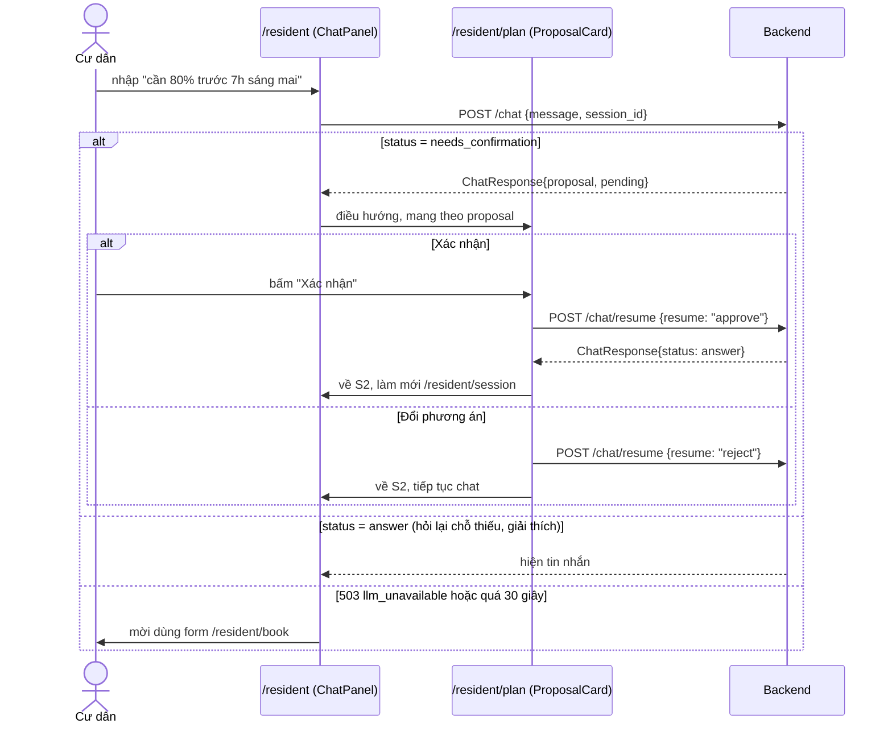

# Plan 20 — Frontend (Next.js App Router + TypeScript)

> **Cập nhật 21/11/2026 theo [ADR-010](../adr/ADR-010-bai-hybrid-ac-dc.md)…[ADR-015](../adr/ADR-015-pham-vi-mvp4-va-quy-tac-bang-chung.md).**
> Bãi không còn là 8 đầu nối × 7 kW / giới hạn 35 kW: số cổng, ID đầu nối, công suất từng cổng và giới hạn **lấy từ
> API** (fixture nền 4 cổng: 2 AC 11 kW + 1 tủ DC 2 cổng 60 kW, ADR-010). ID kiểu A01–A08, A07 và số 35 kW / 7 kW còn
> trong wireframe ASCII là minh hoạ của bản cũ, không hardcode. Phạm vi MVP-4 thêm **màn Copilot WHY / WHAT-IF**
> (vận hành; cư dân chỉ với xe của mình; WHAT-IF luôn hiện "chưa áp dụng") và **thẻ đề nghị AI-1** (Proposal / HITL:
> đồng ý / từ chối, hết hạn thì không áp dụng) — [ADR-014](../adr/ADR-014-decision-trace-counterfactual-hitl.md);
> spec chi tiết chưa viết. Nội dung dưới đây không viết lại.

> Trạng thái: đề xuất Pha A, chờ duyệt (ADR-009, D6). Tham chiếu API ở [10-backend §3](10-backend.md).
> `frontend/` **chưa tồn tại**. Owner: TV4. Task: T1.2, T2.7, T3.3, T3.6, T4.3, T2.9.
> **Đổi 2026-11-19** (00 §12): thiết kế cư dân theo `docs/mockups/cu-dan/`, vận hành theo nhánh `buivanlam`; thêm S9
> Sơ đồ bãi (`/resident/map`, `/operator/map`); bãi hybrid AC + DC theo ADR-010.

## 1. Mục tiêu và phạm vi

Web hai vai trò (F5): cư dân dùng trên điện thoại, vận hành dùng trên máy tính, đủ 8 màn S1–S8 của Wireframe, cộng màn
S9 Sơ đồ bãi (thêm 2026-11-19) cho cả hai vai trò. Trên máy tính, cư dân dùng sidebar trái giống bộ `cu-dan`.
Pha B chỉ dựng **khung**: route, layout theo vai trò, API client có type, client WebSocket, và các trạng thái hệ thống
(đang tải, backend ngủ, 401, 403, 501). Chưa làm giao diện chi tiết hay biểu đồ thật.

Ngoài phạm vi: app di động riêng, SSR có dữ liệu người dùng, đa ngôn ngữ (chỉ tiếng Việt).

## 2. Khởi tạo

```bash
# chạy từ repo root (create-next-app từ chối thư mục đã có file)
npx create-next-app@latest frontend --ts --app --eslint --tailwind --src-dir --import-alias "@/*" --use-npm
```

- Dùng đúng phiên bản Next.js mà lệnh trên sinh ra và ghim trong `package.json`. Chạy `--help` trước để xác nhận tên
  cờ của phiên bản hiện hành; xem lại toàn bộ file được sinh trước khi commit.
- Luôn mở công cụ AI ở **repo root**, không mở trong `frontend/`: hook ghi AI-log dùng đường dẫn tương đối `scripts/…`.
- `node_modules/`, `.next/` đã có trong `.gitignore`. `frontend/` phải được thêm vào `.dockerignore` (50 §5).

## 3. Cây route và thư mục (tới từng file)

```text
frontend/
├── package.json  tsconfig.json  next.config.ts  eslint.config.mjs  vitest.config.ts
├── .env.example                 NEXT_PUBLIC_API_URL, NEXT_PUBLIC_WS_URL
├── openapi.json                 bản chụp hợp đồng — do scripts/export_openapi.py ghi, KHÔNG sửa tay
└── src/
    ├── app/
    │   ├── layout.tsx                          <html lang="vi">, Providers (QueryClient, Auth)
    │   ├── page.tsx                            chuyển hướng: chưa đăng nhập → /login; resident → /resident; operator → /operator
    │   ├── error.tsx  not-found.tsx  loading.tsx  globals.css
    │   ├── login/page.tsx                      S1
    │   ├── resident/
    │   │   ├── layout.tsx                      AuthGate(resident) + header mobile (chuông, menu) + BackendStatusBanner
    │   │   ├── page.tsx                        S2  thẻ xe, chat, chip giờ rẻ
    │   │   ├── plan/page.tsx                   S3  xác nhận lịch (từ chat hoặc từ form)
    │   │   ├── book/page.tsx                   form đặt lịch thủ công (đường dự phòng khi LLM lỗi)
    │   │   ├── notifications/page.tsx          danh sách thông báo (chuông)
    │   │   ├── notifications/[approvalId]/page.tsx   S4
    │   │   ├── map/page.tsx                    S9 cư dân: sơ đồ khu sạc rút gọn, chỉ lộ xe của mình (mới 19/11)
    │   │   └── profile/page.tsx                hồ sơ F8: xe mặc định, phạm vi đồng ý, xoá tài khoản
    │   └── operator/
    │       ├── layout.tsx                      AuthGate(operator) + tab [Dashboard][Sơ đồ bãi][Hàng đợi][Duyệt (n)][Mô phỏng]
    │       ├── page.tsx                        S5
    │       ├── map/page.tsx                    S9 vận hành: mặt bằng vùng → tủ → cổng → ô, làn chờ AC/DC (mới 19/11)
    │       ├── schedule/page.tsx               S6
    │       ├── approvals/page.tsx              S7
    │       └── simulation/page.tsx             S8
    ├── components/
    │   ├── auth/        AuthGate.tsx  LoginForm.tsx
    │   ├── system/      BackendStatusBanner.tsx  NotImplementedPanel.tsx  ErrorPanel.tsx  QueryBoundary.tsx  LiveIndicator.tsx
    │   ├── resident/    VehicleCard.tsx  ChatPanel.tsx  CheapHourChips.tsx  ProposalCard.tsx  BookingForm.tsx
    │   │                ApprovalPrompt.tsx  QueueBadge.tsx
    │   └── operator/    KpiBar.tsx  LoadChart.tsx  ConnectorGrid.tsx  ConnectorDialog.tsx  EventTicker.tsx
    │                    GanttChart.tsx  QueueList.tsx  ApprovalTable.tsx  BlockedTable.tsx  ScenarioForm.tsx  KpiCompareTable.tsx
    │   └── site-map/    SiteMap.tsx (SVG, dùng chung 2 vai trò)  BayDetail.tsx  ZoneQueue.tsx  PowerTiers.tsx
    ├── lib/
    │   ├── api/schema.d.ts      SINH TỰ ĐỘNG bằng openapi-typescript — không sửa tay
    │   ├── api/client.ts        openapi-fetch + middleware: gắn token, chuẩn hoá lỗi, retry khi backend ngủ
    │   ├── api/errors.ts        ApiError { status, code, taskId, detail, requestId }
    │   ├── api/queries.ts       query key + hook cho từng endpoint
    │   ├── auth/session.ts      đọc/ghi token, AuthContext, đăng xuất
    │   ├── ws/client.ts         ReconnectingSocket
    │   ├── ws/types.ts          ánh xạ WsMessage.type → kiểu payload (dùng lại type sinh tự động)
    │   ├── ws/useStationStream.ts  useResidentStream.ts
    │   ├── format.ts            kW, kWh, VND, giờ theo múi giờ của trạm
    │   └── env.ts               đọc và kiểm NEXT_PUBLIC_*
    └── test/                    api-client.test.ts  ws-client.test.ts  not-implemented.test.tsx
```

| Màn | Route | Dữ liệu (REST) | Realtime |
|---|---|---|---|
| S1 | `/login` | `POST /auth/login` | — |
| S2 | `/resident` | `/auth/me`, `/vehicles`, `/tariff`, `/resident/session`, `/resident/queue`, `/resident/notifications`, `POST /chat` | `schedule_changed`, `notification`, `approval_request` |
| S3 | `/resident/plan` | `ChatResponse.proposal` → `POST /chat/resume`; hoặc `/resident/quote` → `POST /resident/bookings`; `/resident/explanation` | — |
| — | `/resident/book` | `/vehicles`, `/energy/estimate`, `/resident/quote` | — |
| S4 | `/resident/notifications/[approvalId]` | `GET` + `POST /resident/approvals/{id}` | `approval_request` |
| — | `/resident/profile` | `GET` / `PUT` / `DELETE /resident/profile` | — |
| S9 | `/resident/map` | `/station/config` (+ G22 layout), 🆕 G24 `GET /resident/site-map`, `/resident/session`, `/resident/queue` | `schedule_changed`, 🆕 `site_occupancy` |
| S5 | `/operator` | `/operator/station`, `/operator/load`, `/operator/events`, `/operator/connectors/{id}` | `station_snapshot`, `event` |
| S9 | `/operator/map` | `/station/config` (+ G22 layout), `/operator/station` (+ G23 tầng công suất), `/operator/bookings?status=queued`, `/operator/events`, `/operator/connectors/{id}` | `station_snapshot`, `event` |
| S6 | `/operator/schedule` | `/operator/schedule?date=`, `/operator/bookings?status=queued`, `replan`, `assign` | `schedule_changed` |
| S7 | `/operator/approvals` | `/operator/approvals`, `/operator/commands/blocked`, `/operator/decision-log` | `approval_request`, `command_blocked` |
| S8 | `/operator/simulation` | `/simulation/scenarios`, `runs`, `incidents`, `benchmark` | — |

## 4. Quyết định kỹ thuật và dependency (D6)

| Thành phần | Chọn | Lý do | Nếu không duyệt |
|---|---|---|---|
| Type từ backend | `openapi-typescript` (dev) | Đổi model Pydantic là type web đổi theo; không gõ tay DTO | Không có phương án thay thế hợp lý |
| Gọi REST | `openapi-fetch` | Lớp mỏng trên `fetch`, kiểm path / body / response theo `schema.d.ts` | `fetch` + hàm bọc tự viết |
| Cache + retry | `@tanstack/react-query` | Retry có backoff khi backend ngủ; WebSocket cập nhật cache bằng `setQueryData` | Hook `useApi` tự viết |
| Biểu đồ tải S5 | `recharts` | Đường tải + vạch giới hạn lấy từ API (fixture nền 4 cổng, ADR-010) | SVG tự vẽ |
| Gantt S6 | CSS grid tự viết | Số hàng = số đầu nối lấy từ API (fixture nền 4 cổng, ADR-010); không đáng thêm thư viện Gantt | — |
| Sơ đồ bãi S9 | SVG tự vẽ trong React | Toạ độ ô lấy từ G22; không cần thư viện bản đồ / canvas | — |
| Font | Be Vietnam Pro tự host (`next/font/local`, file `.woff` lấy từ `docs/mockups/cu-dan/assets/`, giấy phép OFL) | Bộ `cu-dan` và nhánh `buivanlam` cùng dùng | system stack |
| Giao diện | Tailwind (đi kèm `create-next-app`) | Làm nhanh, không thêm bộ component | CSS module |
| Test | `vitest` + `@testing-library/react` (dev) | Test client API, client WebSocket, màn 501 | Chỉ typecheck + build |

Trang có dữ liệu người dùng là **Client Component**: token nằm ở trình duyệt nên server của Next không gọi API thay
người dùng được. Server Component chỉ dùng cho khung trang.

## 5. Ranh giới với backend

- Frontend chỉ nhận **một** thứ từ backend: `frontend/openapi.json`.
  `python scripts/export_openapi.py` ghi file này; `npm run gen:api` sinh `src/lib/api/schema.d.ts`.
- CI chạy lại hai bước trên rồi `git diff --exit-code`: quên sinh lại thì đỏ.
- `tests/test_architecture.py` thêm test: không file nào trong `frontend/src/` import đường dẫn trỏ ra ngoài `frontend/`.
- Kiểu payload WebSocket không tự xuất hiện trên OpenAPI. `ws/types.ts` (viết tay, khoảng 15 dòng) ánh xạ `type` sang
  model đã có trong `schema.d.ts` theo bảng ở 10 §8.

## 6. Phiên đăng nhập và layout theo vai trò

- Token gửi qua header `Authorization: Bearer`, lưu trong `sessionStorage`. Không dùng cookie: frontend
  (`*.vercel.app`) và backend (`*.onrender.com`) khác site, cookie bên thứ ba bị trình duyệt chặn ngày càng nhiều.
- `AuthGate` (client) đọc phiên, gọi `/auth/me`, chuyển hướng nếu chưa đăng nhập hoặc sai vai trò. Đây chỉ là trải
  nghiệm người dùng; phân quyền thật nằm ở backend (401/403).
- S1 không có nút chọn vai trò (Q4): vai trò lấy từ `TokenResponse.role`, rồi điều hướng `/resident` hoặc `/operator`.

## 7. Trạng thái hệ thống

### 7.1 Backend đang "ngủ" (Render free)

- `BackendStatusBanner` gọi `GET /health` (timeout 5 giây) khi mở app. Trạng thái: `checking → waking → online`, quá
  120 giây thì `offline` kèm nút "Thử lại".
- Khi `waking`, hiện "Máy chủ đang khởi động, thường mất khoảng 1 phút" kèm số giây đã chờ; tự thử lại.
- Trang `/login` gọi `/health` ngay khi mở để đánh thức backend trong lúc người dùng gõ mật khẩu.
- Truy vấn GET tự thử lại khi lỗi mạng / 502 / 503 / 504 theo backoff 1, 2, 4, 8, 15 giây, tối đa khoảng 90 giây.
  Không thử lại 4xx và 501. Mutation chỉ thử lại khi có `Idempotency-Key`.
- Khi tab đang hiển thị, gọi `/health` mỗi 5 phút để backend không ngủ giữa buổi demo.

### 7.2 Mã lỗi

| Trạng thái | Xử lý |
|---|---|
| 401 | Xoá phiên, về `/login?next=…`, báo "Phiên đăng nhập đã hết hạn" |
| 403 | `ErrorPanel` "Bạn không có quyền xem trang này" + liên kết về trang của vai trò |
| 409 | Thông điệp theo `code` (`booking_conflict`, `proposal_expired`, `approval_already_decided`…) |
| 422 | Gắn lỗi vào đúng ô nhập |
| 501 | `NotImplementedPanel`: "Chức năng này chưa được cài đặt" + `task_id` + endpoint. Bọc theo **từng khối**, phần còn lại của trang vẫn chạy |
| 503 `llm_unavailable` | "Trợ lý tạm thời không dùng được" + nút "Đặt lịch bằng form" → `/resident/book` |
| Lỗi mạng | Banner 7.1 |

### 7.3 WebSocket

`ReconnectingSocket(url, getToken, onMessage, onStatus)`:

1. Mở kết nối, gửi `{"type": "auth", "token"}`; trạng thái `connecting → open`.
2. Mất kết nối: thử lại theo backoff 1, 2, 4, 8, 16, 30 giây có jitter; thành công thì về 1 giây.
3. Ping 25 giây; 10 giây không có `pong` thì tự đóng và nối lại.
4. Nối lại thành công: `invalidateQueries` cho các truy vấn của trạm, vì server không phát lại bản tin đã lỡ.
5. Mã đóng `4401` → đăng xuất; `4403` → dừng; `1011` (stub hiện tại) → dừng thử lại, hiện "Realtime chưa được cài đặt
   [T3.6]" và chuyển sang hỏi lại REST mỗi 15 giây.

`LiveIndicator` ở header: "Trực tiếp" / "Đang kết nối lại" / "Ngoại tuyến".

## 8. Luồng chat và xác nhận lịch (S2 → S3)



- `session_id` sinh ở client (`crypto.randomUUID()`), giữ trong `sessionStorage`.
- Backend khởi động lại thì mất phiên chat đang chờ xác nhận (checkpoint nằm trong RAM, 30 §3.6). Khi `resume`
  trả 409, S3 chuyển sang form với dữ liệu điền sẵn từ `pending`.
- S4 hiện đồng hồ "Hết hạn sau mm:ss" kèm câu "Nếu bạn không trả lời, điều chỉnh sẽ **không** được áp dụng". Wireframe
  ghi "Tự áp dụng sau", trái với AC4; đang theo PRD (PROJECT_CONTEXT §0.2).
- Chip "Gợi ý giờ rẻ" lấy khung `off_peak` từ `GET /tariff` (Q5).

## 9. Accessibility và mobile

- Cư dân: thiết kế từ 360 px trở lên. Vận hành: tối ưu ≥ 1024 px, vẫn dùng được trên tablet.
- Mục tiêu WCAG 2.1 AA: landmark ngữ nghĩa, `<label>` cho mọi ô nhập, thấy rõ focus, thao tác được hết bằng bàn phím,
  hộp thoại dùng `<dialog>`, vùng chạm ≥ 44 px, tương phản ≥ 4,5:1, tôn trọng `prefers-reduced-motion`.
- Trạng thái đầu nối **không chỉ dựa vào màu**: mỗi ô có chữ ("Đang sạc", "Giảm công suất", "Trống", "Đã đầy",
  "Lỗi"). Wireframe chỉ dùng chấm màu.
- `aria-live="polite"` cho tin nhắn chat, thông báo mới và trạng thái kết nối.
- Biểu đồ tải và Gantt có bảng số liệu tương đương trong `<details>`.
- Số và giờ định dạng `vi-VN`, theo múi giờ lấy từ `GET /station/config`.

## 10. Map FR/AC → route → test

| Yêu cầu | Route / thành phần | Test |
|---|---|---|
| FR1, AC8 | `/login`, `AuthGate` | ＋ `auth-gate.test.tsx` [T2.7] · kiểm tay trên live URL [T4.4] |
| FR15 | `/resident/*` | ＋ `not-implemented.test.tsx` [T1.2] · thử người dùng [T4.3] |
| FR16 | `/operator/*`, `useStationStream` | ＋ `ws-client.test.ts` (backoff, auth, 1011) [T1.2] |
| AC1, FR2 | `ChatPanel`, `ProposalCard` | ＋ `chat-flow.test.tsx` [T3.3] |
| AC2 | `QueueBadge` | ＋ `queue-badge.test.tsx` [T2.7] |
| AC4 | `ApprovalPrompt` | ＋ `approval-prompt.test.tsx` (hết hạn không tự áp dụng) [T3.3] |
| AC6 | `BlockedTable` | ＋ `blocked-table.test.tsx` [T3.6] |
| FR16, ADR-010 | `SiteMap` (S9) | ＋ `site-map.test.tsx`: mỗi ô có `aria-label` đủ trạng thái bằng chữ; chế độ cư dân không render xe / SOC của người khác [T2.9] |
| NFR khả dụng | `/resident/book`, `BackendStatusBanner` | ＋ `api-client.test.ts` (retry 503, không retry 501) [T1.2] |
| Ranh giới | `frontend/openapi.json` | ＋ `tests/test_architecture.py::test_frontend_only_consumes_generated_types` |

## 11. Rủi ro

| Rủi ro | Giảm thiểu |
|---|---|
| Phiên bản Next.js mới đổi API / cờ CLI so với hiểu biết của nhóm | Đọc tài liệu của đúng phiên bản được cài; không chép mẫu cũ |
| Type lệch backend | Bước `gen:api` + `git diff` trong CI |
| Demo gặp backend ngủ | Mục 7.1 và checklist trước demo (50 §9) |
| Token trong `sessionStorage` | Phạm vi demo với dữ liệu giả lập; không nhúng script bên thứ ba; TTL 8 giờ |
| Frontend chờ backend | Mọi màn dựng được với 501 nhờ `NotImplementedPanel`; có thể thêm dữ liệu mẫu cục bộ ở T2.7 |

## 12. Thứ tự làm trong Pha B và Definition of Done

1. Chạy `create-next-app`, xem lại file sinh ra, thêm `frontend/` vào `.dockerignore`.
2. `scripts/export_openapi.py` → `frontend/openapi.json` → `npm run gen:api`.
3. `lib/api/*`, `lib/auth/session.ts`, `lib/ws/*`, các component `system/`.
4. 12 trang stub: mỗi trang gọi đúng endpoint của mình và hiện kết quả thô hoặc `NotImplementedPanel`.
5. Test vitest cho client API, client WebSocket, màn 501.

DoD: `npm run lint`, `npx tsc --noEmit`, `npm test`, `npm run build` đều xanh; mở từng route thấy rõ endpoint nào
đang 501 kèm task ID; `/login` hiện banner khi backend tắt; không file nào trong `frontend/src/` import ra ngoài
`frontend/`.
