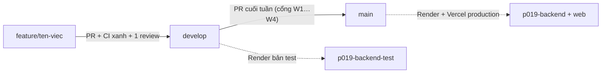
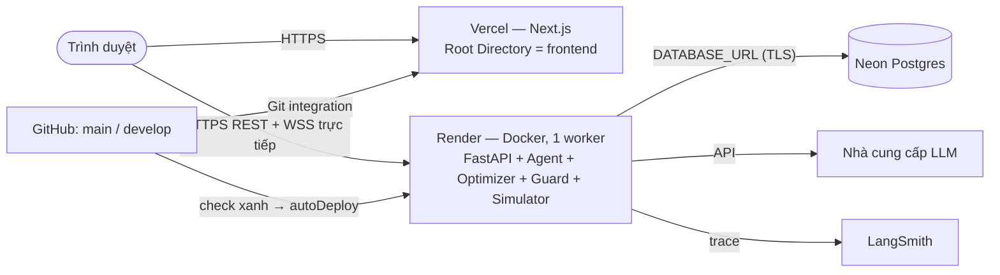

# Plan 50 — DevOps: Git flow, CI, Docker, hosting, vận hành

> **Hiện trạng 23/11/2026 (ADR-019, refactor Unified Core Phase 4) — đọc trước, ưu tiên hơn nội dung bên dưới:**
> backend chạy `HybridStation` trên một kernel `StationKernel` dùng chung với `HybridSimulator`; `LiveStation` và LP
> backend A–D (`mpc`, `lp_model`, `assignment`, `baselines`, `strategies`) **đã xoá**, A–D bỏ khỏi `StrategyName` /
> OpenAPI / S8. Policy hiện hành: B0 / M2b / M3a / M3b (`src/optimizer/registry.py`). Benchmark S8 = baseline có version
> (`eval/evidence/2026-11-23-refactor-phase3-baseline/`); bảng A–D cũ là archive deprecated. Quote / booking = admission
> trên bản fork, kết quả là ước tính có điều kiện, không phải SLA. Chỗ nào bên dưới còn nhắc `LiveStation` / A–D /
> `lp_model` là plan lịch sử.
>
> Trạng thái: đề xuất Pha A, chờ duyệt (D5, P1–P3). Owner: TV4. Task: T1.1, T1.9, T4.4, T4.5.
> Mọi thay đổi trong `.github/` chỉ được **đề xuất dạng diff**: thư mục này thuộc CODEOWNERS của ban tổ chức.
> Các con số về gói free là ước lượng ngày 16/11/2026; kiểm lại trên trang của nhà cung cấp trước demo. Cách deploy
> đang dùng thật: [`56-deploy-render-image.md`](56-deploy-render-image.md).

## 1. Mục tiêu và phạm vi

- Mỗi thay đổi đi qua PR có CI xanh trước khi tới `main`; `main` luôn deploy được.
- Live URL hai vai trò (AC8) trên gói free: Vercel (web) → Render (API) → Neon (Postgres).
- Không có secret nào trong repo, log hay URL.

Ngoài phạm vi: Kubernetes, hạ tầng trả phí, giám sát bên thứ ba, tên miền riêng.

## 2. File liên quan

```text
.github/workflows/ci.yml        sửa — CHỈ đề xuất diff (mục 4). Lưu ý: file này ĐÃ có thay đổi chưa commit từ phiên trước
.github/PULL_REQUEST_TEMPLATE.md   giữ (của ban tổ chức)
.github/CODEOWNERS              giữ, không đụng
Dockerfile                      sửa: cài requirements-runtime.txt, CMD chạy migration trước uvicorn
.dockerignore                   sửa: loại frontend/, tests/, thư mục công cụ AI; giữ eval/results/benchmark.json
docker-compose.yml              sửa: thêm dịch vụ Postgres tuỳ chọn (profile) để thử giống Neon
requirements-runtime.txt        🆕 dependency lúc chạy — file image Docker cài (D5)
requirements.txt                `-r requirements-runtime.txt` + ruff, pytest, pytest-asyncio, httpx, pandas, jupyter
render.yaml, render.test.yaml   sửa: biến môi trường mới; bản test theo nhánh develop
.env.example                    sửa: mục 6
Makefile                        sửa: python3 → python; thêm `make check-all`, `make openapi`, `make migrate`
scripts/export_openapi.py       🆕 ghi / kiểm frontend/openapi.json
frontend/.env.example, frontend/.nvmrc   🆕
```

Không đụng: `.ai-log/`, `scripts/log_*.py`, `scripts/submit_log.py`, `scripts/_pyrun.sh`, `.git/hooks/`,
`.claude/settings.json`, `.cursor/`, `.codex/`, `.gemini/`, `.github/hooks/`, `.agents/`.

## 3. Git flow



- Nhánh: `feature/<ten>` tách từ `develop`. Commit: `type(scope): mô tả` (`feat`, `fix`, `docs`, `test`, `refactor`,
  `chore`, `style`). Không bao giờ dùng `--no-verify`, không tắt hook AI-log.
- `feature/*` → `develop`: squash merge. `develop` → `main`: merge commit, gắn tag `w1` … `w4` tại mỗi cổng kiểm chứng.
- Bảo vệ nhánh (cần quyền admin repo; nếu tổ chức khoá thì xin ban tổ chức):

| Nhánh | Luật đề xuất |
|---|---|
| `main` | Bắt buộc PR; 1 approval; check bắt buộc: `backend`, `backend-postgres`, `frontend`, `docker-smoke`; cấm force-push và xoá |
| `develop` | Bắt buộc PR; cùng các check; cấm force-push |

- `.github/CODEOWNERS` có dòng `* @AI20K-Build-Phase/book-maintainers`. Nếu repo bật "Require review from Code Owners",
  **mọi** PR sẽ phải chờ nhóm đó duyệt. Cần hỏi ban tổ chức luật này có áp cho repo P-019 không.

### 3.1 Đưa skeleton hiện tại vào Git (P1, P2 — làm khi bạn yêu cầu)

Toàn bộ skeleton đang là thay đổi chưa commit trên `main`; chưa có `develop`. Đề xuất, theo thứ tự:

1. Tạo `develop` từ `main` hiện tại (working tree đi theo).
2. Commit theo nhóm để lịch sử đọc được, ví dụ: `feat(models): hợp đồng dữ liệu ChargePilot` ·
   `feat(config): tham số trạm, xe, giá, kịch bản` · `feat(guard): checker và stub 7 luật` ·
   `feat(optimizer): interface chiến lược A–D` · `feat(api): router contract-first trả 501` ·
   `test(architecture): khoá ranh giới import` · `docs(adr): ADR-001…004` · `docs(plan): plan Pha A`.
3. Một commit riêng `style: ruff format` cho 20 file đang lệch format, **không trộn** với thay đổi logic.
4. Pha B làm trên `feature/skeleton-v2`, PR vào `develop`.

`main` không đổi cho tới PR cổng W1, nên Render production không deploy gì trong lúc dựng skeleton.

## 4. CI (`.github/workflows/ci.yml` — đã áp 2026-11-17 sau khi người dùng duyệt)

Trước đây có 2 job: `lint-and-test` (ruff check + pytest) và `docker-smoke`. Hiện có 4 job (mọi bước đã chạy thử
trên máy local và đều qua; workflow chưa từng chạy trên GitHub):

| Job | Bước | Vì sao |
|---|---|---|
| `backend` | `pip install -r requirements.txt` → `ruff check src/ tests/` → `ruff format --check src/ tests/` → `pytest tests/ -q` → `python scripts/check_docs.py` → `python scripts/export_openapi.py --check` → eval offline | Đúng 4 lệnh của quy tắc 10 + chống lệch hợp đồng API |
| `backend-postgres` | service `postgres:16` → `alembic upgrade head` → `alembic check` → `downgrade base` → `upgrade head` → `pytest tests/test_services/test_repository.py -q` | Bắt khác biệt SQLite / Postgres trước khi lên Neon |
| `frontend` | `npm ci` → `npm run gen:api` + `git diff --exit-code` → `npm run lint` → `npx tsc --noEmit` → `npm test` → `npm run build` | Type web luôn khớp backend |
| `docker-smoke` | build image → chạy container (migration chạy trong CMD) → gọi `/health` và `/ready` → in dung lượng image | Đúng image mà Render sẽ deploy |

Chi tiết cần chú ý:

- Bước format chỉ thêm **sau** commit `style: ruff format` (P2), nếu không CI đỏ ngay.
- Eval offline: `OPENAI_API_KEY=""`, `LANGCHAIN_TRACING_V2=false`, kết quả ghi ra `$RUNNER_TEMP`. Bước pytest của job
  `backend` đặt `OPENAI_API_KEY: test-key`; `eval/run_eval.py` coi mọi chuỗi không rỗng là key thật, nên hai bước eval
  tự đặt lại biến này thành rỗng.
- `eval/run_eval.py` mặc định ghi vào `eval/results/report.md` (file được track); CI và chạy thử local dùng `--out`
  (đã thêm ở Pha B) để không làm bẩn working tree.
- Job `lint-and-test` cũ đã đổi tên thành `backend`. Nếu repo có required status check đặt theo tên cũ thì phải sửa
  cấu hình branch protection (hỏi ban tổ chức khi mở PR đầu tiên).
- CI không bao giờ gọi LLM thật và không cần secret nào.
- `check_docs.py` chỉ quét `docs/guide/`. Link trong `docs/plan/`, `docs/adr/` chưa có gì kiểm. Mở rộng script là thay
  đổi công cụ của template; để ngỏ, không nằm trong Pha B.
- Job `docker-smoke` phải nhận thêm `JWT_SECRET` giả **cùng PR** với việc đưa biến này vào validator production (10 §4.3).

## 5. Docker

> **Lệch plan có chủ đích (Pha B):** bản đề xuất ban đầu tách `requirements-dev.txt`. Khi làm, đổi thành
> `requirements-runtime.txt` (image cài) + `requirements.txt` (dev, `-r` file kia) để CI hiện tại
> (`pip install -r requirements.txt`) không vỡ trong lúc `ci.yml` chưa được sửa. Tài liệu này đã cập nhật theo thực tế.

| Thay đổi | Lý do |
|---|---|
| Image chỉ cài `requirements-runtime.txt`; công cụ dev ở `requirements.txt` (file này `-r` file kia) | Image hiện chứa ruff, pytest; gói free ít RAM và build chậm |
| `CMD`: `alembic upgrade head && exec uvicorn src.main:app --host 0.0.0.0 --port ${PORT:-8000} --workers 1` | Render free không có shell hay lệnh pre-deploy (40 §7) |
| **Một worker duy nhất** | Runtime, event bus, sổ kết nối WebSocket và checkpoint chat nằm trong RAM của process |
| `.dockerignore` thêm `frontend/`, `tests/`, `.github/`, `.ai-log/`, thư mục công cụ AI, `node_modules/` | Image nhỏ, không mang log và cấu hình công cụ lên server |
| `.dockerignore` dùng `**/__pycache__`, `**/*.pyc` | Mẫu không có `**/` chỉ khớp ở thư mục gốc — bytecode của máy dev sẽ lọt vào image |
| `.dockerignore` **giữ lại** `eval/results/benchmark.json` | Hiện `eval/` bị loại hẳn, nên `simulation_service.latest_benchmark()` sẽ không có file để đọc trên Render |
| Giữ `config/`, `prompts/`, `migrations/`, `alembic.ini`, `src/forecast/artifacts/` trong image | Cần lúc chạy |

`docker-compose.yml` thêm dịch vụ `db` (Postgres) dưới một profile tuỳ chọn, để thử gần giống Neon trên máy local.

## 6. Hosting và biến môi trường



| Môi trường | Nhánh | Backend | Web | DB |
|---|---|---|---|---|
| Local | bất kỳ | `uvicorn --reload` | `npm run dev` | SQLite `data/app.db` |
| Test | `develop` | Render `p019-backend-test` (`render.test.yaml`) | Vercel preview | Neon, nhánh / database riêng |
| Production | `main` | Render `p019-backend` (`render.yaml`) | Vercel production | Neon chính |

Biến môi trường backend (🔒 = secret, chỉ đặt trên dashboard hoặc trong `.env` local):

| Biến | Ghi chú |
|---|---|
| `APP_ENV`, `LOG_LEVEL`, `PORT` | `PORT` do Render cấp |
| 🔒 `OPENAI_API_KEY` | bắt buộc khi `APP_ENV=production` (validator hiện có) |
| `MODEL_CLASSIFY`, `MODEL_GENERATE`, `MODEL_JUDGE` | chọn ở T2.5 (Q10) |
| `CORS_ORIGINS` | domain Vercel, phân cách bằng dấu phẩy |
| 🔒 `DATABASE_URL` | chuỗi kết nối Neon; local mặc định SQLite |
| 🔒 `JWT_SECRET`, `JWT_TTL_MINUTES` | ≥ 32 byte ngẫu nhiên; khác nhau giữa test và production |
| 🔒 `SEED_USERS_JSON` | tài khoản demo (40 §7) |
| `SIMULATOR_BACKEND`, `FORECAST_MODEL_PATH` | đã có |
| `CONTROL_LOOP_ENABLED`, `SIM_TIME_SCALE` | deploy `true`, `1`; local mặc định `false` (10 §5.3, plan 56 §4) |
| `LANGCHAIN_TRACING_V2`, `LANGCHAIN_PROJECT`, 🔒 `LANGCHAIN_API_KEY` | mỗi môi trường một project |

Biến frontend (Vercel, công khai): `NEXT_PUBLIC_API_URL`, `NEXT_PUBLIC_WS_URL`. Không đặt secret vào biến `NEXT_PUBLIC_*`.

Sửa `.env.example` (chỉ là file mẫu, không chứa giá trị thật):

- `OPENAI_API_KEY=sk-your-key-here` → để trống kèm chú thích. Placeholder hiện tại bị code coi là key thật.
- `DATABASE_URL` mặc định về SQLite (40 §4).
- `OPENAI_TEMPERATURE`, `OPENAI_MAX_TOKENS`, `LLM_PROVIDER` không được `src/config.py` đọc (field là `llm_temperature`
  → biến `LLM_TEMPERATURE`). Bỏ hoặc đổi tên cho khớp.
- Thêm các biến mới ở bảng trên; bỏ `CHROMA_PERSIST_DIR` khi gỡ phần RAG (Q11).

`render.yaml` / `render.test.yaml`: thêm `DATABASE_URL`, `JWT_SECRET`, `SEED_USERS_JSON` (`sync: false`),
`CONTROL_LOOP_ENABLED`; `render.test.yaml` đổi `branch: develop`.

CORS cho Vercel preview: URL preview đổi theo từng PR. Đề xuất thêm setting tuỳ chọn `CORS_ORIGIN_REGEX` chỉ đặt ở
backend test; production giữ danh sách domain chính xác.

## 7. Health check, logging, tracing

| Thứ | Thiết kế |
|---|---|
| `GET /health` | Liveness, không đụng DB. Dùng cho `healthCheckPath` của Render và ping giữ thức từ frontend |
| `GET /ready` 🆕 | Readiness: `repository.ping()`, config nạp được, trạng thái runtime, phiên bản / commit. Dùng trong smoke test và checklist demo |
| Log ứng dụng | `logging` của stdlib, một dòng JSON mỗi bản ghi ra stdout: thời gian, mức, logger, `request_id`, `user_id` giả danh, path, status, thời lượng. Không thêm thư viện. Thay các lệnh `print` trong lifespan |
| Nhật ký quyết định | Bảng `decision_log` (FR14) — bằng chứng kiểm toán, không phải log kỹ thuật |
| Trace Agent | LangSmith (NFR quan sát được); tắt trong test, CI, eval offline |
| Số đo | `SchedulePlan.solve_time_s` và thời lượng `on_event` ghi log (MT5); độ trễ WebSocket ghi ở `realtime.broadcast` (NFR ≤ 1 s) |

Không ghi token, mật khẩu, email hay nội dung `.env` vào log.

## 8. Giới hạn gói free và cách giảm rủi ro

| Dịch vụ | Giới hạn (theo tech-stack) | Ảnh hưởng | Giảm thiểu |
|---|---|---|---|
| Render free | Ngủ sau 15 phút không có request, thức lại khoảng 1 phút | Người dùng đầu tiên chờ lâu; vòng nền dừng | Frontend có banner + retry (20 §7); đánh thức trước demo; sự kiện xử lý ngay trong request |
| | Đĩa không bền, RAM nhỏ | Mất SQLite; có thể thiếu RAM khi nạp solver + LightGBM + simulator | Dữ liệu ở Neon; đo RAM ngay khi bật từng gói; benchmark chạy ở local / CI |
| | 750 giờ mỗi tháng cho cả workspace | Hai service thức liên tục sẽ vượt | Bản test chỉ thức khi có người dùng; không ping giữ thức bản test |
| | Không có shell, không có pre-deploy | Không chạy tay được migration / seed | Migration trong `CMD`; seed trong lifespan |
| Neon free | Tự tạm dừng sau khoảng 5 phút; giới hạn dung lượng | Truy vấn đầu chậm | `pool_pre_ping`; cắt dữ liệu cũ (40 §3) |
| Vercel Hobby | Chỉ dùng phi thương mại; không giữ WebSocket | — | WebSocket nối thẳng Render |
| LangSmith free | 5.000 trace mỗi tháng | Hết hạn mức giữa chừng | Tắt trace ở test / CI / eval offline |
| LLM API | Trả tiền theo token | Vượt ngân sách 20 USD | Đặt hạn mức chi tiêu ở nhà cung cấp; eval thật chạy có chủ đích |
| GitHub Actions | Miễn phí với repo public | — | — |

## 9. Checklist trước demo (T4.4)

- [ ] `main` xanh cả 4 job; tag `w4`.
- [ ] `/ready` của production trả 200, đúng commit.
- [ ] Đăng nhập được bằng tài khoản `resident` và `operator` trên live URL (AC8).
- [ ] `CORS_ORIGINS` đúng domain Vercel; WebSocket kết nối được (LiveIndicator "Trực tiếp").
- [ ] Đi hết luồng AC1 (chat) và luồng form khi tắt LLM.
- [ ] Chạy kịch bản `power_drop` trên S8: tải không vượt giới hạn mới, S7 có nhật ký.
- [ ] `eval/results/benchmark.md` và báo cáo MAE đã commit; `config/vehicles.yaml`, `config/tariff.yaml` đã `verified: true`.
- [ ] Hạn mức chi tiêu LLM đã đặt; số dư đủ.
- [ ] Đánh thức backend 5 phút trước giờ demo; mở sẵn hai tab hai vai trò.
- [ ] Có video quay sẵn luồng chính làm phương án dự phòng.
- [ ] Không có secret trong repo: soát `git log -p` với các từ khoá key / token.

## 10. Map yêu cầu → hạng mục → bằng chứng

| Yêu cầu | Hạng mục | Bằng chứng |
|---|---|---|
| AC8 | Render + Vercel + Neon, tài khoản seed | Live URL; checklist mục 9 |
| NFR triển khai | `Dockerfile`, `render.yaml` | Job `docker-smoke` |
| NFR bảo mật | Secret ngoài repo; `.env` trong `.gitignore` | `.env.example` không có giá trị thật; soát lịch sử commit |
| NFR quan sát được | Log JSON, `decision_log`, LangSmith | `/operator/decision-log`; trace mẫu |
| NFR khả dụng | Migration + seed tự động; khôi phục lịch gần nhất | `test_latest_plan_survives_restart` (40 §9) |
| Deliverable AI-log | Hook giữ nguyên | `.ai-log/` có bản ghi; không dùng `--no-verify` |

## 11. Rủi ro

| Rủi ro | Giảm thiểu |
|---|---|
| CODEOWNERS chặn mọi PR | Hỏi ban tổ chức ngay W1 (mục 3) |
| Sửa `ci.yml` cần ban tổ chức duyệt, làm chậm T1.9 | Gửi diff sớm; trong lúc chờ chạy `make check-all` ở local |
| Đưa `JWT_SECRET` vào validator trước khi cấu hình Render | Ba thay đổi (validator, `render.yaml`, `docker-smoke`) đi cùng một PR |
| Migration lỗi làm production đứng | `docker-smoke` chạy migration; Render giữ bản cũ khi health check fail |
| Lộ key | SECURITY.md: xoay key ngay, xoá commit là chưa đủ |

## 12. Thứ tự làm trong Pha B và Definition of Done

1. `requirements-runtime.txt`, `Makefile`, `.env.example`, `.dockerignore`, `Dockerfile`, `docker-compose.yml`.
2. `render.yaml`, `render.test.yaml`.
3. `scripts/export_openapi.py`.
4. Diff cho `.github/workflows/ci.yml` — đã được duyệt và áp ngày 2026-11-17 (file đề xuất đã xoá).

DoD: `docker build` thành công và `/health`, `/ready` trả 200 trong container — **đã kiểm 2026-11-17** (image 476 MB,
migration chạy trong `CMD`, HEALTHCHECK healthy, RAM lúc rảnh ≈ 110 MiB); `.env.example` không còn placeholder giả dạng key; không file nào trong danh sách "không đụng" bị thay đổi.
